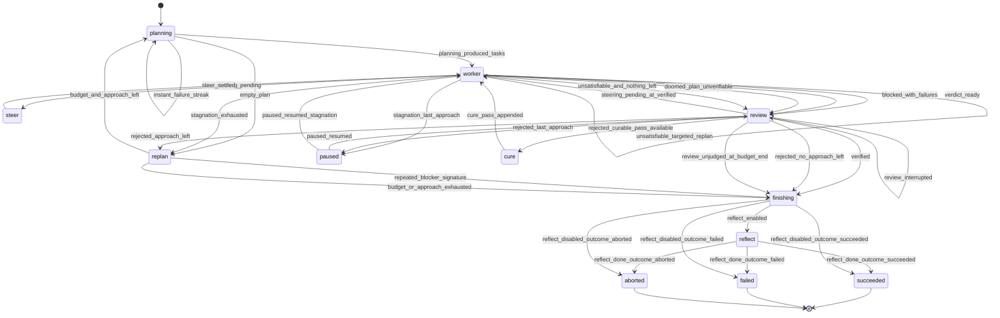

# ralphd Architecture

Status: as shipped in v0.9.0 unless marked otherwise (subsections dated to an
earlier version are historical design notes, kept because the reasoning still
explains the code). This line stayed a wave behind v0.9's own release while
#70's SPEC/architecture gaps were open; it moves to v0.9.0 now that task 011
closes them (the router/`router_model` and the `PUT /config/prompts/{name}`
correction above), and stays a wave behind v0.10 in turn until that wave's own
doc task closes out its remaining gaps.

## 1. Overview

ralphd is a job-scoped autonomous coding loop. A **job** is one PRD (product
requirements document / task description) executed to verified completion. Each job
runs in its own Docker container. The container holds:

- the **engine** (`ralphd-engine`, Python): loop supervisor + HTTP API server, PID 1
- the **agent runtime**: [pi](https://pi.dev) CLI, spawned as a subprocess once per
  iteration
- a **workspace**: the code being worked on, either an existing host checkout
  bind-mounted in or a directory the engine creates on the run dir and the
  planning iteration clones into (§3 "State model"; there is no named-volume
  mode)

The host side is driven entirely by **`ralphctl`** (Python CLI): it prepares config,
starts the container, talks to the API, and maintains the run registry at
`~/.ralphd/`. Nothing in the engine assumes any particular cloud, CI system, or
network beyond reaching the configured LLM endpoint.

## 2. The loop

The loop has three phase types drawing on one shared **iteration budget**
(`iterations` in `job.yaml`, `JobConfig.iterations`, published as
`budgets.iterations`):

```
job start
  └─ approach 1..max_approaches (shared budget):
       ├─ PLANNING   (1 iteration)  read PRD → write tasks.json + notes.md
       ├─ WORKER     (n iterations) execute tasks one at a time until a
       │                            "plan_complete" verdict is honoured
       │    └─ [vigilant mode] VERIFY after each newly completed task;
       │                       failure ⇒ status=validation-failed, back to worker
       └─ REVIEW     (1 iteration)  independently re-check EVERY PRD requirement
            ├─ satisfied  ⇒ {"verdict": "verified"} ⇒ job succeeds
            └─ not        ⇒ {"verdict": "rejected", ...} + review-findings.md ⇒
                            next approach with a composite PRD (original +
                            findings + attempt history)
budget exhausted or max_approaches reached ⇒ job fails (state preserved)
```

Design invariants:

- **The worker's word is never trusted.** `COMPLETE` only gates entry to review.
  Only the reviewer's own `"verified"` contract verdict ends the job
  successfully (task 119, SPEC §4.3) -- not the retired `<promise>VERIFIED</promise>`
  sentinel. Entry to review is the
  *engine's* decision, not the worker's: it also happens on the off-budget grace
  review and when a plan has nothing actionable left but a `failed` task in it
  (below).
- **Fresh context per iteration.** Each iteration is a new `pi` process; continuity
  flows exclusively through state files (below). This bounds context growth and makes
  every iteration resumable and interruptible.
- **`tasks.json` is the source of truth.** The engine's own writes to it
  (fingerprints, validation notes, approach archiving) are atomic (write-temp +
  rename), so killing an iteration mid-flight loses at most that iteration's
  uncommitted reasoning, never task state. The *agent* writes it too, and its
  writes are not atomic — which is why every reader goes through one hardened
  read path (§3, "Reading `tasks.json`: unknown is not zero") instead of
  assuming it can never catch a half-written file.
- **The whole-plan claim is a contract verdict, not a bare sentinel** (v0.14
  requirement O, #100 -- the retired `<promise>COMPLETE</promise>` marker's
  successor). `worker`'s reply is parsed the same JSON-contract way `verify`
  and `review` already report through (task 118, task 119, SPEC §4.3), and the
  literal marker text is still matched by `IterationResult.saw_complete` for
  an operator diagnostic only -- it drives no decision any more. The promise
  claim itself must count **only as the final non-blank line** of that
  output, so an agent quoting the protocol — or explaining why it is
  *withholding* the signal — cannot accidentally emit it; mentioning one
  anywhere else is logged as "mentioned but did not end with it".
  And a `"plan_complete"` verdict, valid only when no task was assigned this
  iteration, is honoured only after the engine has cross-checked the plan it
  just re-read: any task not `completed`/`skipped` refuses it and the worker loop
  keeps going (SPEC §4.3). Narration never decides; the record does.
- **One task per worker iteration.** Checkpointing, steering application, and
  vigilant verification all key off iteration boundaries; a worker that batches
  several tasks into one iteration silently bypasses all three. The worker
  prompt makes this the headline rule (with the *why*, since capable models
  treat unexplained rules as optional efficiency advice), and the engine
  detects violations by diffing task statuses around each worker iteration,
  emitting a warning `log` event when more than one task completed. The engine
  cannot roll extra completions back — detection is for operator visibility
  and prompt regression testing.
- **Iteration failures are contained.** Any engine-side error while running an
  iteration (stream overflow, OS error, agent crash) fails that iteration —
  recorded in its `meta.json` and events — and the loop continues; only budget
  exhaustion, an explicit abort, or an unrecoverable engine bug ends the job.
  The runner must never leave an orphaned agent process behind (kill the
  process group on any exit path).
- **In-step liveness is the log stream; task status changes only at a step
  transition (task 022, requirement F).** A task's `status` field never
  changes while a hat's subprocess is executing — `_emit_task_changes()`
  runs only at the harness's own at-transition writes (a worker/verify
  iteration ending, a vigilant claim relabelled, a verify verdict applied),
  never on a timer. Before task 022, a 0.25s background poller
  (`LoopSupervisor._poll_task_changes`) re-read `tasks.json` while the
  agent subprocess for a worker iteration was still running, so a status
  written mid-iteration (the worker prompt's old "flip to `in-progress`
  first" instruction) surfaced as a `task` event immediately. That poller
  is retired: `GET /tasks` already re-reads `tasks.json` from disk on
  every call regardless of any poll, so an operator's `GET /tasks` /
  `ralphctl tasks` view was never actually dependent on it; the one real
  loss is a `task` *event* for a transient in-iteration state, which is
  now never observed at all (`_emit_task_changes()`'s diff jumps straight
  from the status before the iteration to the status after it). What an
  operator watching a long-running iteration needs instead — proof the
  run is still alive and doing something, not stalled — is what
  `GET /logs?follow` (tailing `output.jsonl` as the agent subprocess
  writes it) already provided independently of the poller, and continues
  to provide with no change. See `artifacts/reports/poll-retirement.md`
  for the itemised before/after and the test proving the hub's run-detail
  view keeps updating (never blank) for the length of a long worker
  iteration purely from the log stream.

  **Task 116 update:** the picture above still holds for the harness's
  OWN pre-spawn claim — the pending -> in-progress move `_step_worker`
  now writes and emits itself, strictly before the worker subprocess is
  spawned (the scheduler, task 115, picks the task; the agent no longer
  edits `tasks.json` at all, fact 9). That write is a genuine at-transition
  event, not the transient mid-iteration state task 022 retired the poller
  over, so it DOES surface as its own `task` event now — an operator
  watching `GET /tasks`/`ralphctl tasks` sees the claim the instant it
  happens, through the event stream as well as the on-disk re-read. The
  in-iteration gap task 022 describes still exists for everything AFTER
  that claim: no further status event for the same task appears until the
  subprocess has exited and the harness applies its reported verdict.

### The declared transition table (task 008/014/016, requirement B)

States, legal transitions and guard-predicate names live as one data
structure in `src/ralphd/engine/transitions.py` (`TABLE` plus the
`VIGILANT_DELTA` that is the *only* difference between vigilant and
non-vigilant); `engine.loop.LoopSupervisor._advance()` walks it through
`transitions.TransitionExecutor.advance()`, which raises
`IllegalTransition` for any edge the table for the variant in force does
not list — refusal happens at the one runtime primitive every state move
passes through, not by a test reading the table back. The table below is
generated from that module, not hand-copied; see
`scripts/render_transition_table.py`'s docstring and
`tests/test_transition_table_docs.py` for how drift is caught.

<!-- BEGIN GENERATED TRANSITION TABLE (scripts/render_transition_table.py) -->

Generated from `src/ralphd/engine/transitions.py` by `scripts/render_transition_table.py` — do not hand-edit this block; regenerate it with `python scripts/render_transition_table.py --write` and let `tests/test_transition_table_docs.py` catch drift. Entry state: `planning`. Run-terminal states (`status.json`'s top-level `state`, not a step state): `succeeded`, `failed`, `aborted`.

| State | Hat | Variant | Target | Guard |
|---|---|---|---|---|
| `planning` | planning | both | `planning` | `instant_failure_streak` |
| `planning` | planning | both | `replan` | `empty_plan` |
| `planning` | planning | both | `worker` | `planning_produced_tasks` |
| `planning` | planning | peer plan review only | `plan_review` | `planning_produced_tasks_peer_review_enabled` |
| `worker` | worker | both | `steer` | `steering_pending` |
| `worker` | worker | both | `worker` | `no_verdict_yet` |
| `worker` | worker | both | `review` | `verdict_ready` |
| `worker` | worker | both | `review` | `blocked_with_failures` |
| `worker` | worker | both | `replan` | `stagnation_exhausted` |
| `worker` | worker | both | `review` | `doomed_plan_unverifiable` |
| `worker` | worker | both | `worker` | `unsatisfiable_targeted_replan` |
| `worker` | worker | both | `review` | `unsatisfiable_and_nothing_left` |
| `worker` | worker | both | `paused` | `stagnation_last_approach` |
| `worker` | worker | vigilant only | `verify` | `completed_task_pending_verification` |
| `verify` | verify | vigilant only | `worker` | `verify_failed_retry_same_task` |
| `verify` | verify | vigilant only | `worker` | `verify_passed_next_task` |
| `review` | review | both | `worker` | `steering_pending_at_verified` |
| `review` | review | both | `finishing` | `verified` |
| `review` | review | both | `replan` | `rejected_approach_left` |
| `review` | review | both | `review` | `rejected_incurable` |
| `review` | review | both | `cure` | `rejected_curable_pass_available` |
| `review` | review | both | `paused` | `rejected_last_approach` |
| `review` | review | both | `finishing` | `rejected_no_approach_left` |
| `review` | review | both | `review` | `review_interrupted` |
| `review` | review | both | `finishing` | `review_unjudged_at_budget_end` |
| `review` | review | peer verdict gate only | `verdict_gate` | `verified_peer_verdict_gate_enabled` |
| `replan` | — | both | `finishing` | `repeated_blocker_signature` |
| `replan` | — | both | `planning` | `budget_and_approach_left` |
| `replan` | — | both | `finishing` | `budget_or_approach_exhausted` |
| `reflect` | reflect | both | `succeeded` | `reflect_done_outcome_succeeded` |
| `reflect` | reflect | both | `failed` | `reflect_done_outcome_failed` |
| `reflect` | reflect | both | `aborted` | `reflect_done_outcome_aborted` |
| `steer` | steer | both | `worker` | `steer_settled` |
| `plan_review` | plan_review | peer plan review only | `worker` | `plan_review_approved` |
| `plan_review` | plan_review | peer plan review only | `planning` | `plan_review_objected_revision_available` |
| `plan_review` | plan_review | peer plan review only | `worker` | `plan_review_revision_bound_reached` |
| `verdict_gate` | verdict_gate | peer verdict gate only | `finishing` | `verdict_gate_approved` |
| `verdict_gate` | verdict_gate | peer verdict gate only | `replan` | `verdict_gate_rejected_approach_left` |
| `verdict_gate` | verdict_gate | peer verdict gate only | `finishing` | `verdict_gate_rejected_no_approach_left` |
| `cure` | — | both | `worker` | `cure_pass_appended` |
| `paused` | — | both | `review` | `paused_resumed` |
| `paused` | — | both | `worker` | `paused_resumed_stagnation` |
| `finishing` | — | both | `reflect` | `reflect_enabled` |
| `finishing` | — | both | `succeeded` | `reflect_disabled_outcome_succeeded` |
| `finishing` | — | both | `failed` | `reflect_disabled_outcome_failed` |
| `finishing` | — | both | `aborted` | `reflect_disabled_outcome_aborted` |
| `succeeded` | — | — | `— (terminal)` | `—` |
| `failed` | — | — | `— (terminal)` | `—` |
| `aborted` | — | — | `— (terminal)` | `—` |

<!-- END GENERATED TRANSITION TABLE -->

The same table rendered as an FSM diagram, generated by
`scripts/render_transition_diagram.py` from
`transitions.table_for(vigilant=False)` — the non-vigilant variant, which
already contains `review -> cure` and `review -> paused` unconditionally
(the vigilant-only, peer-plan-review-only and peer-verdict-gate-only edges
above are not drawn here); see `tests/test_transition_diagram_docs.py` for
how drift is caught.

<!-- BEGIN GENERATED TRANSITION DIAGRAM (scripts/render_transition_diagram.py) -->

Generated from `src/ralphd/engine/transitions.py` (the non-vigilant table, `transitions.table_for(vigilant=False)`) by `scripts/render_transition_diagram.py` — do not hand-edit this block; regenerate it with `python scripts/render_transition_diagram.py --write` and let `tests/test_transition_diagram_docs.py` catch drift.



<!-- END GENERATED TRANSITION DIAGRAM -->

### The router: one constrained question, deterministic-first (task 018, requirement E)

Not every state above resolves to a single edge from disk alone. Where
`transitions.successors(state, vigilant)` returns more than one legal edge
(and only then — most states have ≤1 and never reach this path),
`_step_generic_hat` asks `engine.router.decide()` one JSON question,
validated against `router.ROUTER_SCHEMA` and the table's own legal targets,
re-prompted up to `contract_retry_max` times and bounded by
`JobConfig.router_timeout_s` (env `RALPHD_ROUTER_TIMEOUT_S`, default `60.0`,
published as `GET /config`'s `budgets.routerTimeoutS`); a timeout or an
answer that never validates falls back to the state's own declared choice
(`transitions.fallback_guard`/`ROUTER_FALLBACK`) rather than ever taking an
edge the table does not list. The router's own model is a dedicated config
key, `router_model` (env `RALPHD_ROUTER_MODEL`, `job.yaml` key `router_model`,
surfaced as `GET /config`'s `model.routerModel`) — checked after
`model_overrides["router"]` and before falling back to `model` directly;
`router` carries no strategy-tier row (task 006 retired the tiered mechanism
entirely) -- a one-question classification never needs anything beyond its
own key or the plain default. Every call
is its own transcript under `artifacts/router/NNNN.jsonl` (a plain counter,
not an iteration slot: `LoopSupervisor._ask_router()` never increments
`iterations_used` or writes a `meta.json`), and its usage folds into
`usage.byPhase["router"]` so the cost of a call that is never charged as a
work iteration is still visible, not hidden.

A contract re-ask is the same shape, uncounted for the same reason.
Every `contract_enforcement.enforce_contract` retry ladder (task 010) --
the schema/task-status site in `_step_generic_hat` and the worker's own
verdict sites -- passes `LoopSupervisor._ask_contract_fix()` as its
`respond` once a hat's payload fails `contracts.validate_payload` or its
semantic sibling check. It states the validation errors verbatim and asks
ONLY for the corrected final payload, never the hat's own task prompt
again, and it is built directly on `_ask_router`'s own precedent: no
iteration slot, no `iterations_used` increment, no `meta.json` (`loop.py`
never calls `_run_iteration_once` or touches `self.iterations_used` from
inside it). Each call gets its own transcript under
`artifacts/contract/NNNN.jsonl` (a plain counter, `loop.py:2963-2966`, not
an iteration directory), and its usage folds into
`usage.byPhase["contract"]` (`loop.py:2982`) -- kept separate from
`"router"`'s bucket because the two uncharged channels answer structurally
different questions. The re-ask runs on the offending hat's own model
(`self.cfg.model_for(hat)`, task 004), never a fixed `"contract"` lookup,
so the repair stays inside the tier that made the mistake.

### Phase prompts

Prompt templates ship inside the installed package (`src/ralphd/prompts/`) —
one per phase: `planning.md`, `worker.md`, `review.md`, `task-verify.md`,
`reflect.md`, `steer.md` (task 009, PRD requirement G), `plan_review.md`
(task 018, PRD requirement K — the opt-in peer plan-review gate) and
`verdict_gate.md` (task 020, PRD requirement L — the opt-in, genuinely
BLIND peer verdict gate). Every one
of them is **overridable by mount**: a file of the same
name in `/config/prompts/` (mapped by the CLI) takes precedence, resolved per
iteration through the config overlay order (§5). Runtime replacement over the
API (`PUT /config/prompts/{name}`, taking effect next iteration) covers the
four phases `engine/config.py: PROMPT_NAMES` lists — `reflect`, `steer`,
`plan_review` and `verdict_gate` are deliberately not among them (none of
the four is listed
by `GET /config/prompts` or `ralphctl prompts ls` either), so the
post-terminal reflection prompt, the steer hat's prompt, the peer
plan-review hat's prompt and the peer verdict-gate hat's prompt can only be
replaced by a mount or in the image.
`PUT /config/prompts/{name}` is one of
the routes `control_token` gates unconditionally (task 005, requirement A /
#62, SPEC §13.3), and no spawned iteration's own process can ever present
that header (`PiRunner` strips `RALPHD_CONTROL_TOKEN` from its environment) —
so this surface is, in practice, host-only: an operator calling it from
outside the job container, never a phase configuring itself from inside one.
Prompts are authored fresh for this project.

### Vigilant mode

Optional (`vigilant: true` in job config). After a worker iteration, the engine
checks which tasks are currently `completed` and haven't yet received a passing
verify iteration; each such task gets a verification iteration against its
`successCriteria`. Failures set `status: validation-failed` with
`validationNotes`; the worker treats those like `pending` and reads the notes. Three
failed validations of the same task mark it `failed` (budget protection).

**Crash/resume-safe tracking (task 052).** "Hasn't yet received a passing verify
iteration" is answered from an engine-owned, disk-persisted record --
`<run-dir>/vigilant-verified.json`, a JSON list of task ids that have passed a
verify iteration (`RunDir.read_verified_tasks()` / `mark_task_verified()`) -- not
from an in-process before/after diff of `tasks.json` scoped to a single
`run_iteration("worker")` call. The earlier before/after-diff design had a gap: if
the engine crashed after a worker iteration wrote a task as `completed` but before
(or during) its verify iteration, a resumed process's very first `tasks.json`
snapshot already showed that task as `completed`, so the diff never fired for it
again and its mandatory verification was silently skipped for the rest of the job.
Because the verified-task record survives the crash (it's just a file in the run
dir, read fresh on every check) and is checked against every currently-`completed`
task -- not only ones that changed status inside this process -- a resumed engine
always still catches and runs the pending verify iteration for such a task before
the job can reach a terminal verdict. The record is purely a derived cache, never
edited by the agent (unlike `tasks.json`) and rebuildable in principle by rescanning
iteration `meta.json` files for `verifyOutcome: "pass"`.

**The quiet gate is a warning (task 026, #29's carried-forward suggestion).** The
same record is also the single point of failure: if it claims a completed task is
already verified, `pending_verify` computes empty and the engine keeps running
worker iterations, which from outside is indistinguishable from a run with
nothing left to verify (#29 was silent for 17 iterations of a real run). The
first worker iteration that finds the gate empty while some currently-`completed`
task was never verified by this process therefore emits one `log` event at level
`warning` (`LoopSupervisor._warn_if_verify_gate_empty()`), naming the task ids
and the approach, once per engine process rather than per iteration. A legitimate
resume looks the same, so the message names both explanations rather than
claiming a bug.

A verify iteration that errors out mid-stream (agent/provider failure -- e.g. a
Bedrock 502 -- surfaced as an assistant `message_end` with `stopReason: "error"`)
before ever reporting a `verdict` through the `verify` contract (task 118) is an
infrastructure fault, not a verdict, and must never be scored as a validation
failure: the engine retries verification (bounded, `MAX_VERIFY_ERROR_RETRIES = 3`)
without touching the task's `status` or `validationAttempts`. If every retry also
errors (or the iteration budget runs out first), the engine gives up on verifying
that task for now, logs an error event, and leaves its status exactly as the
worker left it -- it is not marked `validation-failed`, `failed`, or otherwise
penalized. The verify iteration's `meta.json` records `verifyOutcome: "error"`
for these attempts (distinct from `"pass"`/`"fail"`).

Task 012 (#45) generalized that from "errored out" to **reached no verdict**,
because an in-band error is only one of the ways an attempt can end without a
verifier ever finishing: the full `iteration_timeout_s` firing (`timed_out`), the
startup-window watchdog killing a silent agent (`no_traffic_timeout`) and a
signal (`interrupted`) all record no `error_message` at all, so they used to fall
through to the verdict-miss bookkeeping -- burning a validation attempt and
writing a `validationNotes` that blamed the worker for the engine's own timeout.
All four shapes are now the same case, decided in one place
(`LoopSupervisor._verify_no_verdict`): retried within the same bounded budget,
and if no attempt reaches a verdict, `status`, `validationAttempts` and
`validationNotes` come out byte-for-byte as they went in (as they do when the
iteration budget ran out before any verify iteration could run at all). The
record distinguishes the two outcomes in words as well as in `verifyOutcome`: a
negative verdict says a verifier ran to completion and reported nothing the
harness could treat as `verified`, while a no-verdict path says the verifier
never reached a verdict and names what ended it.

### Criteria fingerprinting and edited-after-failure detection (task 008)

Every task gets a `criteriaFingerprint` (sha256 of its `successCriteria`
text) recorded in `tasks.json`, alongside the verbatim baseline text as
`criteriaOfRecord`: set on first sight (right after planning, or on first
observation for a task discovered mid-run). Any subsequent edit is flagged
UNCONDITIONALLY -- including while `validationAttempts` is still 0 --
setting a persistent `criteriaEditedAfterValidationFailure: true` marker
(once set, never cleared) and, when the task carries a recoverable
`criteriaOfRecord`, RESTORING `successCriteria` to that recorded text rather
than letting the rewrite stand; the restore is witnessed with its own
`task.criteria_edit_refused` event carrying both the refused and the
restored text. The marker is also what makes the refusal outlast the pass
that caught it: the engine-authored blocking finding it feeds
(`findings.flagged_criteria_findings`) RECURS on every later `review` pass
until the task is resolved, so one rewrite keeps blocking acceptance instead
of being noticed once and forgotten. (A run resumed from before this
recording existed, where the pre-rewrite text was never captured, falls back
to the pre-existing flag-and-track-forward behaviour, with that recurring
engine-forced blocking finding as the whole of the enforcement.) This catches a worker or planner
that quietly rewrites the bar it just failed instead of doing the work.
There are exactly two legal ways to move a task's criteria forward, each of
which advances the fingerprint and `criteriaOfRecord` atomically with the
replacement text so a legitimate change is never mistaken for one of these
unauthorized rewrites: a judge-authored amendment on a CONFIRMED petition
(`_apply_criteria_amendments`), and an operator-issued steer `task-update`
naming `successCriteria` (`steer_task_update`, #132). Task 009 feeds the
list of flagged tasks to the review prompt so at least one independent
re-verification of the new text happens before a `VERIFIED` verdict,
closing the gap where `_verify_task`'s `validationAttempts >= 3` skip would
otherwise let repeatedly-rewritten criteria dodge every check.

### Feeding flagged tasks into the review prompt (task 009)

`LoopSupervisor._flagged_criteria_review_context()` reads `tasks.json` fresh
before every `review` iteration (both the initial one and any re-review after
deferred steering is consumed) and, when at least one task carries
`criteriaEditedAfterValidationFailure: true`, renders a `## Criteria edited
after a validation failure` section listing each such task's id, title, and
CURRENT `successCriteria` text as `extra` context passed to `build_prompt`.
When no task is flagged, the context is the empty string and the review
prompt is byte-for-byte unaffected. `prompts/review.md` itself always carries
a standing instruction (present regardless of whether the section is
present this iteration) that when that section IS present, the reviewer
MUST independently re-verify each listed task id against its current
criteria text and state an explicit pass/fail conclusion per id before
emitting `VERIFIED` -- a task's own exhausted `validationAttempts` (the
`_verify_task` `>= 3` skip) never substitutes for this manual check.

### The two meanings of `failed`, and why a `failed` task no longer strands a run (task 024, #33)

`failed` on a task used to mean both "a verifier judged this requirement unmet"
and "the engine consumed the last of this task's validation rounds". The engine
now labels its own verdict: when `_verify_task()` sees `validationAttempts` reach
`VALIDATION_ATTEMPT_LIMIT` it writes `failureKind: "validation-exhausted"` beside
the status, and an agent's own `failed` reads as `requirement-unmet`.
`state.task_failure_kind()` is the single reader and *derives* the kind for a
`tasks.json` written before the label existed (at or past the limit ⇒
exhausted), so an old plan still reads correctly.

The vocabulary matters because of what a `failed` task used to do to a run:
`worker.md`'s completion signal recognises only `completed` and `skipped`, so no
whole-plan completion claim was ever legitimate again, the run never reached
review, and the stagnation guard eventually replanned the wave against a
finished repo -- escapable only by an operator hand-editing `tasks.json`. The
worker gets exactly one iteration to apply one of its two honest resolutions
(carve the residual gap into a new task, or relabel `skipped` without claiming
the criteria were met -- both change `tasks.json`, so both reset the stagnation
counter); a worker that changes nothing hands the run to review instead:
`LoopSupervisor._unresolved_failures()` reports the `failed` tasks of a plan with
no actionable task left (`state.TASK_ACTIONABLE_STATUSES`), the loop emits a
warning `log` event naming them and their kinds, and enters `review`. Entry only
-- the reviewer still decides whether the run succeeded. A doomed *dependency*
chain gets the same routing one hop earlier, when it covers the entire
actionable remainder rather than leaving `_unresolved_failures()` anything to
find (v0.14 requirement D, #99, `doomed_plan_unverifiable` in the table below).

Every surface that *counts* task statuses reports both meanings (task 025, #33)
without learning a sixth status: `state.task_counts()` keeps counting both kinds
under `failed` -- so its status keys still sum to `total` -- and adds the
sub-counts `failedValidationExhausted`/`failedRequirementUnmet`, which sum to
`failed`. The words come from the same two places for everyone
(`TASK_STATUS_LABELS` for a tally, `format_task_status()` for one record), and
the per-task map `state.task_failure_kinds()` is served as `taskFailureKinds` by
`GET /tasks`, `ralphctl tasks --json` and the hub's run-detail payload, so the
browser renders a derived kind rather than re-deriving it in JS. `ralphctl runs`
and the hub's TASKS cell flag a `failed` plan as trouble under either meaning.

### No-progress escalation guard vs. instant startup/infra failures (task 059)

The worker loop's stagnation guard (3 consecutive worker iterations with no
`tasks.json` change and no `COMPLETE`/interrupt ⇒ fail the approach) and
planning's "produced no `tasks.json`" check exist to detect a stuck
*approach* — an agent that keeps genuinely attempting the task and failing
or spinning. They must not fire on a completely different failure class:
the agent process itself never starting at all (missing/broken LLM
credentials, a provider outage before the first token, any startup fault),
which the engine can tell apart from a genuine attempt because it leaves no
observable work signal whatsoever — no assistant text, no token usage — and
returns in well under the time any real model call could ever take.

`LoopSupervisor._check_instant_failure()` classifies an iteration result as
an **instant failure** when all of: exit code nonzero, not interrupted, not
timed out, no `final_text`, no `usage`, and wall-clock duration under
`INSTANT_FAILURE_MAX_DURATION_S` (5s). Each instant failure increments an
engine-instance counter (`_instant_failure_streak`, reset to 0 the moment a
non-instant-failure result occurs, in *any* phase); an iteration classified
this way is excluded entirely from the stagnation guard's before/after diff
and from planning's empty-`tasks.json` approach-advance — it neither counts
as progress nor as no-progress, and the current approach is retried in
place rather than abandoned. Once the streak reaches
`MAX_CONSECUTIVE_INSTANT_FAILURES` (3), the engine gives up immediately:
it sets the job's abort reason to a diagnostic naming the likely cause
("... likely missing or broken LLM credentials, or an agent-startup
fault ... failing fast instead of burning through approaches via the
no-progress escalation guard"), which makes `budget_left()` false job-wide
— the job reaches a terminal state in exactly 3 iterations (`state:
aborted`, `verdict: unverified`, `reason: <the diagnostic>`), never having
switched approaches and never having been scored as an ordinary no-progress
failure. A worker that runs to completion every iteration but never
changes `tasks.json` (a genuine stall, not a crash) is unaffected and still
trips the ordinary 3-iterations-no-progress guard exactly as before.

Task 017 (v0.19 requirement D, #151): `_check_instant_failure` IGNORES an
attempt whose error text matched a genuine `INFRA_SIGNATURES` row (DNS,
TCP, TLS, a gateway 5xx, back-pressure, …) entirely — it touches neither
the streak nor its signature, leaving that attempt to the infra outage
budget and backoff ladder alone (§10.5). Before this task, three identical
instant `ECONNREFUSED` attempts tripped this same counter exactly like
three identical broken-credential ones, ending a recoverable outage in
seconds instead of letting the (hours-long, by default) outage budget
govern it. An *unclassified* no-traffic failure — still `classify_fault()`'s
`"infra"` by its own deliberate catch-all, but with no signature match — is
NOT exempted: that shape is exactly the missing/broken-credential incident
this counter exists for, so it still counts and can still fail fast well
inside the outage budget.

### Infra-fault fail-fast + retry with backoff (task 001a)

> Historical design note for the *first cut* of this machinery. The shipped
> v0.5 whole — fault taxonomy incl. `faultClass` and the `aborted` carve-out,
> the outage-budget model, the deadline extension, the `health`/`infraWait`
> contract, manual retry-now, and the instant-failure carve-out — is §10.

Filed after a live incident distinct from task 059's: two consecutive
*worker* iterations each hung the **full** `iteration_timeout_s` (45 minutes
by default) on a transient `getaddrinfo ENOTFOUND` gateway-DNS glitch before
the process finally died with `exit=-2`, burning ~90 minutes of wall clock
and 2 iterations of budget. Task 059's instant-failure carve-out never saw
it: that guard only classifies exits under `INSTANT_FAILURE_MAX_DURATION_S`
(5s), and this failure mode is the opposite shape — the process doesn't
exit quickly, it *hangs*.

**1. Startup-window watchdog (fail fast on zero LLM traffic).** `PiRunner.run()`
accepts a `startup_timeout_s` argument; while the agent subprocess's stdout is
being pumped, a concurrent watchdog task waits for the first line that parses
as a pi NDJSON event at all (`PiRunner._scan_line()`'s return value — any
event, not specifically a `message_end`) inside that window. If none arrives,
the watchdog sets `IterationResult.no_traffic_timeout = True` and SIGINTs the
process immediately, rather than waiting for the full `timeout_s` to elapse.
`LoopSupervisor._run_iteration_once()` passes a real `startup_timeout_s`
(`cfg.infra_startup_timeout_s`, default 150s, overridable via
`RALPHD_INFRA_STARTUP_TIMEOUT` or the `infra_startup_timeout_s` job.yaml key)
for exactly the phases the infra-retry wrapper protects — since task 009 that
is **all five** (`planning`, `worker`, `review`, `verify`, `reflect`): a hung
invocation is only worth killing early if something is going to retry it.

**2. Classification.** `.faults.classify_fault()` is a pure function (no
engine state) that maps a finished iteration's failure signal to `"infra"`,
`"work"`, or `None` (not a failure at all): `no_traffic_timeout=True` is
always `"infra"`; a captured error string matching a known infra signature
(DNS/`ENOTFOUND`, `ECONNREFUSED`/`ECONNRESET`, TLS/SSL handshake failure, or
a gateway 5xx) is `"infra"` regardless of whether some traffic preceded it;
an iteration that produced real LLM traffic (assistant text or token usage)
and then exited nonzero/timed out/was interrupted with no recognized infra
text is `"work"`; any other no-traffic failure defaults to `"infra"` too
(deliberately — an unclassifiable no-traffic failure is far more likely to
be an environment/startup fault than genuine agent work).

**3. Retry with backoff, not escalation.** `LoopSupervisor._run_iteration_with_infra_retry()`
wraps `_run_iteration_once()` for every phase in
`LoopSupervisor.INFRA_RETRY_PHASES` — since task 009 all five (`planning`,
`worker`, `review`, `verify`, `reflect`), because an endpoint outage does not
care which prompt is running: before that, an infra-shaped `review` failure
rejected and archived the approach, an infra-shaped `verify` failure ate the
task's bounded error-retry budget, and `reflect` just lost its report. The
wrapper takes **precedence** over those phase-local budgets: an
infra-classified failure is retried and refunded here and consumes neither
`MAX_VERIFY_ERROR_RETRIES`, the review steering loop's iterations, nor a
task's `validationAttempts`; the phase's own logic only sees a result once it
is no longer an infra fault, or once the wrapper gave up (which sets
`_abort_reason`, so `budget_left()` is already False and those loops exit
rather than re-charging the same outage). Since task 010 (#5) an
infra-classified result that is *also* an instant failure
(sub-`INSTANT_FAILURE_MAX_DURATION_S`, no `no_traffic_timeout`, no observable
work) is retried here too, with task 059's streak-based carve-out keeping the
last word on a *run* of identically-failing attempts (§10.5); only an instant
failure that did reach the model (tokens billed) is returned immediately to
the phase's own bounded error retry, so the two mechanisms never race or
double-count the same failure. Any other infra-classified result
retries the *same* phase/iteration in place with escalating backoff
(`cfg.infra_retry_backoff_s`, default `[2, 5, 15, 30, 60, 120, 300]` seconds
with the last value repeating, clamped to `cfg.infra_retry_backoff_max_s`
(default 300s); overridable via `RALPHD_INFRA_RETRY_BACKOFF_S="s1,s2,..."` /
`RALPHD_INFRA_RETRY_BACKOFF_MAX_S`).

The stopping rule is wall-clock, not an attempt count: attempts are
**unlimited by default** and stop only when the *episode clock* has spent
`cfg.infra_outage_budget_s` (default 4h, `RALPHD_INFRA_OUTAGE_BUDGET_S`) on
waiting. An *episode* is one continuous outage — consecutive
infra-classified attempts with no iteration reaching the model in between;
`LoopSupervisor._reset_infra_episode()` clears the attempt counter and the
accumulated wait as soon as one does (success or genuine work failure), so a
job that hits a short glitch every hour is never slowly starved of retry
budget. Each wait is additionally clamped to what is left of the budget, so an
episode's cumulative wait never exceeds it. `cfg.infra_retry_max`
(`RALPHD_INFRA_RETRY_MAX`) remains an optional attempt cap honoured **only when
set explicitly** (back-compat and a hard-stop escape hatch); while unset,
nothing but the outage budget ends a retry episode. Each infra-classified attempt
increments `LoopSupervisor._infra_refunded`, which `budget_left()` subtracts
from `iterations_used` — an infra retry never counts against the job's
iteration budget (the attempt still gets its own iteration directory/number,
since `iterations_used` itself keeps incrementing monotonically; only the
*budget comparison* is adjusted), and since task 023 (#32) the counter is
persisted in `status.json` (`iterationsRefunded`) and seeded back on resume
instead of restarting at zero. It also never touches
`_instant_failure_streak` or the worker loop's stagnation counter.

**4. Surfacing.** Each attempt emits a `type: infra_retry` event
(`phase`, `attempt`, `maxAttempts` — `null` when uncapped, `error`,
`noTrafficTimeout`, `backoffS` — the wait about to start, `null` when giving
up, `waitedS` — the episode's cumulative wait so far, `budgetS`) to
`events.jsonl`. While waiting out the backoff between attempts,
`status.json`'s `currentIteration.note` reads `"retrying after infra fault
(attempt N[/max], next in Xs): <error>"` (visible via `ralphctl status`/the
hub). When the outage budget runs out, `LoopSupervisor._abort_reason` is set to
`"infra fault: <phase> iteration failed throughout a <D>s infra outage (<N>
attempts, <W>s of the <B>s outage budget spent waiting): <error>"` (with an
explicit `infra_retry_max` it keeps the older `"...failed after <max>
attempts (<error>)"` wording) — picked up by the same `budget_left() == False` → `state: aborted` path task
059 uses, so the terminal `reason` names the infra fault plainly (e.g. the
literal `getaddrinfo ENOTFOUND` text, when the failure surfaced one) rather
than a generic timeout message. Since task 004 (#11) the same verdict is also
*recorded* per iteration as `faultClass` (§10.1).

**5. Since v0.5.** Each wait is interruptible (`POST /retry`, §10.4), extends
the job deadline by the seconds waited (§10.2), and publishes
`health: "degraded"` + `infraWait` (§10.3); an operator-initiated abort is
never an infra fault (§10.1's `aborted` carve-out).

A traceability row for this requirement belongs alongside task 013's
requirement→test table (see `artifacts/reports/traceability.md`, built by
that task) once it exists.

### Grace review at budget exhaustion (task 002)

Live incident this closes: a job exhausted its 8-iteration budget with
**all 7 tasks completed** but no review slot ever ran (the last worker
iteration finished the final task and burned the last budgeted iteration
doing it) → terminal `failed/unverified` despite the work being done. The
operator had to `ralphctl resume +3` just to get a review.

**Invariant:** a job whose tasks are all `completed` should get a review
verdict if at all possible, even if the iteration budget has already run
out.

**Design choice:** rather than reserving the final budget slot ahead of
time (which would require the loop to predict exhaustion before it
happens — tricky given the worker loop's own budget check runs *before*
each iteration, not after), the engine grants a single **off-budget**
review iteration at the moment `budget_left()` is discovered to be
`False`, if and only if every task in `tasks.json` is already `completed`.
This is simpler to reason about than slot-reservation bookkeeping earlier
in the loop, and is checked at both places the worker loop can exit with
budget exhausted: the top of the per-approach `for` loop (covers a
resumed run whose tasks were already all completed by a prior process)
and right after the worker `while budget_left()` loop exits (covers the
live incident's exact shape: the final iteration both completes the last
task and exhausts the budget in the same step, whether or not the worker
happened to also emit `COMPLETE` that iteration).

`LoopSupervisor._maybe_grace_review()` implements it: `_grace_review_granted`
(a set of approach numbers) guarantees **at most one grace review per
approach** — never a loop, never a second free review. The review
iteration itself increments `iterations_used` (gets its own iteration
directory/number) exactly like any other iteration, but also increments
`_grace_refunded`, which `budget_left()` subtracts alongside
`_infra_refunded` — the same refund mechanism task 001a uses for
infra-retry attempts, persisted the same way (`iterationsRefunded`, #32) — so
it never counts against `cfg.iterations`. The `_grace_review_granted` set
itself stays per-process: a resumed engine may grant one more, which is why
the *refund* is persisted and the *grant* is not. If the
grace review comes back `VERIFIED` (and no operator steering is left
pending unconsumed), the job goes terminal `succeeded`/`verified` with
`status.json`'s `graceReview: true` and a `reason` stating the grace
review ran and verified — **unless the opt-in peer verdict gate
(`peer_verdict_gate: true`, task 020, PRD requirement L) is on**, in which
case this path gets its own single, equally BLIND off-budget
`verdict_gate` iteration first (`_grace_verdict_gate()`, refunded through
the same `grace` channel, bounded by the same `_grace_review_granted`
guard, and called with no `extra` context so the grace review's own
verdict/`reason` never reach the peer). The gate is a property of the run
reaching terminal success, not of one particular edge into `finishing`:
`_maybe_grace_review()` is the only other site that writes
`succeeded`/`verified`, and a peer rejection (or any unusable reply,
`_verdict_gate_verdict()`'s shared safe default) leaves the ordinary
failed/unverified terminal write below — there is no approach to replan
into, since exhausted budget is why this path ran at all. If it does not verify, the job still ends
failed/aborted exactly as it would without this feature — no second
approach is attempted once budget is exhausted — except the terminal
`reason` now says a grace review ran and did not verify, or that the off-budget blind peer verdict
gate did not verify (via
`_terminal_reason_note`, kept separate from `_abort_reason` so a plain
unsatisfied grace review doesn't relabel the terminal `state` from
`failed` to `aborted`). The negative case (tasks NOT all completed when
budget exhausts) is unaffected: `_maybe_grace_review()` returns
immediately without touching anything, and the job fails exactly as
before this feature.

### Verdict values beyond plain verified/unverified (v0.18 requirements D.3/F.3/F.1)

SPEC §5.2 documents `status.json`'s `verdict` field contract; this section is
the design rationale for the two extra terminal values and the one legal
mid-run non-terminal value that is never written to `status.json` at all.

- **`verified-with-residuals` (task 012, requirement D.3).** A `verified`
  review that CONTRADICTS its own structured findings (`{"verdict":
  "verified"}` alongside a `severity: "blocking"` finding) is already a
  contract violation the ladder above rejects; a `verified` review whose
  findings channel carries `severity: "residual"` findings ONLY is not a
  violation at all -- residual findings are, by the rubric's own vocabulary,
  things that do not block a pass. Writing that run's terminal `verdict` as
  plain `verified` would silently drop them from the one field every
  surface (`ralphctl status`, the hub's run list, `run-record.md`'s own
  header) reads first. `LoopSupervisor._review_success_verdict_label()` is
  the ONE place that decides between the two words, called from every site
  about to write `_finish("succeeded", ...)` off a VERIFIED outcome (the
  ordinary review pass, the peer verdict-gate approval, and the grace
  review) -- it never itself decides curability or blocking-ness, only
  whether a genuinely verified approach still has something worth naming.
- **`unreviewed` (task 016, requirement F.3, #146).** Before this task, a
  deadline that took the last budgeted attempt while `review` was still
  mid-flight -- the ordinary self-loop's own exhaustion, or the off-budget
  grace attempt -- landed on the SAME `unverified` verdict a genuine
  rejection or an operator abort would, so a run a reviewer never actually
  looked at read identically to one a reviewer looked at and rejected.
  `_review_deadline_unreviewed` (an instance flag set the moment the
  deadline is detected mid-review, alongside a `review_deadline_unreviewed`
  event) is read by the tail of `_finish_tail_unverified()`: when it is set
  and this was not an operator abort, the terminal write is `verdict:
  "unreviewed"` with `reason: "deadline during review"` instead of
  `unverified`. Resume routes back into `review` over the same approach
  (`_unreviewed_awaiting_resume`) rather than treating the abandoned
  attempt as a rejection to replan away from.
- **`"adjudicated"` (task 014, requirement F.1, #144) is a MID-RUN reply
  value, never a `status.json` verdict.** The bounded, off-budget petition
  adjudication episode (`_maybe_run_midrun_adjudication_episode`, next
  section) answers the review contract's `verdict` field but scores no
  approach and writes no terminal state; `transitions.MIDRUN_REVIEW_SCHEMA`
  is the separate, wider schema this one call's contract ladder validates
  against (never `HAT_SCHEMAS["review"]`), adding `"adjudicated"` as a
  third legal value and making `verdict` itself optional -- so a reply with
  nothing terminal to claim about the approach is never read as a contract
  violation the way it would be from an ordinary run-ending review.

### Mid-run petition adjudication: settling an impossibility petition without waiting for the run to end (v0.18 requirement F.1, task 014, #144)

An impossibility petition (`docs/petition-format.md`) filed against a task
can sit OPEN for the rest of an approach with no ordinary review in sight --
review only runs once the worker loop as a whole signals completion, and a
petitioned task's own `validationAttempts` keep burning against a verify
ladder that will never resolve favourably while the petition stays
unadjudicated. `LoopSupervisor._maybe_run_midrun_adjudication_episode()`
runs, unconditionally, right before `_step_worker`'s own `pending_verify`
loop hands any task back to `verify` -- a no-op in the overwhelming common
case (no petition open at all), and otherwise exactly ONE bounded, review-
hat-model iteration per set of newly-open obligations
(`self._petition_adjudication_seen`, so the SAME open petition is never
re-asked forever just because it stays open). The episode reuses
`_review_verdict(..., mid_run=True)` for the ENGINE side effect an ordinary
review iteration already applies from the identical `petition_adjudications`
payload field -- CONFIRMED entries persist at run scope
(`petitions.record_confirmed_adjudications`), REFUTED entries move the
matching `petitioned` task straight to `failed` carrying the remedy -- but
never `_advance`s a state, never `_finish`es, and is refunded through the
same off-budget `grace` channel the grace review already uses, so it never
competes with the run's iteration budget or a task's own
`validationAttempts`. See the verdict-values section above for the
`"adjudicated"` reply value this episode alone may use.

### The adjudication MAC and its run-secrets mount (v0.19 requirement E.4, #150/#152, task 020)

`petition_adjudications_recorded` (`petitions.record_confirmed_adjudications`)
keys a MAC over the CONFIRMED-adjudication record with a per-run secret that
lives ONLY in the engine process's own memory for the episode
(`petitions._AUTHORITIES`, never a file under the agent-owned run dir --
see that module's `key_store_dir` docstring for why). That is enough to
catch a worker-phase rewrite within one episode, but a `ralphctl resume`
starts a fresh engine process with no memory of the old key, so without
somewhere to persist it, an EARLIER episode's record could no longer
authenticate after a restart and would read as tampered/empty.

`ralphctl start`/`resume` (`src/ralphd/cli/main.py`, `_bind_run_secrets_mount`)
bind a mode-0700 host directory, `~/.ralphd/configs/<run>/run-secrets/`
(`run_secrets_dir(run_id)`, next to that run's `job.yaml`, never inside the
agent-owned run dir), at the fixed container path
`petitions.DEFAULT_RUN_SECRETS_DIR` (`/var/lib/ralphd/run-secrets`) on every
`start` and every `resume` -- created and mode-fixed unconditionally each
time, so a run dir that predates this task self-heals on its first resume
rather than needing a manual migration. Inside the container,
`petitions.key_store_dir()` only actually uses that mount when
`privsep.separated()` is true (the engine started as root and dropped to the
agent uid -- the real container's shape, not this repo's own test suite,
which runs single-uid): there the mount is root-owned 0700 with a root-owned
0600 key file inside it, neither readable nor replaceable at the agent uid,
so a later episode's read of an earlier episode's key is trustworthy.

**The documented fallback.** With no uid boundary (or an operator override
via `$RALPHD_RUN_SECRETS_DIR` naming nowhere readable), `key_store_dir()`
returns `None` and there is no on-disk key at all -- a later episode cannot
authenticate an earlier episode's CONFIRMED record and treats it as empty,
failing closed rather than trusting an unverifiable claim. The fallback
check for "did this run's adjudications actually happen" in that condition
is the same `events.jsonl` witness every episode already writes:
`ADJUDICATIONS_RECORDED_EVENT` (`petition_adjudications_recorded`) carries
the MAC of the write that produced it, independent of whatever
`petition-adjudications.json` says on disk right now. `ralphctl status`
names the mount per run (`runSecretsMount.bound`, and the same fallback
sentence in the text line when it is `False`); `ralphctl doctor` names the
mount and its fallback unconditionally, registry-wide.

### The run's own terminal record: run-record.md/.json (v0.18 requirement B.1, #140, cured by task 035)

Every closing report a worker or reviewer writes is the AGENT's account of
the run; nothing stops it from omitting an inconvenient rejection or citing
an approach that never happened. Requirement B.1 asks for a second, engine-
authored account that cannot make that mistake because nothing in it is agent
prose: `src/ralphd/engine/run_record.py` builds a record entirely out of
files the engine itself already owns and writes -- `status.json`,
`approach-metadata.json`, `petition-adjudications.json`, the steering ledger,
`CONFIG_DIR/amendments/`, and (only as a fallback for an approach judged
before task 035 existed) the archived `approaches/NN/` findings sidecars --
and renders it two ways: `build_run_record()` for `artifacts/run-record.json`,
`render_run_record_markdown()` for the identical record as `artifacts/
run-record.md`. `write_run_record()` writes both together, called from
`LoopSupervisor._write_run_record()` at every entry to `finishing`
(`_finish()`) and rewritten on the later terminal transition that promotes a
recorded `finishing` write (`_promote_finishing_state()`/
`_promote_recorded_finishing_state()`), so the pair on disk always reflects
the most recent terminal decision even across a container restart mid-
`finishing`.

**Why the per-approach judge verdicts live in their own engine-owned file
rather than being read off the findings sidecars alone (task 035, cure for
task 006).** `review-findings.json`/`verdict-gate-findings.json` are written
by the JUDGE hat's own process, are optional (a judge that verifies clean
writes no sidecar at all), and are cleared/archived by the SAME approach-
archiving step the run record has to describe -- so a record built only from
them cannot tell "this approach verified with nothing to say" apart from
"this approach's judge never ran a sidecar-writing pass at all", and loses
the distinction entirely once an approach is archived without one.
`state.record_approach_verdict()` fixes this by persisting the ENGINE's own
copy of each judge channel's verdict -- explicit `blocking`/`residual`
arrays, `findingsChannel: bool`, `recordedAt` -- into `approach-metadata.json`
at the run root the MOMENT that judge's verdict is decided
(`LoopSupervisor._review_verdict`/`_verdict_gate_verdict`, never a mid-run
adjudication episode, which scores no approach verdict), independent of
approach archiving. `run_record.build_approach_history()` reads that
metadata FIRST for every approach it lists (live or archived) and only falls
back to a findings sidecar for an approach this engine-owned file has no
entry for at all -- a run entirely on this side of task 035.

### Model resolution

Each hat resolves its model independently: per-hat override (`models:`/
`model_overrides:`, keyed by `planning`, `worker`, `verify`, `review`,
`reflect`, `steer`, `plan_review`, `verdict_gate`, `router`) → job default (`model`, `None` =
pi's own default). An unrecognised hat name degrades to `planning`'s own
configured entry (`UNRECOGNISED_HAT_FALLBACK`), never to some cheaper tier —
a typo must never quietly downgrade a phase. `steer` (task 009, PRD
requirement G), `plan_review` (task 018, PRD requirement K, the opt-in
peer plan-review gate — off by default via `peer_plan_review: false`) and
`verdict_gate` (task 020, PRD requirement L, the opt-in, genuinely BLIND
peer verdict gate — off by default via `peer_verdict_gate: false`) are
all real, first-class entries here, resolved through this same table like
every other known hat — never through the unrecognised-name fallback, which
is reserved for a typo, not a real role. `router` additionally has its own
dedicated `router_model` key, checked before `model_overrides["router"]`'s
sibling rung.
Each hat's `(model, thinking)` PAIR — never just the model — is what
`JobConfig.bundle_for(hat)` (task 007) actually returns: `thinking_overrides:`
is the same per-hat table for `pi --thinking`/reasoning settings, kept as a
separate field from `model_overrides` rather than folded into it, because a
model ref and its thinking setting are two independent axes that can be set
independently.

Task 006 retired the earlier `model_strategy`/`fast_model` phase→tier
preset table (`quality-first`/`cost-optimized`/`balanced`) entirely — there
is no implicit "fast" tier any more without an explicit `models`/`model_overrides` entry naming it. A job.yaml still carrying either
retired key is translated deterministically into an equivalent `models:`
table at load time (`engine.config._migrate_legacy_model_config`), so an old
run keeps resolving to the same models it always did; `ralphctl config set
model_strategy`/`fast_model` and `ralphctl start --model-strategy`/
`--fast-model` are refused outright, naming the `models:` replacement.

Every model ref is just a pi "provider/model-id" string in job config — any
model pi can reach is valid in any hat's slot. The engine sets the model
per-iteration via pi's model selection flag/env on the subprocess.

### Tiered provisioning (task 012, #68 half 2)

The per-hat bundle above is one CELL of a wider matrix: task 012 gives every
hat its own ladder of exactly three ordinal tiers, `trivial < normal < hard`
(`engine/tiers.py`) — not a configurable count, and each hat's ladder is its
own (no relationship assumed between one hat's `hard` rung and another's).
`tiers.default_host_map(cfg)` widens `JobConfig.bundle_for`'s existing
per-hat table into the `{hat: {tier: HatBundle}}` matrix by handing every
rung of a hat's ladder that hat's single already-resolved bundle, so a
job.yaml naming only `model`/`model_overrides` collapses cleanly: tiering is
a no-op, never an error, with no special-case branch.

**The resolver is a pure function applied at dispatch, never a transition-
table entry.** `tiers.resolve_bundle(hat, effective_tier, host_map) ->
HatBundle` does no I/O, touches no clock, and never reads `JobConfig` itself
(`default_host_map` is the one place that happens, once, by delegating to
`bundle_for`, so there is exactly one model-resolution pathway, not two).
`transitions.TABLE` stays untouched by any of this — the table is about
*what happens next*; provisioning is *how*, resolved at the single dispatch
call site in `loop.py`'s `run_iteration()` (task 016), which passes in
whichever tier applies for that call: a task-scoped call (worker, per-task
verify) reads the in-hand task's effective tier; every hat with no task in
hand (planning, reflect, the router's own call) keeps its static half-1 role
at `tiers.DEFAULT_TIER`; the run-ending verification that decides the run's
own verdict always provisions at `tiers.TOP_TIER`, unconditionally — the exit
gate is never economised.

**A task's tier moves only up, and only on validation-failed.** Task 013
lets the planner annotate an optional `tier` per task at ingestion time
(defaulted to `normal` when missing/unrecognised, with a warning — never
rejecting the plan); `tasks.json`'s engine-written `effectiveTier` is claimed
equal to that baseline on first claim and escalated exactly one rung
(`tiers.escalate_tier`, capped at `hard`) per `validation-failed` re-claim
(task 014) — there is no de-escalation path, true by construction: no
function that touches `effectiveTier` ever moves it down. A task already at
`hard` that fails validation again is marked `tierLadderExhausted` instead,
feeding the stagnation guard. Per-task verify then provisions one rung BELOW
the work it is checking (`tiers.step_down_tier`, floored at `trivial`, task
015) — checking is cheaper than doing, never cheaper than the ladder's own
floor. Spend and iteration counts are broken down by tier the same way they
already are by phase and approach (`usage.byTier`, task 017), and the
highest `effectiveTier` any task currently carries is published on the hub/
`ralphctl runs` row (task 019) so escalation is visible without opening a
task's own detail.

### Self-reflection phase (PRD req 24)

Optional (`reflect: true` in job config, `ralphctl start --reflect`). After the
job's normal loop (`LoopSupervisor._run_job_core()`) reaches a terminal state
(`succeeded`/`failed`/`aborted`), the engine runs exactly one extra `reflect`
iteration (`LoopSupervisor._run_reflection()`), using its own builtin prompt
(`src/ralphd/prompts/reflect.md`, phase name `reflect`, model resolved per the
job's per-hat model table exactly like any other hat). This iteration is *not* part
of the normal budget accounting gate (`budget_left()`); it always runs once, even
if the iteration budget was already exhausted when the job reached its terminal
state.

The reflect prompt instructs the agent to analyze the run's PRD, final
`tasks.json`, `notes.md`, and iteration records, and write a report plus an
optional unified diff of proposed prompt/skill improvements to
`artifacts/reflection/` — and to touch nothing else (workspace files, `tasks.json`,
`status.json`, `notes.md`, `review-findings.md`, steering files, or any
`iterations/` content). This is instructed, not sandboxed: the reflect iteration
runs with the same tool access as any other phase, so it is trusted the same way
review/verify iterations are trusted to follow their own prompts. The one
engine-side guarantee is that `run_job()`'s returned final state and the job's
terminal `status.json` fields (`state`, `verdict`, `endedAt`) are set *before*
the reflect iteration runs and are never touched by it; the engine does reset
`status.json`'s `phase` field back to `None` immediately after the reflect
iteration finishes (it's transiently set to `"reflect"` while it runs, the same
as every other phase), so a terminal job never appears to still be mid-phase.

Task 121 replaced the phase's bare `<promise>REFLECTED</promise>` sentinel
(never scored by the engine) with a `reflect` response contract
(`{"report_written": ..., "suggestions_written": ..., "notes": ...}`,
`transitions.HAT_SCHEMAS["reflect"]`): `LoopSupervisor._reflect_verdict()`
parses the reply's last non-blank line as JSON and validates it
(`contracts.validate_payload` plus `transitions.reflect_report_errors`, which
requires a non-empty `notes` on a `report_written: false` claim), and
`_reflect_failure()` treats a missing/malformed contract or a
`report_written: false` claim as a reflect failure ON TOP OF, never instead
of, the pre-existing check that `artifacts/reflection/report.md` actually
exists on disk.

With `reflect` absent/`false` (the default), no extra iteration runs at all —
`run_job()` is a no-op wrapper around the same core loop as before this feature.

## 3. State model

All run state lives in `/run/ralphd` inside the container (the engine's
`RALPHD_RUN_DIR`, `engine/config.py: RUN_DIR`), which is **always a host
bind-mount** of `~/.ralphd/runs/<run-id>/`. This is what makes history survive the
container and lets the CLI read state even when the container is dead.

```
~/.ralphd/runs/<run-id>/          # mounted at /run/ralphd in the container
├── status.json         # engine-maintained: phase, iteration, approach, verdict
├── host.json           # host-side facts ralphctl recorded: apiUrl, container,
│                       #   workspace path(s), network, resolved image
├── prd.md              # original PRD
├── composite-prd.md    # approach ≥2 only
├── tasks.json          # task state (source of truth)
├── .tasks-last-good.json # fallback copy, written ONLY when a read of tasks.json fails
├── notes.md            # agent handoff notes, ≤50 lines enforced by prompt
├── standing-rules.md   # harness-pinned copy of notes.md's "## Standing rules" block (task 107)
├── review-findings.md  # written by failed reviews
├── review-findings.json # the same findings, structured (severity/curable/clause/evidence, task 001, #110)
├── verdict-gate-findings.md # the peer verdict gate's own free-markdown findings, when it rejects (task 019, requirement D.4, #125)
├── verdict-gate-findings.json # the same findings, structured, the sidecar `verdict_gate_findings_json_file` points at
├── petition-adjudications.json # run-scope CONFIRMED impossibility-petition adjudications, survives _archive_approach (task 011, #112)
├── approach-metadata.json # engine-owned per-approach judge verdicts (review/verdictGate, explicit blocking+residual arrays), written when the judge runs, survives _archive_approach (task 035, requirement B.1)
├── vigilant-verified.json # task ids that have passed a verify iteration
├── operator-termination.json # what the operator asked for (abort/interrupt)
├── .lock               # the engine's exclusive flock (self-protection, below)
├── steering/           # steering inbox: 001-*.md, 002-*.md …
│   └── .consumed.json  # which of them an iteration has already been given
├── iterations/         # per-iteration record
│   └── 0007/
│       ├── meta.json   # phase, model, start/end, exit code, signal seen, usage
│       ├── prompt.md   # the exact prompt this iteration was given
│       ├── output.jsonl# full agent transcript (pi session log)
│       └── attempts/01/# an earlier, crashed attempt at this same number (#44)
├── approaches/         # archived tasks.json/notes.md per finished approach
├── artifacts/          # anything the agent is told to persist (reports, screenshots)
└── events.jsonl        # append-only event log (also fed to the SSE stream)
```

`tasks.json` schema (v1):

```json
{
  "version": 1,
  "runId": "brisk-otter-1408",
  "goal": "one-line goal distilled from the PRD",
  "scope": {"level": "single-repo", "reasoning": "..."},
  "repositories": ["https://github.com/acme/widget"],
  "tasks": [
    {
      "id": "001",
      "title": "Add JWT middleware",
      "status": "pending|in-progress|completed|validation-failed|failed|skipped",
      "successCriteria": "natural-language, independently checkable",
      "validationNotes": "present when validation-failed",
      "validationAttempts": 0,
      "failureKind": "validation-exhausted|requirement-unmet, engine-written when failed",
      "dependsOn": ["000"],
      "priority": 0
    }
  ],
  "discovered": {}
}
```

`dependsOn` (list of task ids) and `priority` (number, higher = more
important) are OPTIONAL per task, added by the planner only when the plan
genuinely needs cross-task ordering or prioritisation (see
`prompts/planning.md`). The worker's pick rule (`prompts/worker.md`): among
`pending` tasks whose `dependsOn` are all `completed`, pick the highest
`priority` (missing = 0), ties broken by list order; a task blocked by a
`failed`/`skipped` dependency (directly or transitively, through another
merely-blocked task) is never silently ground against, but the worker does
not have to notice or record it either -- the harness derives it itself
(`engine.state.task_blocked_by`, task 021, requirement F) and marks the
dependent `blocked` on every surface (`ralphctl tasks`, the hub, and
`GET /tasks`'/`GET /status`'s own `taskBlockedBy` map / `blocked` count)
the moment the dependency reaches `failed`/`skipped`. With no
`dependsOn`/`priority` fields anywhere in the plan this is identical to
plain sequential list-order picking. This rule lives entirely in the phase
prompts (the engine does not parse or enforce it in code) — it is the agent
reading `tasks.json` and the prompt's instructions, same as task selection
always has been; the `blocked` DERIVATION, unlike the pick rule itself, is
engine code (`engine/state.py`), not prompt text.

### Reading `tasks.json`: unknown is not zero (task 002, #15)

`tasks.json` is written by the **agent** (`pi`, per `prompts/worker.md`), never
by the engine, so no reader may assume an atomic write: a poll landing inside
the agent's rewrite window reads a truncated file. Turning that
`JSONDecodeError` into the reader's default — what every surface used to do —
is how a whole plan briefly vanished from the hub table and the `tasks: n/m`
counters went to zero for one poll cycle. Unknown is not zero; this is the same
principle `format_cost` applies to money.

One hardened read path therefore serves every surface
(`state.read_tasks_doc(run_root) -> TasksRead`), used by `RunDir.read_tasks()` /
`RunDir.read_tasks_result()`, `GET /tasks`, the `/status` task counts, the hub
server and `ralphctl tasks`:

1. **Bounded re-read.** A parse failure is retried a few times ~10 ms apart
   (`TASKS_READ_ATTEMPTS`/`TASKS_READ_DELAY`, ~30 ms total) — long enough to
   outlast the write window, short enough never to stall a request.
2. **Last-good fallback.** If it still will not parse, the last payload that
   *did* parse is served with `stale=True`.
3. **A three-way result**, so the three situations that collapsed into one
   default stay distinguishable:

| `TasksRead.source` | means | `stale` |
|---|---|---|
| `absent` | no `tasks.json` yet — an empty plan is the truth | no |
| `file` | parsed off disk (an empty `tasks` list here is also the truth) | no |
| `last-good` | unparseable; serving the previous payload | **yes** |
| `unreadable` | unparseable and no last-good exists — emptiness is ignorance | **yes** |

`TasksRead.tasks` is always a list, `.counts` is `task_counts()` over it, and
`.present` says whether a `tasks.json` exists at all (so a surface can tell
"0 tasks" apart from "no plan").

**Why this is a fallback and not a mirror.** The last-good payload lives in
process memory; the on-disk copy (`<run-dir>/.tasks-last-good.json`) is written
**only at the moment a read actually fails**, never on the happy path. So the
engine never maintains a second copy of the plan that could drift from
`tasks.json` or be mistaken for it — the cache exists purely so the fallback
survives an engine restart, and everything in it was read verbatim out of
`tasks.json`. Read-only viewers of somebody else's run dir pass `persist=False`
and write nothing at all. The two alternatives were considered and rejected: an
engine-maintained atomic mirror is a second source of truth, and telling an LLM
to write atomically is unenforceable (readers would still have to cope).

The **workspace** (`/workspace`) is separate from `/run/ralphd`: it is the repo checkout the
agent edits. Two modes, chosen per job:

- `--workspace <host-dir>` — bind-mount an existing checkout (preferred; the
  operator's normal working copy or a dedicated clone)
- no workspace flag — the engine creates `/workspace` on the run dir
  (`runs/<id>/workspace/`) and the planning iteration clones the PRD-listed repos
  using whatever git credentials were injected

**Multi-workspace jobs** (PRD req 27): `--workspace` is repeatable. A single
bare `--workspace <dir>` keeps the single-mode behavior above (mounted at
`/workspace`). Two or more `--workspace` flags each require a `:name`
(`--workspace <dir>:<name>`) and are mounted at `/workspace/<name>` side by
side instead — one job container, several checked-out repos. The container
gets `RALPHD_WORKSPACES=<comma-separated names>`, which every phase prompt's
"Job context" section reads to list each mounted name/path explicitly, so
the agent never has to guess what's under `/workspace` from a directory
listing. `host.json` records the mapping as `workspaces` (name→host path)
instead of the single-mode `workspace` key, and `ralphctl resume` remounts
every named workspace the same way on the fresh container.

## 4. Container engine

Single Python process (`ralphd.engine`), PID 1 in the container, two concerns:

1. **Supervisor** — an asyncio task running the loop: builds each iteration's
   prompt, spawns `pi` with the right env (model, workspace cwd), streams its
   output to `iterations/N/output.jsonl`, scans for sentinels, updates
   `status.json`/`events.jsonl`, applies steering, enforces budgets and timeouts.
2. **API server** — FastAPI on `:7777` (uvicorn in the same process), serving the
   endpoints in [api.md](api.md). Reads state files; writes only to the steering
   inbox, config drop-ins, and the control channel to the supervisor (pause /
   interrupt / abort / resume).

Because both share a process, "interrupt" is a plain `SIGINT` to the `pi` child
process group; the supervisor records the iteration as interrupted and proceeds to
the next one (which will see any newly arrived steering).

### Diagnosability requirements

Failures must be visible without digging into transcripts:

- **Agent-level errors surface upward.** When an iteration's agent reports an
  error (pi `message_end` with `stopReason: "error"`), the engine records the
  `errorMessage` in the iteration's `meta.json`, in the `iteration.end` event,
  and as an error-level `log` event. A job that failed because of provider/auth
  errors must say so in `/status`-adjacent surfaces, not just exit silently.
- **`docker logs` is informative on its own**: the engine logs each iteration's
  start (phase, model) and end (exit code, sentinels, error summary) to stdout,
  so a dead-in-2-seconds job is diagnosable from container logs alone.

### Live job log (pretty console)

The per-iteration transcripts are raw pi NDJSON — correct as a record, unreadable
as a console. The engine therefore exposes a **whole-job log view** that spans
iteration boundaries (`GET /logs`, see [api.md](api.md)): a merged stream of every
iteration's transcript in order, with iteration/phase boundary markers, that can
be fetched as a bounded tail or followed live across iterations (no re-attach
dance when a new iteration starts). The engine serves **raw NDJSON**; making it
pretty is the CLI's job:

- `ralphctl logs` renders the stream human-first by default, Jenkins-console
  style: iteration/phase headers, assistant text as it streams, tool calls as
  one-liners (name + compact args + outcome), thinking elided to a marker,
  per-iteration usage/cost footers, agent errors highlighted.
- `--raw` emits the underlying NDJSON untouched (for machines and debugging).
- The syntax follows `tail`: `logs -100` (last 100 rendered lines), `-150f`
  (last 150, then follow), `logsf` (follow from now). See [cli.md](cli.md).

The renderer is pure presentation over the same events — nothing is stored
pretty; the run dir stays raw and replayable.

### Container lifecycle

```
created ─ starting ─ running ─┬─ succeeded ─┐
                              ├─ failed ────┼─ exit (default) — container exits
                              └─ aborted ───┘        └─ or idle (on_complete: idle, debugging opt-in)
```

- `on_complete: exit` (default) — container exits with 0 (succeeded) / 1
  (failed/aborted). Suits scripted/batch use; state remains in the run dir
  either way.
- `on_complete: idle` — engine stays up, API remains queryable, agent is
  never spawned again. An explicit debugging opt-in: the operator collects
  outputs / post-mortems, then `ralphctl stop`.

### Completion hook (PRD req 26)

Optional `on_complete_cmd: <shell command>` job option (`ralphctl start
--on-complete-cmd '<cmd>'`, or a job.yaml field a template can supply). The
engine runs the command exactly once, in-container, via `asyncio.create_
subprocess_shell`, strictly after the job has reached a terminal state
(`succeeded`/`failed`/`aborted`) — including after the reflect iteration
(PRD req 24) when `reflect: true`, since both share the single point in
`ralphd-engine`'s `amain()` right after `loop.run_job()` returns. The hook
receives the process's own environment plus three vars: `RALPHD_RUN_ID` (the
job's configured run id), `RALPHD_STATE` (the final state string), and
`RALPHD_VERDICT` (`status.json`'s `verdict`, `"verified"`/`"unverified"`, or
empty string if somehow absent). A nonzero exit, or the command failing to
spawn at all, is recorded as an `events.jsonl` `log` event at `level: error`
(with a tail of stderr/stdout) — it is purely observational: the hook can
never change the job's `state`/`verdict` or the engine process's own exit
code. With `on_complete_cmd` unset (the default), nothing extra runs.

A **job timeout** (wall clock, default 8h) and per-iteration timeout (default 45m)
bound runaway runs; hitting either aborts the current iteration and, for the job
timeout, fails the job.

### Steering

Steering files are markdown notes dropped into `steering/` (via API or by writing
the mounted dir directly). At each iteration start the engine checks for
*unconsumed* steering files, but only **actionable** phases -- `planning` and
`worker`, whose prompts explicitly instruct the agent to act on operator
guidance -- include the full steering text and can mark it consumed (recorded in
`meta.json`'s `steeringDelivered`/`steeringConsumed` and in
`steering/.consumed.json`). The
`review` and `verify` phases are pure verification roles ("Do NOT fix
anything yourself"; nothing in their prompts tells the agent to act on
steering), so if a steering file arrives while a worker iteration is in
flight and the very next iteration boundary happens to be a review or verify
iteration, that iteration only sees a passive notice (file names, no content,
not marked consumed) and leaves it pending -- it is picked up and consumed by
the next planning/worker iteration instead. This prevents steering from being
silently discarded (recorded as "consumed" yet never actually acted on) when
it happens to land just before a non-worker-bound phase.

**Every hat's prompt also carries a read-only context echo of recent operator
messages** (`## Recent operator messages (read-only context)`,
`LoopSupervisor._recent_steering_echo()`) -- the successor of the passive notice
above, which reached only the non-actionable phases and only while a message was
still pending, so a message vanished from every prompt the moment it was applied.
The echo lists the run's most recent messages (capped in count and per-message
length, with the file path for the full text) with each one's state, whatever the
phase. It carries **no consumption semantics**: building a prompt neither
consumes nor settles anything (`RunDir.consume_steering` remains the only
writer), `applied (settled)` says only that some hat processed the message and
never that the tasks it produced are `done` -- `tasks.json` is the single source
of truth for that -- and being listed is not permission to act, which is what the
actionable/passive block above still decides.

**Delivery is at-least-once; application is at-most-once (issue #34).** Being
handed to an actionable phase is not enough either: the marker append happens
only after that iteration has *finished cleanly* (`faultClass is None`), so the
ordering is build the prompt -> run the agent -> record the outcome -> append to
`.consumed.json`. An iteration that fails, is interrupted, times out or dies with
the engine therefore leaves its notes pending and the next actionable iteration
is handed them again -- the alternative (marking them at iteration start, which
is what v0.6 did) turns any dead iteration into a silently discarded operator
instruction that the run nevertheless reports as `applied`. Re-delivery cannot
apply a note twice: `RunDir.consume_steering` skips names already in the marker,
so neither the `applied` state nor the `steering.consumed` event can be doubled.
The per-iteration record keeps the two apart, so an operator can see a note was
handed to iteration 12 and only earned by iteration 13.

**A `VERIFIED` verdict is refused while steering is unsettled or a
steering-origin task is unfinished.** Passive notice at review time is not
enough on its own: if a steering file arrives while the worker is in flight
and the very next iteration boundary is the review that would otherwise end
the job, the engine must not let the run go terminal-succeeded with that
steering permanently stranded (a terminal run never reads pending steering
again). Both exit-gate sites -- `_step_review`'s `VERIFIED` check and the
off-budget grace review -- therefore ask one shared predicate,
`LoopSupervisor._terminal_success_blockers()`, which names two things: a
steering file nothing has settled yet (`Run.pending_steering()`), and a
steering-origin task that is not terminal (`state.steering_origin_
outstanding`, task 013 of v0.14 -- `settled` is not `done`, a message can be
`consumed` with most of the work it asked for still undone). When it names
anything, the verdict is discarded and the run defers exactly once through
the declared `steering_pending_at_verified` edge back to `worker`; the
ordinary dispatch loop then routes an unsettled message to the `steer` hat
at absolute top priority (which consumes it only on a clean exit) or leaves
the outstanding task to the worker's own scheduler, and the approach is
re-reviewed the ordinary way. Only a `VERIFIED` verdict observed with that
predicate empty is allowed to end the job successfully. (Before v0.14 this
was an in-place loop inside `_step_review` that dispatched a no-task
`worker` iteration itself and re-reviewed until the FILE was consumed --
same guarantee, but keyed on the message rather than on the work it asked
for.)

**Any terminal state still surfaces unconsumed steering, belt-and-braces
(task 006).** The `VERIFIED`-refusal above closes the most common silent-drop
window, but other terminal paths -- an aborted run, a run that exhausts its
iteration/approach budget while a worker-bound iteration never comes back
round, or an unhandled engine error -- can still end with steering files
that were accepted (`POST /steering` returned `202`) but never marked
consumed. Every terminal `update_status(...)` call in `_run_job_core`
(succeeded, failed, and aborted alike) is patched with
`_unconsumed_steering_patch()`, which adds an `unconsumedSteering` field to
`status.json` listing the basenames of whatever `Run.pending_steering()`
still returns at that instant (empty list in the common, fully-consumed
case). This is a *reporting* guarantee, not a consumption one: it does not
retry or re-open a terminal run, it just makes the stranded-steering fact
impossible to miss from `status.json` alone -- surfaced further by
`ralphctl status` (a loud warning line, not just a `--json` field) and the
hub run-detail view (a `.steering-warning` banner).
`POST /interrupt` gives the "right now" variant: SIGINT the current iteration so the
next one starts immediately with the new guidance. Steering is guidance for the
agent; it does not mutate `tasks.json` directly.

### Self-protection

`ralphd-engine` is defensive about being invoked accidentally against a run dir
that is already live (a bare `ralphd-engine --help`, or a stray second process
pointed at the same `RALPHD_RUN_DIR`, must never double-write `events.jsonl` /
`status.json` into a running job):

- **`--help` / `--version` are argument-parsed up front** (`argparse`, in
  `build_arg_parser()`) and exit `0` via `SystemExit` *before* `amain()` runs —
  no config load, no directory creation, no server, no lock. This makes them
  safe to run bare, with no `RALPHD_*` env, from any cwd.
- **At startup the engine takes an exclusive, non-blocking `flock` on
  `<run-dir>/.lock`** (`RunDir.acquire_lock()` in `engine/state.py`). If another
  live engine already holds it, the new process prints a diagnostic naming the
  run dir to stderr/log and exits **`3`** (`EXIT_RUN_DIR_LOCKED` in
  `engine/main.py`) without touching any other state file; the holder is
  unaffected and keeps serving. The lock file records the holder's PID for
  diagnosis but the flock itself (not the PID content) is what's authoritative.
  Because `flock` is process-lifetime (kernel-held, not a lock file whose mere
  *existence* is checked), it is released automatically on any process exit —
  including `SIGKILL` — so a killed engine never leaves a stale false-positive
  lock behind; a fresh engine started immediately after can acquire it.

### The uid boundary: an iteration cannot signal its own supervisor (task 020, #48)

The engine is the container's PID 1 with the argv `ralphd-engine`, and until
v0.7 `container/Dockerfile` ended in `USER agent` — the same uid iterations run
as. `pkill -f ralphd-engine` typed inside a task iteration was therefore both a
match and *permitted*, and it ended a 9h36m run. This is the containment model's
floor, so it is enforced by the kernel rather than by a prompt rule:

- **The image no longer sets `USER`.** The entrypoint and the engine start as
  root; `engine/privsep.py:separate_engine_identity()` then runs
  `setresgid(0, agent_gid, 0)` and `setresuid(0, agent_uid, 0)` before anything
  else in the process — before the first file is written and before the API
  listens.
- **Signals are decided by the *real or saved* uid of the target.** Both stay
  `0`, so nothing running as `agent` can signal the engine: not by pid, not by
  process group, not by any `pkill`/`killall` pattern (`ptrace` follows the same
  rule). The attempt returns `EPERM` and the iteration goes on being an ordinary
  failed-or-successful iteration.
- **File ownership is decided by the *effective* uid**, which stays the agent's.
  Every file the engine writes into the bind-mounted run dir, the workspace and
  `$HOME` is owned by uid 1000 exactly as in v0.6 — which is what makes this
  route cheap: the `$HOME` config overlay, the `~/.creds` files pi must read,
  the git identity used for commits and the host user's ability to read and
  remove its own run dir are all untouched.
- **Each iteration is dropped all the way down.** `runner.py` passes
  `user=`/`group=` (from `privsep.agent_child_kwargs()`) to
  `create_subprocess_exec`, which `setreuid(uid, uid)`s the forked child, so the
  iteration's *saved* uid moves too and it cannot climb back to the engine's
  real uid. `on_complete_cmd` — operator-supplied shell — runs under the same
  drop. The engine can still signal the iteration (`interrupt()`'s `killpg`):
  permission flows downward, its effective uid being the child's real uid.
- **No boundary is claimed when there is none.** The engine is also run
  unprivileged (the whole test suite, `docker run --user 1000`, a derived image
  that ends in `USER 1000`); every function in `privsep.py` is then a no-op that
  logs one warning, and `separated()` reads the live process credentials rather
  than a startup flag, so no surface can report a boundary the kernel is not
  enforcing.

PID-namespace isolation per iteration (the other route, still deferred) remains
the general fix: it would additionally let the engine distinguish "stop this one
iteration" from "the container is being torn down", which the uid boundary does
not address. It is not needed to stop the signal.

### The task record, root-owned under the same boundary (task 105, #60 requirement D)

`RunDir.write_tasks()` (`engine/state.py`, the sole authorized writer, task
013) routes its atomic write through `privsep.write_root_owned_json()` rather
than calling `atomic_write_json` itself. Under the uid boundary above
(`privsep.separated()` true) the engine's real and saved uid are already `0`;
`privsep.root_for_write()` raises the *effective* uid back to `0` for exactly
the duration of that one write (`setresuid(0, 0, 0)` ... write ... `setresuid(0,
agent_uid, 0)`, the restore in a `finally` so a write that raises cannot leave
the engine's effective uid at root), then `chmod`s the file `0644`. The result:
`tasks.json` is owned by root, mode `0644` -- readable by the agent uid (so
`GET /tasks`/`ralphctl tasks` and every iteration's own read of the plan are
unaffected) but not writable by it. **Hand-editing a live run's task record
from inside a job container is no longer available**; `ralphctl steer` is the
channel an operator uses instead, and every other file the engine writes stays
owned by the agent uid exactly as the section above describes -- this is the
one deliberate exception, not a second ownership model.

Without the boundary (`separated()` false -- the whole test suite, `docker run
--user 1000`, an unprivileged engine) `root_for_write()` is a no-op, the write
lands owned by the agent uid exactly as every other file does, and the engine
logs exactly one warning per process the first time it happens -- the same
degrade-don't-fail discipline every other function in `privsep.py` already
follows, not a second code path. `tests/test_engine_uid_docker.py`'s
`test_a_worker_iteration_cannot_kill_the_engine` proves the root-owned shape in
a real container (ownership, mode, and a `docker exec --user 1000:1000` write
attempt refused with `Permission denied`); `tests/test_engine_uid_boundary.py`
covers the degrade and the elevate/restore bracketing at the fast-lane tier.

### Run-dir schema version (PRD req 18)

`status.json` carries a `schemaVersion` integer, stamped by the engine on every
startup (`RunDir.check_schema_version()` + the `update_status(...,
schemaVersion=CURRENT_SCHEMA_VERSION)` call in `engine/main.py`). It tracks the
run-dir *on-disk shape* (files/fields the engine relies on), not the job or
software version. Policy, checked immediately after the run-dir lock is
acquired and before anything else in the run dir is touched (no workspace
creation, no PRD copy, no `status.json`/`tasks.json` write):

- **Recorded version newer than this engine build's `CURRENT_SCHEMA_VERSION`**
  (an older engine pointed at a run dir a newer engine already advanced) →
  refuses to start: prints a diagnostic naming *both* versions to stderr/log
  and exits **`4`** (`EXIT_SCHEMA_TOO_NEW` in `engine/main.py`), touching
  nothing else.
- **Recorded version older than current, or absent** (a pre-schema run dir
  from before this feature existed reads as version `0`) → accepted; the
  engine proceeds normally and stamps `schemaVersion: CURRENT_SCHEMA_VERSION`
  into `status.json` on its first status update. There is currently only one
  schema version (`1`), so "upgrading" an older run dir is just this stamp;
  the check exists so a future on-disk shape change has a documented,
  enforced upgrade/refusal point to hang real migration logic off.

**Model-route validation.** Before iteration 1, every `MODEL_HATS` entry's
resolved ref is checked against the profile's own declared providers (task
009, PRD v0.11 requirement D): `engine/llm.py:check_hat_routes` reads
`~/.pi/agent/models.json` locally (never a live gateway call) and, on the
first hat whose ref names an undeclared provider, prints a diagnostic naming
the hat, the offending ref, and the provider keys that ARE available, then
exits **`5`** (`EXIT_UNROUTABLE_HAT_MODEL` in `engine/main.py`) before
`LoopSupervisor.run_job()` is ever scheduled — a typo in one hat's ref
surfaces at start, not three hours in on that hat's first dispatch. An
empty/absent `models.json` skips the check entirely ("nothing declared yet",
not "nothing is routable").
- **Recorded version equal to current** → no-op, same stamp is rewritten.

### Engine resume-from-existing-state (PRD req 16, engine side)

A container is disposable; the run dir is not. `ralphd-engine` can always be
started fresh over an *existing* run dir (same mounted `<run-dir>`, same or
adjusted `job.yaml` iteration budget) and picks up where the previous process
left off, instead of re-planning from scratch. This is what backs
`ralphctl resume <run-id>` (task 029, CLI side) and recovery after a killed
container (task 030, crash-consistency), but the detection and resumption
logic itself lives entirely engine-side and needs no CLI/API cooperation.

- **Iteration numbering.** `LoopSupervisor.__init__` seeds
  `self.iterations_used` from `RunDir.max_iteration_number()` -- the highest
  `iterations/<NNNN>/` directory whose `meta.json` already has an `endedAt`
  field (a genuinely *completed* iteration; a half-written directory left by
  a process killed mid-iteration is not counted and its number is reused).
  On a fresh run dir this is `0`, so numbering is unaffected; on a run dir
  with `N` completed iterations already on disk, the very next iteration is
  numbered `N+1`. This one seed is what makes numbering monotonic across
  restarts with no other change needed.
- **The crashed attempt survives the reuse (#44).** Reusing the *number* must
  not mean overwriting the *record*: `RunDir.begin_iteration_dir()` moves
  everything the dead attempt left in that slot into
  `iterations/<NNNN>/attempts/<NN>/` (oldest first, mirroring
  `approaches/<NN>/`) before the resumed attempt writes, emits one
  `iteration.attempt_archived` event, and surfaces the count as
  `archivedAttempts` on the iteration-detail views. The archive is never read
  as an iteration of its own -- not by the numbering seed, not by the budget,
  not by the transcript merge -- so a resume that preserves evidence cannot
  inflate what the run is charged for.
- **Skipping planning.** `LoopSupervisor._resume_point()` decides where
  `run_job()` starts: if `tasks.json` already has tasks *and* at least one
  completed iteration is on disk, it resumes the approach recorded in
  `status.json`'s `approach` field (that field persists across restarts --
  `update_status()` merges, it never resets fields it isn't given) and skips
  straight into the worker loop for that approach, emitting a `log` event
  ('resuming existing run-dir state: approach N, K iteration(s) already
  recorded; skipping planning') so the resume is operator-visible. A
  genuinely fresh run dir (no tasks yet, or `max_iteration_number() == 0`)
  is completely unaffected -- planning still runs first, exactly as before.
- **Budget accounting.** Because `iterations_used` starts from the prior
  count, `budget_left()`'s `iterations_used < cfg.iterations` check
  automatically reflects prior usage -- a bumped `iterations` value in the
  freshly-loaded `job.yaml` (the CLI-side top-up) is *remaining* budget on
  top of what was already spent, not a brand new allowance. The wall-clock
  `job_timeout_s` deadline, by contrast, is a fresh per-process guard
  (`self.deadline = time.monotonic() + cfg.job_timeout_s` in `__init__`) --
  each container invocation gets its own timeout window, it does not
  accumulate across restarts.
- This also covers resuming a *terminal* (e.g. `failed`/`aborted`) run dir
  after the operator increases the iteration budget and restarts: the same
  detection (`tasks.json` has tasks + completed iterations exist) applies
  regardless of what `state` the previous process left in `status.json`,
  since that field is unconditionally overwritten to `"running"` at the top
  of `run_job()` before the resume decision is made.
- **Resuming a run paused by `rejected_incurable` (task 007, requirement B,
  #111).** The `review -> review` `rejected_incurable` edge (task 006) parks
  the run on `self._pause` awaiting an operator ruling, and that pause is an
  in-memory `asyncio.Event`: a container restart while it is held loses it
  entirely. `_resume_point()` therefore has a fifth case,
  `LoopSupervisor._paused_awaiting_incurable_ruling(approach)` -- the most
  recent `operator_escalation` event with `reason == "rejected_incurable"`
  for this approach, with no later `iteration.start` on record -- and routes
  straight back to **`review`**, never to `replan` (a fresh approach over
  findings a fresh approach was already shown incapable of curing) and never
  through a throwaway `worker` pass first.
  The rulings the operator recorded while it sat paused reach that review
  iteration through both ruling channels, so nothing is left silently
  unruled: `mode: status` rulings are applied by
  `_apply_operator_status_rulings()` (-> `state.apply_amendment_status_rulings`),
  which runs unconditionally **once per engine episode** at the top of
  `_run_job_core()`, ahead of the resume decision -- that once-per-episode
  call is exactly why the container-restart path re-applies rulings recorded
  during the pause, while the in-process `POST /resume` path (which never
  re-runs it mid-episode) relies on the other channel: review's own prompt
  context, `_operator_amendment_review_context()`, re-reads `CONFIG_DIR`
  fresh on every `_step_review()` call, restart or in-process resume alike.
  Tests: `tests/test_resume_after_incurable_rejection.py` --
  `test_resume_point_routes_straight_to_review_not_worker_not_replan` pins
  the routing, `test_resume_lands_on_review_and_sees_the_ruling_recorded_while_paused`
  pins the visibility (the amendment text written host-side while paused
  appears in the resumed review iteration's own prompt), and
  `test_resume_without_any_ruling_still_lands_on_review_and_rejects_again`
  is its no-ruling control. All of them reach the paused state through an
  already-paused fixture and never await an unscheduled operator.
- **The cure pass: one chance to fix curable findings before spending a
  fresh approach (v0.18 requirement C.1/C.2, #141, tasks 009/010).** A
  `rejected` review whose blocking findings are ALL `curable: true`
  (`findings.all_blocking_findings_curable`) does not automatically take the
  ordinary `rejected_approach_left` edge into a brand-new `planning` pass --
  it takes `rejected_curable_pass_available` back into `worker` instead,
  **exactly once per approach**: `LoopSupervisor._step_review` checks
  `status.json`'s `curePasses["<approach>"]` (absent reads as `0`) AFTER the
  `rejected_incurable` check above, so an incurable finding keeps its
  precedence even when curable findings are also present. Taking the edge
  appends one cure task per blocking finding to the SAME approach's
  `tasks.json` (`state.insert_cure_tasks`, `origin: "review-cure"`, so a
  cure task is visibly distinct from the planner's own), increments
  `curePasses[approach]` to `1`, and emits `approach.cure_pass` -- a second
  `rejected` verdict in that same approach, curable or not, falls through to
  the ordinary `rejected_approach_left`/`rejected_incurable`/
  `rejected_last_approach` edges regardless, because the counter is already
  spent. `curePasses` is disk-backed (survives a resume) and is never reset
  by anything short of a fresh approach (it is keyed by approach number, and
  archiving one leaves the next approach's own entry, if any, absent). This
  is what makes `rejected_last_approach` below reachable on the LAST
  approach specifically: a final-approach rejection that is all-curable
  takes the cure pass FIRST (same as any other approach) and only pauses on
  a SECOND all-curable rejection, once that approach's one cure pass is
  already spent. Tests: `tests/test_cure_pass_task009.py` (the edge and the
  appended tasks) and `tests/test_bounded_cure_pass_task010.py` (the
  one-per-approach bound, incurable precedence, and that the counter
  survives a resume). A criteria-tamper rejection is the ONE exception to
  "all-curable takes the cure pass": the engine's own tamper finding
  (`findings.flagged_criteria_findings`, #116 section 2) is flagged
  `curable: true` because a *fresh* approach that never rewrites its
  criteria again does not repeat the violation -- but curing is not a fresh
  approach, it hands the approach that already rewrote its own
  `successCriteria` another worker pass over exactly those tasks. So
  `_review_cure_pass_available` refuses the edge whenever
  `findings.any_criteria_tamper_finding` recognises such a finding in the
  channel (severity-blind on purpose, so a downgrade cannot buy the cure
  pass back), and a tampered approach is archived and replanned exactly as
  it was before this edge existed (v0.18 task 039, operator steer 002).
  Tests: `tests/test_cure_pass_not_on_tamper_task039.py` in process and
  `tests/test_e2e.py::test_criteria_edited_after_validation_failure_is_refused`
  end to end.
- **Resuming a run paused by `rejected_last_approach`, and seeing that pause
  from the host (v0.18 requirement D.1/D.2, #142, tasks 011 and 036).** The
  final approach's all-curable rejection takes `rejected_last_approach` into
  the dedicated `paused` step state (v0.18 task 004, finding 4 --
  previously a `review -> review` self-loop) and parks the run on the same
  `self._pause` event via `LoopSupervisor._step_paused`; `_resume_point()`'s
  `_paused_awaiting_last_approach_ruling(approach)` case routes a restarted
  episode straight back to **`review`** over the SAME (never archived)
  approach, for the same reasons as the `rejected_incurable` case above plus
  one more: there is no fresh approach left to route to at all.
  Task 036 adds the half that makes the hold *legible off the run dir*: an
  engine-initiated pause passes its edge name to `pause(reason=...)`, which
  persists `state: "paused"` plus `pauseReason: "rejected_last_approach"` to
  `status.json` at the escalation site itself, and `resume()` clears exactly
  that pair (back to `running`/`null`) while leaving `approach` and `phase`
  untouched. Nobody typed that pause, so unlike an operator `POST /pause` --
  which still records no status field at all -- there would otherwise be
  nothing on disk telling a host the run is waiting for a ruling rather than
  working. `paused` is therefore part of `state.NONTERMINAL_STATES`: a live
  engine still owns the run, no destructive action may open on it, and an
  engine killed while parked leaves it dangling like any other non-terminal
  run. Tests: `tests/test_last_approach_pause_task011.py` (the edge) and
  `tests/test_last_approach_pause_persisted_task036.py` (the persisted pause,
  the resume that clears it over the same approach, and the operator pause
  that still records nothing).
- Tests: `tests/test_resume.py` (no Docker, real `ralphd-engine` twice over
  the same run dir via `test_e2e.py`'s `engine_factory` fixture).
- **Vigilant-mode verification across a crash (task 052).** Resuming into an
  existing approach's worker loop (skipping planning) does not, by itself,
  re-derive which tasks still need a verify iteration from an in-process
  diff -- see "Crash/resume-safe tracking" under Vigilant mode above.
  Instead every pass through the worker loop (including the very first one
  after a resume) re-reads `<run-dir>/vigilant-verified.json` and verifies
  any currently-`completed` task not yet in it, so a task whose completion
  survived a crash but whose verify iteration never ran (or never finished)
  still gets verified before the job can reach a terminal verdict. Tests:
  `tests/test_vigilant_crash_resume.py` (SIGKILL a specific PID after a
  task is durably `completed` but its verify iteration's `meta.json` has
  `startedAt` and no `endedAt`; resume proves a `taskVerified` signal and a
  passing verify iteration for that task eventually appear).

## 5. Configuration & injection

Everything the job needs is mapped in by the CLI. Three mount points:

| Mount | Contents | Writable at runtime |
|-------|----------|--------------------|
| `/run/ralphd` | run state (always host-mounted) | engine-owned |
| `/workspace` | code | agent-owned |
| `/config` | prompts overrides, skills, creds, pi settings | via API (`/config/*`) |

`/config` layout:

```
/config/
├── job.yaml            # job config (PRD ref, budgets, mode flags, model strategy)
├── llm-wiring.json     # `--llm`-derived env/mounts, so `resume` reproduces them (§9)
├── env-wiring.json     # resolved --forward-env/--llm-env/--env pairs (§9)
├── prompts/            # optional phase-prompt overrides
├── skills/             # agent skills, exposed to pi as workspace skills
├── creds/              # operator-prepared credential env files + extras
│   ├── github.env      # KEY=value lines → placed at ~/.creds/github.env (0600)
│   ├── jenkins.env     # …one file per credential set, any names
│   └── setup.sh        # optional: run once before first iteration
└── pi/                 # pi settings fragments (models.json, provider config)
```

Both `*-wiring.json` files are mode `0600` and never served by any HTTP route;
the rest of `/config` is the operator's own input.

- **Skills**: directories of instruction files (`SKILL.md` convention), forwarded
  **explicitly and scoped per job** — `ralphctl start --skills <dir>` (repeatable),
  one directory per skill. There is deliberately no "forward all host skills"
  mode: the operator picks exactly what a job needs. Each named dir is *copied*
  into the job's config dir at start (so later host edits don't leak into a
  running job), mounted at `/config/skills/<name>`. **The engine itself**
  (`engine/skills.py:place_skills()`, run at startup from `engine/main.py`,
  before the job loop starts — not the container entrypoint script, mirroring
  the creds discipline below) symlinks the effective skill set into the
  location pi discovers skills from (`~/.pi/agent/skills/`).
  Gotcha: `--skills` treats its argument as *one* skill — passing a parent
  directory of many skills forwards it as a single mis-named skill. `ralphctl`
  rejects a `--skills` dir that has no `SKILL.md` unless every immediate child
  has one, in which case it expands to the children.
  Skills are full CRUD at runtime via the API (`GET/PUT/DELETE
  /config/skills/{name}`, tar bodies) — `PUT`/`DELETE` land in the writable
  overlay (`<overlay>/skills/<name>/`, an "api"-origin skill always wins over
  a same-named mounted one; `DELETE` writes a tombstone in
  `<overlay>/skills-deleted/<name>` so a mounted skill of that name isn't
  resurrected) and call `place_skills()` again immediately, so the mutation
  is live for the very next iteration without a container restart.
- **Credentials — env-file convention.** This mirrors the original Ralph's AWS
  Secrets Manager approach, made file-based: every credential set the job needs
  is prepared by the operator as one `<name>.env` file (`KEY=value` lines, `#`
  comments), e.g. `github.env`, `jenkins.env`, `sonarqube.env`. `ralphctl start
  --creds <dir>` copies `<dir>/*.env` into the job config; **the engine itself**
  (`engine/creds.py:place_creds()`, run at startup from `engine/main.py`, before
  the job loop starts) places them at **`~/.creds/*.env`** (agent-owned, mode
  `0600`) inside the container -- not the container entrypoint script, so that
  secret handling stays inside the same process that already guarantees
  values never reach `/run/ralphd`, `events.jsonl`, stdout, or the job config
  (only file
  *names* are ever logged).
  **The agent knows where to look**: every phase prompt lists the available cred
  file names and the usage rule — *source the file you need, in the shell where
  you need it* (`set -a; . ~/.creds/github.env; set +a`). Values are **not**
  auto-exported into the engine or agent process environment; a credential is
  visible only to commands that explicitly source its file. Recognized
  non-env extras keep their conventional placement (`gitconfig`,
  `git-credentials`, `netrc`, `ssh/`), and an executable `setup.sh` still runs
  once at container start as the escape hatch. Nothing credential-shaped is
  ever written to `/run/ralphd` (which is host-visible history) or logged.
  **The prompt-level rule that makes this hold in practice**: every tool
  call's arguments and stdout land verbatim in the run's iteration
  transcript, so the creds note (`loop.py:_creds_note()`) and the worker
  prompt's dedicated "Credential handling" section both explicitly forbid
  printing/`cat`-ing/`echo`-ing a credential file's contents or pasting a
  secret value into a command's arguments (query strings, `--token` flags,
  inline `Authorization:` headers) — either would permanently persist the
  secret in that transcript. The sanctioned pattern is exactly `set -a; .
  ~/.creds/<name>.env; set +a` followed by letting the tool read `$VARNAME`
  from its own environment. The same guidance forbids token-bearing git
  remote URLs (`https://<token>@host/...`, which leaks via `git remote -v`
  and `.git/config`) in favor of a credential helper / `~/.git-credentials`.
  Creds are full CRUD at runtime via the API (`GET/PUT/DELETE
  /config/creds/{name}`) — including read-back of values, an explicit design
  choice: **holding the API bearer token is defined as equivalent to holding the
  job's credentials** (see §6). Prompts see updated inventories at the next
  iteration.
- **LLM config**: env vars + pi config fragments produced by the CLI's LLM-profile
  resolution — see [llm-profiles.md](llm-profiles.md). The engine merges
  `/config/pi/*` into the container-local pi settings at startup and again on API
  update.

### Writable config overlay

In real containers `/config` is mounted **read-only** (`ro`) from the host, by
design: the operator-provided config is immutable job input, and the run dir
(`/run/ralphd`) must never carry credential-shaped content. But the runtime
config-CRUD API (`/config/*` PUT/DELETE routes — skills, creds, prompts, llm)
needs *somewhere* writable to land mutations that must survive for the rest
of the job and be visible to the next iteration.

That somewhere is a **container-local writable overlay**,
`$HOME/.ralphd/config-overlay/` by default (override via
`RALPHD_CONFIG_OVERLAY_DIR`) — deliberately neither `/config` (read-only, and
host-visible input shouldn't be mutated by the running job) nor the run dir
(host-visible history; also where creds must never appear). It lives entirely
in the container's own writable filesystem layer and disappears with the
container.

Every config-relative read goes through a single resolution order, implemented
once in `engine/config.py`:

1. `$HOME/.ralphd/config-overlay/<rel>` — a runtime mutation via the API, if any.
2. `/config/<rel>` — the operator-mounted (possibly read-only) config.
3. A builtin default, if the caller has one (e.g. `src/ralphd/prompts/*.md`).

`engine/config.py:overlay_or_config(rel)` implements steps 1–2;
`overlay_write_path(rel)` is what API handlers call to get a writable
destination for step 1, creating parent directories as needed. The one
running example today is prompt overrides: `PUT /config/prompts/{name}`
writes to the overlay, and `LoopSupervisor.prompt_text()` resolves through
the order above on every iteration, so an override is effective starting with
the next iteration that builds that phase's prompt — without ever touching
the read-only `/config` mount. Skills CRUD follows the same pattern (see
above); creds/llm CRUD are a later milestone.

### Security: mechanical secret redaction

Prompt-level guidance (the creds note's "never `cat`/`echo`/paste a secret"
rule, task 049) is necessary but not sufficient: it has already failed twice
in this project's own self-hosted run — a worker `cat`-ed
`~/.git-credentials`, and a separate iteration ran `docker inspect` on the
*production* engine container and got back its real `AWS_BEARER_TOKEN_BEDROCK`
in the output. Both happened *after* the prompt guidance already existed, so
the engine also enforces this mechanically (`engine/redact.py`), the same
principle as Jenkins credential masking: scrub every known secret *value*
from everything the engine persists or serves, regardless of how an agent's
command happened to produce it.

**Redaction-set sources** (rebuilt fresh at engine startup, and again after
any `PUT`/`DELETE /config/creds/{name}` or `PUT /config/llm` — never
persisted, never returned by any API route, in-memory only for this process's
lifetime):
- process/LLM-forwarded env vars whose *name* matches `TOKEN`/`KEY`/`SECRET`/
  `PASSWORD` (case-insensitive) or is a known LLM provider var (e.g.
  `ANTHROPIC_API_KEY`, `AWS_BEARER_TOKEN_BEDROCK`) — covers both the
  process's own environment and any `PUT /config/llm` env override;
- values parsed best-effort from placed creds files: `~/.creds/*.env` (`KEY=
  value` lines), `~/.git-credentials` (the URL password), `~/.netrc`
  (`password` fields). Unparseable files are simply skipped.

**Scrub points** (defense-in-depth, several independent layers): every line
of a `pi` subprocess's stdout is scrubbed before being appended to that
iteration's `output.jsonl` (`runner.py`); every event is scrubbed as its
serialized JSON text before being appended to `events.jsonl`
(`state.py:RunDir.emit()`); `GET /logs` (both tail and follow modes) scrubs
again as it serves content, so a value only *recognized* as a secret after a
transcript line was originally written (e.g. a cred added mid-run) is still
caught retroactively when served.

**Length floor**: only values at least 8 characters long are ever redacted,
so short/common substrings (region codes, single words) are never mangled —
deliberately trading a narrow gap in coverage for never corrupting ordinary
transcript text.

**Memory-only guarantee**: the redaction set itself is exactly as sensitive
as the secrets it holds, so it is never written to disk (not even under the
writable overlay) and no API route (`GET /config`, `GET /config/creds`,
etc.) ever exposes it — those routes already only ever return credential
*names*, never values, and that discipline is unchanged by this feature.

**Host-side on-disk reads: write-time scrubbing is the guarantee** (decided
in v0.5, task 042). Since v0.5 the transcript merge is a shared module
(`src/ralphd/log_merge.py`) that host-side surfaces read *directly
from the run dir* when the engine's container is gone: `ralphctl logs`
(snapshot mode) and the hub's log tail (`ui_server.rendered_log_lines`,
`live: false`). Those readers run outside the engine process, so scrub
point 3 (`GET /logs` re-scrubbing at serve time) is not available to them.
The decision is to **accept write-time-only scrubbing there, and NOT to
persist the redaction map** — because:

- the redaction map is exactly as sensitive as the secrets in it, so
  writing it into the run dir to enable a second pass would place every
  secret value on disk in plaintext, next to the transcript it is meant to
  protect — strictly worse than the gap it closes, and it would break the
  memory-only guarantee above;
- the bytes an on-disk reader sees were *already* scrubbed before they were
  written (`runner.py` for `output.jsonl`, `state.py:RunDir.emit()` for
  `events.jsonl`), so a snapshot is no less scrubbed than the file itself;
  `log_merge` therefore takes its `scrub` callback as an injected argument
  (the engine passes `redact.scrub_text`; host-side callers pass nothing)
  rather than pretending to redact host-side.

**Consequence for hub/CLI snapshot output**: a snapshot inherits exactly the
write-time redaction set — the values the engine knew about *when the line
was written*. It does not get the retroactive catch that `GET /logs`
provides for a value only recognized as a secret later (e.g. a cred added
mid-run via `PUT /config/creds/{name}`, after a transcript line already
quoted it). While the run's container is alive, both surfaces read through
`GET /logs` and are covered; only a dead run's snapshot can expose that
narrow window. The bound is asserted by tests/test_secret_redaction.py,
which renders the same fixture run dir through the host-side on-disk merge
and the hub's fallback and requires no unscrubbed secret literal in either.

**Non-goals** (recorded as roadmap notes, not implemented here — see
[roadmap.md](roadmap.md)): PID-namespace isolation of agent iterations (v0.7
closed the in-container *signal* hazard with the uid boundary above instead —
see §4's "The uid boundary"; what a namespace would still add is telling "stop
this iteration" from "the container is being torn down"), and a `ralphctl
repair` command for hand-fixing corrupted run state.

## 6. API security

- Default: container port published to `127.0.0.1` only, **no auth**.
- Optional: `--api-token <t>` (or auto-generate with `--api-token auto`) makes the
  engine require `Authorization: Bearer <t>` on every route; combine with
  `--api-bind 0.0.0.0` for LAN/remote access. The CLI stores the token in the run
  registry (`~/.ralphd/runs/<id>/.api-token`, mode 0600) and sends it automatically.
- The job config itself (`<config-dir>/job.yaml`) is written **verbatim**, not
  redacted at rest: it is a private host-side file (like `llm-wiring.json` /
  `env-wiring.json` next to it) that only ever reaches the container as a
  read-only mount, and no HTTP route serves it. Redaction happens where it is
  *read out* — `ralphctl docs <run> job` and the hub's document dialog mask by
  key name and scrub by value through `engine/redact.py: redact_job_yaml()`, so
  a secret an operator put in e.g. `on_complete_cmd` is not printed or
  screenshotted. The creds API, however, is
  full CRUD **including read-back** — by design, the API bearer token *is* the
  job's credential boundary. Protect it accordingly: keep the default
  loopback-only bind unless the token is set, and treat `--api-bind 0.0.0.0`
  + token as granting whoever holds the token everything the job can do.

### Host-network jobs (`--network host`, task 007)

`ralphctl start --network host` (and the `ralphctl config set network host`
registry-wide fallback, §7) puts the job container into the host's network
namespace instead of the default bridge network. Use it when the job's
workload needs to reach host-only, VPN, or tailnet services that aren't
routable from a bridged container — e.g. an internal LLM gateway only
reachable on the host's tailnet interface, or a database bound to
`localhost` on the host outside docker entirely. Prefer the default bridge
network (no `--network`) whenever the job's own network needs are already
satisfiable through it; `host` is a wider trust boundary and should be
opted into deliberately, per job.

**Mechanism.** Docker's `-p`/port-publish flags are meaningless once a
container shares the host's network namespace (docker ignores them with a
warning), so `--network host` swaps that mechanism out for two env vars the
CLI injects instead of a `-p` flag (see `_network_args` in
`src/ralphd/cli/main.py`):

- `RALPHD_PORT` — the host TCP port the engine's HTTP API should listen on
  directly (chosen the same way as the bridge-network case: an explicit
  `--port`, or an ephemeral free port otherwise).
- `RALPHD_BIND` — the address the engine binds that port on, taken directly
  from `--api-bind` (default `127.0.0.1`).

The engine reads both at startup and binds accordingly; every other aspect
of the job (container lifecycle, run-dir schema, resume) is unaffected by
which network mode was used to reach the API.

**Security posture: the API bind address is the only boundary.** With the
default bridge network, docker's own `-p 127.0.0.1:<port>:7777` publish
rule is a second layer of isolation independent of what the engine binds
to internally. `--network host` removes that layer entirely — the
container's listening socket *is* a socket on the host's own network
stack, reachable by anything that can reach the host on that port. This
makes `--api-bind` (→ `RALPHD_BIND`) the *only* thing standing between the
job's HTTP API and the network, exactly as if the engine process ran
directly on the host outside any container:

- Leave `--api-bind 127.0.0.1` (the default) unless the job genuinely needs
  the API itself reachable from elsewhere — `--network host` alone does not
  widen who can reach the API; only combining it with a non-loopback
  `--api-bind` does.
- If the API must be reachable beyond loopback on a host-network job, set
  `--api-token` (or `auto`) too — the same rule as the bridge-network case
  in §6, just with a narrower safety net (no docker-level port isolation to
  fall back on if the bind address is misconfigured).
- `ralphctl doctor` (task 006) proactively flags this: when the
  configured/requested network is `host`, its report notes that the API
  binds `--api-bind` directly with no docker port-publish isolation, so an
  operator auditing a run's exposure sees the caveat without having to
  reconstruct the reasoning above.

### Docker socket opt-in (`--allow-docker`)

By default the job container has **no docker socket** (§8) — that stays the
baseline. `ralphctl start --allow-docker` is an explicit, per-job trust
escalation for PRDs that need to build/run containers (integration tests,
image builds):

- **Trust model: root-equivalent.** The mounted socket lets the job
  `docker run --privileged -v /:/host …` and own the machine; the non-root
  `agent` user and any container hardening are irrelevant once it holds the
  socket. There is no partial-trust variant (socket proxies that allow `run`
  at all still allow arbitrary mounts). ralphctl prints a loud warning at
  launch; use only with PRDs you trust as much as your own shell.
- **Mechanics.** ralphctl mounts the socket (default `/var/run/docker.sock`,
  overridable via `RALPHD_DOCKER_SOCK`) and adds the socket's group via
  `--group-add <gid>` (computed at launch — the gid differs per host). The
  containers the job starts are **siblings** on the host daemon, not children.
- **Path translation gotcha.** A sibling's `-v` is resolved by the *host*
  daemon: container-local paths (`/workspace`, `/run/ralphd`) mount as empty
  dirs and the daemon may auto-create them root-owned on the host. ralphctl
  therefore injects the host-side equivalents as env vars —
  `RALPHD_HOST_WORKSPACE` (when a single unnamed `--workspace` was given) or
  `RALPHD_HOST_WORKSPACES` (a name→host-path JSON object, for the
  multi-workspace case above), plus `RALPHD_HOST_RUN_DIR` and `RALPHD_RUN_ID`
  — and the engine appends a "Docker siblings" section to every phase prompt
  telling the agent to use them. (`docker build` contexts are exempt: the
  CLI streams the context itself.)
- **Label + reap lifecycle.** The job container always carries
  `--label ralphd.run=<run-id>` *and* `--label ralphd.role=job` (with or
  without `--allow-docker`), and is told its own identifier via
  `RALPHD_SELF_CONTAINER_ID` (the `ralphd-<run-id>` name `ralphctl` chose for
  it — docker accepts a name anywhere it accepts an id, and unlike the 64-hex
  id it is known *before* `docker run` returns). Prompts instruct the agent to
  label every sibling `ralphd.run=<run-id>` plus `ralphd.role=sibling` and
  prefer `--rm`; the `role` label is what lets sibling cleanup run from inside
  the job without deleting the job container itself. The idiom the prompt (and
  every doc here) teaches is therefore two-filter, never run-label-only:
  `docker ps -aq --filter label=ralphd.run=$RALPHD_RUN_ID --filter
  label=ralphd.role=sibling`. **Never clean up by the run label alone:** the
  one-filter form matches the job
  container too, so `docker rm -f` over it kills the run mid-iteration, loses
  that iteration's work and transcript, and leaves the run dir non-terminal
  (observed on run `deck-phase1`, issue #7). In-container cleanup is optional
  anyway: reaping is `ralphctl`'s job.
  `ralphctl stop` and `ralphctl rm` best-effort `docker rm -f` everything
  matching the label (idempotent, never fails the command) — host-side, run
  label only, deliberately: there the job container *should* go too; `ralphctl doctor`
  reports stray labeled containers whose run id no longer has a registry dir
  (report-only). Anything unlabeled and detached outlives the job — the daemon
  has no parentage notion between a job and its siblings. Reaping is
  container-only: labeled *images* and *volumes* survive `stop`/`rm` and are
  the operator's (or the job's own) cleanup.

### Toolchain in a sibling

The engine image is deliberately thin (§8) and the agent runs as non-root
`agent`, so a job cannot `apt-get install` a missing toolchain. Deriving a
new engine image per job is the heavyweight answer; the general one is
**run the toolchain work in a sibling container with the host workspace
bind-mounted**. This is the standing pattern for anything the image lacks —
Go, Rust, a JDK, tmux, a database — and the phase prompts teach it verbatim
whenever `--allow-docker` is in effect, so a PRD never has to explain it.

Shape (both files live in the *target* repo, not in ralphd, so the setup is
reproducible without the agent):

- `ci/Dockerfile` — a base image plus just that toolchain, built by the job
  itself (`docker build -t <repo>-ci --label ralphd.run=$RALPHD_RUN_ID ci/`;
  build contexts are exempt from the path-translation gotcha above because the
  CLI streams the context).
- `ci/run.sh` — a thin wrapper that runs an arbitrary command in a `--rm`
  sibling with the mounts/user/caches below, labeled
  `ralphd.run=$RALPHD_RUN_ID` **and** `ralphd.role=sibling`.
  `examples/skills/toolchain-sibling/`
  ships a generic one as a mountable skill (`--skills`).

Load-bearing details, each of them a failure mode when omitted:

1. **Host paths only.** Every sibling `-v` source must be the host-side path
   (`$RALPHD_HOST_WORKSPACE` / `$RALPHD_HOST_WORKSPACES`); mounting the
   container-local `/workspace` silently mounts an *empty* directory. This is
   the single most common mistake.
2. **`--user 1000:1000`.** The job container's `agent` and the host user are
   both uid 1000; a default-root sibling leaves root-owned files in the
   workspace that the agent can afterwards neither modify nor clean up.
3. **A named cache volume** for the toolchain's download/build dirs
   (`GOMODCACHE`/`GOCACHE`, `~/.cargo`, `~/.m2`) — without it every iteration
   re-downloads dependencies. Name it after the repo+toolchain
   (`<repo>-gocache`) and leave the run label off it, so it is deliberately
   shared across runs; a per-run volume is acceptable only if the job removes
   it before finishing. Naming or gating a shared volume on `$RALPHD_RUN_ID`
   makes the repo's own `run.sh` fail for every subsequent run — the trade-off
   is "shared and long-lived" vs "per-run and explicitly deleted", never
   "shared but run-id-checked".
4. **Networking.** Siblings get docker's default bridge network and normal
   internet (image pulls, dependency downloads) regardless of the job
   container's own `--network` (which may be `host`). They neither need nor
   should be given the job's LLM gateway access.
5. **Sibling-only cleanup.** Every sibling carries `ralphd.role=sibling` in
   addition to the run label so that mid-run cleanup can exclude the job
   container: `docker rm -f $(docker ps -aq --filter
   label=ralphd.run=$RALPHD_RUN_ID --filter label=ralphd.role=sibling)`.
   Filtering on `ralphd.run` alone matches the job container itself and kills
   the run mid-iteration (§6 above, issue #7); `$RALPHD_SELF_CONTAINER_ID` is
   the id never to touch, and end-of-run reaping is `ralphctl`'s job.

Verified empirically inside such a sibling (not aspirational): Go 1.25
`go build` and `go test` pass; real `tmux` 3.5a on a private `-L` socket
creates sessions and `capture-pane` reads them back; a real bubbletea TUI
spawned in a pty is driven with keystrokes and its rendered frames asserted;
and file visibility between the sibling and the job container's `/workspace`
is bidirectional and immediate.

## 7. Host-side: CLI and registry

`ralphctl` (see [cli.md](cli.md)) is stateless except for `~/.ralphd/`:

```
~/.ralphd/
├── config.yaml          # registry-wide defaults (`ralphctl config`): image,
│                        #   on_complete, default_llm_profile, network, …
├── llm-profiles/        # named LLM profiles (see llm-profiles.md)
├── templates/<name>/    # optional job templates (`start --template`)
├── configs/<run-id>/    # per-job config dir, bind-mounted read-only as /config:
│                        #   job.yaml, prompts/, skills/, creds/, pi/,
│                        #   llm-wiring.json, env-wiring.json (§5, §9)
└── runs/<run-id>/       # one dir per job, bind-mounted as /run/ralphd (above)
```

Run IDs are generated (`adjective-animal-HHMM` style) or supplied with `--run-id`.
`ralphctl runs` lists history by scanning `runs/*/status.json`; live status merges
in the container API when the container is up. `ralphctl watch` streams that
run's events as they arrive (one line per event, NDJSON with `--json`) — not a
TUI: the host side ships no curses/TUI framework at all.
`ralphctl ui [--port N]` (PRD reqs 21-22) serves the same registry over a
stdlib-only HTTP server (`http.server`; no `fastapi`/`uvicorn` on this path).
Its JSON surface is a family of `GET /api/runs[/<id>[/…]]` reads — run list,
run detail, log tail, PRD, steering history, state documents, artifacts, one
iteration, the fault explanation, the cost breakdown — plus two proxies
(`POST .../steer`, `POST .../retry`) and one mutation (`DELETE /api/runs/<id>`,
terminal runs only). Every endpoint is enumerated with its exact payload in
[cli.md](cli.md#ralphctl-ui---port-n---bind-addr); the rule they share is that
the four live-answer reads (run detail, log tail, PRD, steering history) proxy
each run's container API when reachable and fall back to the on-disk
`status.json`/`tasks.json`/transcript snapshot otherwise, so a dead run degrades
gracefully instead of erroring (each of those payloads carries a `live` flag
saying which side answered), while the rest — the run list, one iteration, the
state documents, the artifacts, the fault explanation and the cost breakdown —
are on-disk by design (the files they read are the engine's own atomic writes,
so there is nothing better a live container could say; the run list only ever
*probes* liveness, with a loopback TCP connect, never an HTTP round trip).
The static bundle served at non-`/api` paths
(`src/ralphd/cli/web/`: `index.html`, `app.js`, `style.css`, shipped in the
wheel, no build step) landed in v0.3 task 034.

**Shared server-side log renderer (task 014).** `GET /api/runs/<id>/logs`
does not proxy the run's raw NDJSON `/logs` transcript verbatim to the
browser: it fetches the FULL raw backlog from the run's live API, then
renders it through `ralphd.cli.log_render.render_to_lines` -- the exact
same function `ralphctl logs` uses -- with `tty=False` (plain text, no
ANSI), and only THEN trims to the requested `tail` count of *rendered*
lines (mirroring the `ralphctl logs` non-follow tail contract, task 057:
`N` means N rendered lines, not N raw events). The response is
`{"live": bool, "lines": [str, ...]}`. `log_render` was pulled out of
`main.py` into its own module specifically so both `main.py` (the CLI)
and `ui_server.py` (the hub) can import it without a circular import
(`main.py` already imports `ui_server` for the `ralphctl ui` subcommand).
The static hub bundle's `app.js` no longer reimplements event-to-HTML
rendering client-side -- it just displays the lines the server already
rendered, one per DOM element. This is a correctness fix, not just a
DRY one: the pre-task-014 client-side renderer had no `thinking_seen`
guard, so a thinking block streamed across many `thinking_delta` events
flooded the tail with one element per delta; the shared renderer's
guard (already exercised by the CLI) collapses each thinking block to
exactly one `[thinking…]` line.

**The hub's render rule (task 018, #27).** The hub renders decisions Python
made and never applies a response it did not ask for. `cli/web/app.js` is a
client in the strict sense: every screen it shows is data `ui_server.py`
already decided (the JSON payload), and `app.js` never lets a stale answer
land on a screen the user has since navigated away from. The mechanism is
`renderGeneration` (task 016, #27): `router()` mints a new generation on
every navigation, each render closure (`renderRunList`/`renderRunDetail`)
captures the generation it was born with as `myGen`, and both the DOM write
and the refresh-timer install are gated on `myGen === renderGeneration`
still holding once the awaited `fetch` resolves — so a second, faster
navigation that supersedes a slow first one lets the first one's response
arrive, decode, and then be silently discarded rather than painted over the
newer screen. The same guard, checked a second time against a per-render
`loadSeq` counter, catches a slow *periodic refresh* tick response landing
after a newer tick of the *same* render superseded it. A test in
`tests/test_docs_semantics.py` derives this paragraph's claim from the code
(the `myGen !== renderGeneration` guard is present in both renderers) and
fails, by mutation, if the guard is removed.

## 8. Docker image

The default job image is **built locally from this checkout** and tagged
`ralphd:<hash>` (`cli/image.py: IMAGE_REPO`, below) — v0.6 publishes no image to
any registry, so there is nothing to pull; see [roadmap.md](roadmap.md) for the
deferred publishing work. `container/Dockerfile` builds it, containing: Python
3.12 (engine), Node 22 +
a **pinned** pi CLI version (npm silently resolves an old pi when the node
engine requirement isn't met — pin both, upgrade deliberately),
git, ripgrep, curl/jq, build essentials, and a non-root `agent` user. Deliberately
**thin on toolchains** — language runtimes beyond Python/Node are the operator's
business via `--base-image`/`--dockerfile` (ralphd layers the engine onto *their*
image, see below) or a job-level
`setup.sh`, or the job's own via the *toolchain-in-a-sibling* pattern (§6),
which is the preferred answer because it keeps this image unchanged.
Engine and API run as the non-root user; no docker socket, no host
network. The image does ship the static docker **client** binary (pinned
`DOCKER_VERSION`), but it is inert without the socket — which is only mounted
by the explicit `--allow-docker` opt-in (§6). It also bundles **playwright-cli** (pinned
`PLAYWRIGHT_CLI_VERSION`) with headless Google Chrome so jobs can drive real
web UIs — e2e verification of frontend changes, screenshots as artifacts.
Chrome, not chromium, because playwright-cli's default channel is `chrome`;
only that channel ships (chromium would add ~500 MB for no default-path gain).

### The job image is content-hashed, and supplied in one of three ways (v0.6, #20)

Until v0.6 `container/Dockerfile` existed and nothing built it: `--image` only
ever *selected* a tag somebody had built by hand, and two runs of this project
silently executed a ten-day-old engine. So the image is now a function of its
inputs, and "the image matches the source" is structural rather than something
an operator remembers. Three repositories, because the three hashes are not
comparable and a staleness check (`doctor`) must not confuse them:

| reference | means | hash covers |
|-----------|-------|-------------|
| `ralphd:<hash>` | the default job image, built from this checkout | `container/`, `pyproject.toml`, `src/ralphd/` (`cli/image.py: IMAGE_INPUTS`) |
| `ralphd-base:<hash>` | an operator's own Dockerfile, built as a **base** | that Dockerfile's name + its whole build context |
| `ralphd-derived:<hash>` | the engine + pi layered onto a base | the base reference + the image inputs + the generated recipe |

A supplied image or Dockerfile is an **ingredient, never the job image**: it has
no `ralphd-engine` in it, so ralphd generates a Dockerfile that layers the engine
and pi (at the version `container/Dockerfile` pins — copied, never restated) onto
it and runs the derived result. Each build is one `docker image inspect` and a
build only on a miss; nothing is ever tagged `latest`, and the base itself is
neither probed nor run.

The three supply keys — `image` (pin a finished image, no hash, no build),
`base_image` (an existing base) and `dockerfile` (a recipe to build one) — are
three answers to a single question, so they are resolved **as one unit** by the
most specific level that answers at all: the command line, then the
`--template`'s `job.yaml`, then the registry's `config.yaml`, then "build
`ralphd:<hash>` from source". A lower level is never consulted for the other two
keys, so `--dockerfile ci/Dockerfile` replaces a registry-wide `image:` pin
instead of colliding with it; two of the three within one level is a usage error,
since there is nothing to rank them by. The ingredients an operator supplied are
recorded in the run's `job.yaml`, so `resume` replays the recipe the run started
with rather than dropping back to `ralphd:dev`. `cli/image.py` owns the
declarative half (which files are inputs, what they hash to, the text of the
generated recipe) and is **docker-free by construction**; running builds, cache
lookups and precedence live in `cli/main.py`.

Because only the first of the three hashes is a function of ralphd's source
alone, `ralphctl doctor`'s staleness check has **four** answers, not two:
`fresh`, `stale`, `missing` and `unknowable` -- the last one for a pin, either
of the other two namespaces, and an install with nothing to hash. A
reference that cannot be compared to a source hash is never reported as up to
date (see [cli.md](cli.md#job-image-staleness-20-h4)). The same verdict is
applied per live run against the image its own `host.json` records, which is
the case the whole mechanism exists for: a running job executing an engine that
predates the fix it is watching for.

### Where the image inputs come from in a `pipx` install (v0.6, #20 H4)

Content-hashing the image assumes the inputs are on disk, and a
`pipx install ralphd` has no checkout next to it. Requirement H4 asked for one
of two answers, chosen and written down. **Decision: the wheel ships the image
inputs as package data**, and a build from such an install stages them into a
context:

| | |
|---|---|
| shipped | `ralphd/_image/` = `container/`, `pyproject.toml`, `README.md`, `LICENSE` (`cli/image.py: PACKAGED_FILES`, mapped into the wheel by `pyproject.toml`'s `force-include` -- no second copy in the repo) |
| staged at build time | that package data, plus the **installed** `ralphd` package copied to `src/ralphd`, into a temporary context laid out exactly like a checkout |
| result | the same `ralphd:<hash>` a checkout of that version builds |

Why not the other option, a pinned *published* tag? v0.6 publishes no image (an
explicit non-goal), so the fallback would name a reference that cannot be
pulled -- trading "cannot tell which engine you are running" for "cannot start
at all", and re-introducing a hand-maintained tag as the thing that decides
which engine runs. Shipping the inputs keeps the property the whole requirement
exists for: whatever way ralphd was installed, the tag is a function of the
engine that is actually installed.

Why the inputs and not just the Dockerfile: the default image's build context
*is* the install recipe (`COPY . /opt/ralphd` then `pip install /opt/ralphd`), so
a wheel carrying only `container/Dockerfile` would build an image with no engine
in it -- and `pip install` also reads the `readme`/license `pyproject.toml`
declares, hence those two files. The engine source is not shipped twice: the
installed package is the source, and staging it means the image contains exactly
the engine the host CLI is running.

The layout is a copy, not a symlink farm, and the copy walks by the same rules
the hash uses (`_collect`: caches pruned, symlinks recreated, the executable bit
preserved), which is what makes the tag come out identical rather than merely
similar; `_image/` itself is left out of the staged `src/ralphd`, since a
checkout has no such directory. The staged context is deleted with the build
that needed it -- derived data, never litter the next build has to distrust.

None of this is silent, which was the other half of the requirement: `start`
prints where the inputs came from on every packaged build, `doctor` reports
`imageStaleness.inputs` (`checkout` / `packaged` / `none`) plus a line naming the
package-data directory, and an install with *neither* a checkout nor package
data still warns and falls back to `ralphd:dev` -- the one case where staleness
remains `unknowable` because there is genuinely nothing to hash.

## 9. Failure containment

- Agent process crash / nonzero exit → iteration recorded as failed, loop continues
  (budget permitting). Repeated immediate failures (3 consecutive iterations with no
  task-state change) → job fails fast with a diagnostic event.
- Engine crash → container exits; run dir remains consistent (atomic writes);
  `ralphctl resume <run-id>` starts a fresh container against the same run dir and
  the loop continues from `tasks.json` (v0.2).
- Host reboot ⇒ same as engine crash; nothing lives only in container memory.

### The iteration containment boundary (tasks 010/011, #28)

The bullets above are the *coarse* containment; this is the one inside the
engine. What one iteration can do to its run is bounded at a single place:
the `await self.runner.run(...)` in `LoopSupervisor._run_iteration_once` is
wrapped in an `except BaseException` guard, which replaces whatever came out
with a failed `IterationResult` (`error_message` starts
`engine iteration failure: ` and carries the exception's `repr`) and lets the
rest of the iteration's bookkeeping run normally --
`meta.json`'s `endedAt`/`faultClass`, the `iteration.end` event, usage
accounting, the infra refund. So a timed-out iteration, an OS error in the
event pump or a stray cancellation each cost **one iteration, never the run**.

The boundary is deliberately at that `await` rather than around the whole run:
the code that makes a failed attempt legible is *below* it, and a guard placed
further out (`_run_job_core`'s, which stays `except Exception` on purpose) can
only end the job with an "engine error" -- exactly the v0.6 failure this closed,
where a worker iteration that blew `iteration_timeout_s` took the engine down.
That leak was an `asyncio.CancelledError`: `asyncio.wait_for` cancels the future
it timed out on, so the runner's old `await asyncio.wait_for(pump_task, ...)`
re-awaited an already-cancelled task and re-raised, and `CancelledError` is a
`BaseException` no `except Exception` in between could see. The runner's timeout
path now uses `asyncio.wait({pump_task}, timeout=...)` (the task is left alone,
so `pi` can be `SIGINT`ed and its last output drained inside
`runner.SHUTDOWN_GRACE_S`); catching `BaseException` here is the structural half
of the fix, so nothing has to trust that no cancellation ever leaks again.

Two escapes are *not* contained, because each one means "stop, do not start
another iteration": `KeyboardInterrupt`/`SystemExit`, and a cancellation
genuinely requested on this task from outside -- distinguished by
`asyncio.Task.cancelling() > 0`, which is `0` for a `CancelledError` that merely
leaked out of inner plumbing.

### CLI-side resume: reproducing `--llm` wiring (task 058)

Everything above is engine/run-dir-side: the run dir and config dir survive
a container's death untouched, and the engine picks up `tasks.json` where
it left off. But `ralphctl resume` still has to launch a *new* container
with the *same* docker-run wiring `start` used, and part of that wiring
(the `--llm`-derived env vars + extra mounts) never lived in a file at all
before task 058 -- it only ever existed as `-e KEY=VALUE` flags on the
original `docker run` invocation, resolved from whatever the *operator's
shell at `start` time* happened to have. A resumed container launched from
a *different* shell (a different terminal, a different day, a machine
that's since restarted its own shell env) had no way to see those values
again -- `resume` silently started the new container with zero LLM
credentials, and every iteration failed instantly with a provider/auth
error (operator steering 018, defect 1).

The fix: `ralphctl start` now persists whatever it resolved for `--llm`
wiring -- `--llm host`'s forwarded `HOST_LLM_ENV` values and its `~/.aws`
mount path if present, or a named profile's fully-resolved `env`/`mounts`
(after every `${env:}`/`${file:}`/`${cmd:}` reference has already been
evaluated) -- to `<config-dir>/llm-wiring.json`, mode `0600`. This reuses
the exact secret-at-rest pattern already established by
`<config-dir>/pi/models.json` (task 013/023-026's resolved `apiKey`) and
`<run-dir>/.api-token`: a private file under the job's own directories,
never served by any HTTP route, mounted read-only into the container like
everything else under `<config-dir>` -- no new secret-storage mechanism was
invented. `ralphctl resume` reads that file (if present -- a run started
before task 058 simply has none, and resumes exactly as it always did) and
adds its `env`/`mounts` to the new `docker run` invocation verbatim, before
ever consulting the resuming shell's own environment.

`--forward-env`/`--llm-env`/`--env` (generic, not `--llm`-derived) had the
same gap for the same reason (task 001, live incident: a job authenticated
via `--forward-env 'AWS_*'` -- a Bedrock bearer token -- resumed into a
credential-less container and died instantly on every iteration). `start`
now also persists the *resolved* `name=value` pairs those three flags
produced, in the exact order they were applied, to a second file next to
`llm-wiring.json`: `<config-dir>/env-wiring.json`, mode `0600`, same
at-rest pattern (private, config-dir-only, read-only mount, never served
over HTTP). `resume` replays `llm-wiring.json`'s `env`/`mounts` first, then
`env-wiring.json`'s pairs in their original order, so precedence on
replay matches `start`'s (a later duplicate name still wins, exactly as
the original `docker -e` flags did). A run started before task 001 has no
`env-wiring.json` and resumes exactly as before -- no error, no extra
`-e` flags.

`resume` currently has no per-invocation `--forward-env`/`--llm-env`/
`--env`/`--llm` override flags of its own -- only the persisted values are
replayed. If such an override flag is ever added, it must win over the
recorded value for that run (never silently ignored).

## 10. Resilience: transient endpoint outages (v0.5)

§9 covers the *coarse* failures (process crash, container death, host
reboot). This section is the fine-grained half added in v0.5 (PRD
`docs/prds/v0.5-resilience.md`, issues #5 and #11): the LLM endpoint itself
going away
for a while — a gateway restart, a DNS wobble, a provider 429/529 storm, a
Bedrock stream fault. The v0.4 loop scored those as *work* failures, which is
how a run could burn its iteration budget, its three approaches and a task's
validation attempts on iterations that never reached a model at all. The
invariant now: **a transient outage costs the job time and nothing else**.
The mechanics live in `src/ralphd/engine/faults.py` and
`LoopSupervisor._run_iteration_with_infra_retry()`; the operator-facing
contract is `docs/api.md` (`GET /status`, `GET /iterations`, `GET /events`,
`POST /retry`) and `docs/cli.md` (`ralphctl status`, `ralphctl retry`).
The two older subsections of §2 are the historical design notes for the
first cut of this machinery ("No-progress escalation guard vs. instant
startup/infra failures", "Infra-fault fail-fast + retry with backoff"); what
follows is the shipped whole.

### 10.1 Fault taxonomy: `faultClass`

Every finished iteration gets exactly one verdict from the pure function
`faults.classify_fault()`, derived from the `IterationResult` in one place
(`LoopSupervisor._classify_result()`) and recorded as `faultClass` in the
iteration's `meta.json`, in `GET /iterations`, and on the `iteration.end`
event:

| `faultClass` | meaning |
| --- | --- |
| `null` | not a failure: exit 0, **no error text recorded**, not interrupted, not timed out, no startup-window kill |
| `"infra"` | the endpoint/provider/network is at fault — retried and refunded by the wrapper (§10.2) |
| `"work"` | the agent reached the model and then genuinely failed — or the *operator* terminated it |

Because both the recorded field and the retry decision come from that one
call, an operator reading `faultClass: "infra"` can be sure that is why the
attempt was retried and refunded — the taxonomy is not a second, cosmetic
opinion about the failure.

Three deliberate details:

- **An error text is a failure signal in its own right** (task 001, #11). pi
  reports an in-band provider error as a `message_end` with
  `stopReason: "error"` and can still exit **0** with zero tokens billed.
  Keying "did this fail?" off the exit code alone scored those as successes:
  no retry, no refund, budget spent on iterations that never ran.
- **Signature families, one reviewable table.** `_INFRA_TEXT_PATTERNS` is a
  single table with one commented line per family, and it is the whole
  contract for "is this the provider's fault": DNS (`ENOTFOUND`,
  `EAI_AGAIN`, `getaddrinfo`), TCP connect/teardown (`ECONNREFUSED`,
  `ECONNRESET`, `ETIMEDOUT`, `EHOSTUNREACH`, `ENETUNREACH`), half-closed
  streams (`EPIPE`, `socket hang up`, `premature close`), TLS/certificate
  failures, the SDK's opaque `Connection error.`, gateway 5xx (`bad
  gateway`, `gateway timeout`, `service unavailable`,
  `ServiceUnavailable`, `internal server error`, `502/503/504`), provider
  back-pressure (`429`, `529`, rate limit, throttling, `overloaded`), and
  Bedrock/capacity shapes (`ModelStreamErrorException`, `quota`,
  `capacity`). A match is `"infra"` *even if traffic preceded it*; each
  family plus negative ("ordinary agent failure text") cases are asserted in
  `tests/test_fault_classifier.py`.
- **The `aborted` carve-out** (task 003, #11). pi records a SIGINT as the
  bare in-band error `"aborted"` with no traffic and no exit code of its own
  — textually identical whether a provider aborted the stream (transient,
  worth retrying) or the *operator* did (`POST /abort`, `POST /interrupt`).
  The text cannot decide it, so `"aborted"` is deliberately **not** in the
  signature table: `classify_fault(operator_abort=...)` takes the loop's real
  bookkeeping (`LoopSupervisor.operator_abort_requested`) and a recorded
  abort/interrupt is never `"infra"`, regardless of text,
  traffic or watchdog state. Otherwise the wrapper would sit in backoff
  re-running the very iteration the operator just stopped.

  That flag is true for a `POST /abort`, a `POST /interrupt` *and* for the
  engine giving up on its own (an exhausted outage budget, a signal from
  anywhere), and cannot tell them apart. The **explanation** surfaces
  (`ralphctl fault`, the hub dialog) therefore say "operator-requested" only
  when `LoopSupervisor._operator_abort_recorded` establishes it and otherwise
  say an abort/interrupt is recorded without naming a cause (steering 004); the
  `faultClass` for *that branch* stays deliberately coarse (its job is "never
  retry this as an outage"), which is issue #49.
- **A signal is its own class** (task 013, #49). An iteration that reached the
  model and was then ended by a signal, with **no** abort recorded for the run
  (an OOM kill, a stray `pkill`, a `docker stop` of the agent's process group),
  is `faultClass: "signal"` — not `"work"`, which is the class that burns
  approach and task-failure bookkeeping and would charge the agent for a failure
  a signal committed, and not `"infra"` either, so the retry wrapper (which acts
  on `"infra"` alone) never relaunches into whatever wanted the run stopped.
  Requirement I's own subject: an iteration that `pkill`s something is exactly
  how this shape arises.
- **A bare `aborted` with a clean exit is the provider hanging up, at any
  duration** (task 014, #49 part 2; the duration bound retired by task 117 /
  steering 005). With traffic already observed, a clean exit status
  (`exit_code == 0`) and no abort recorded for the run, a one-word `aborted` is
  `faultClass: "infra"` — retried and refunded — rather than `"work"`. No
  iteration that did real work exits 0 with nothing but that one word as its
  error text. This used to be bounded by `faults.ABORTED_STREAM_MAX_DURATION_S`
  (120s), derived from a single 39s sample (`selfdev-v06-release` iteration
  145); `selfdev-v09-fsm-loop` then produced 15 more real samples of this exact
  shape, 14 of them above 120s, and failed an approach on three of them in a
  row before the bound was retired in favour of deciding the shape alone
  (SPEC §17 entry 1 records the whole history).

Anything else that produced **no** LLM traffic at all is classified `"infra"`
too: an unclassifiable no-traffic failure is far likelier to be an
environment/startup fault than genuine agent work, and scoring it `"work"`
would let it eat approach/task bookkeeping instead of being retried.

### 10.2 The retry / outage-budget model

`run_iteration()` routes **all five** phases (`INFRA_RETRY_PHASES` =
planning, worker, review, verify, reflect) through
`_run_iteration_with_infra_retry()`, because an outage does not care which
prompt is running. Precedence, as implemented: an `"infra"` result is
handled *inside* the wrapper — retried in place, refunded — and consumes
**none** of the phase-local budgets (`MAX_VERIFY_ERROR_RETRIES`, the review
steering loop's iterations, a task's `validationAttempts`). The phase's own
logic only sees a result once it is no longer an infra fault, or once the
wrapper gave up — which sets `_abort_reason`, so `budget_left()` is already
false and those loops exit instead of re-charging the same outage.

- **Fail fast on a hang, don't wait out the iteration timeout.**
  `PiRunner.run()`'s startup-window watchdog SIGINTs an attempt that has not
  produced a single parseable pi event within `infra_startup_timeout_s`
  (150s) and sets `no_traffic_timeout` — always `"infra"`. Killing early is
  only safe because something retries, which is why the watchdog is armed
  exactly for the wrapper's phases.
- **Escalating backoff:** `infra_retry_backoff_s`, default
  `[2, 5, 15, 30, 60, 120, 300]`s with the last value repeating, clamped by
  `infra_retry_backoff_max_s` (300s) *and* by whatever is left of the
  budget. Fast at the start on purpose: most gateway wobbles are over in
  seconds.
- **The stopping rule is wall clock, not attempts.** Attempts are
  **unlimited by default**; an *episode* (one continuous outage) ends when
  its cumulative wait reaches `infra_outage_budget_s` (default 4h;
  `reflect` gets at most `REFLECT_OUTAGE_BUDGET_S` = 300s, because that
  iteration runs after the job is already terminal). Exhaustion sets
  `_abort_reason` to `infra fault: <phase> iteration failed throughout a
  <D>s infra outage (<N> attempts, <W>s of the <B>s outage budget spent
  waiting): <error>` — the terminal `reason` names the outage duration and
  the last error verbatim. `infra_retry_max` remains an attempt cap
  honoured **only when set explicitly** (back-compat / hard-stop escape
  hatch).
- **Episodes reset on contact.** `_reset_infra_episode()` clears the attempt
  counter, the accumulated wait and the instant-failure streak the moment
  any iteration reaches the model, so a job hitting a short glitch every
  hour is never slowly starved of retry budget by the earlier ones.
- **Refunds.** Each infra attempt increments `_infra_refunded`, which
  `budget_left()` subtracts from `iterations_used`: the attempt still gets
  its own iteration directory (numbering stays monotonic), but the *budget
  comparison* is adjusted. Approaches, the stagnation guard and
  `validationAttempts` are untouched. All refund counters (`infra`, `grace`,
  and `steer` — task 014, #98) are written to `status.json` as
  `iterationsRefunded` as they are earned and seeded back by the next engine
  process, so a resume cannot re-charge them (issue #32).
- **Deadline extension** (task 011, #5). Waiting is not working time: every
  backoff wait adds its real seconds to `status.json`'s `infraWaitTotalS`
  and pushes both `self.deadline` and its published twin `deadlineAt` out by
  exactly that much, emitting `deadline_extended`. So `job_timeout_s` keeps
  its plain meaning — time the job was *able to work* — and a 4-hour outage
  cannot kill an 8-hour job for "timeout" having done nothing wrong. The
  seconds booked are the seconds actually spent, so the budget arithmetic
  and `infraWaitTotalS` can never disagree (a wait cut short by
  `POST /retry` books only what it waited).
- **Reflect** (tasks 018/019, #5) runs through the same wrapper and, when the
  job just ended on an infra-shaped failure, waits one backoff step
  (`reflect_infra_delay`) *before* its first attempt instead of firing into
  the same dead gateway in the same second — unless the operator aborted, who
  gets no countdown. A reflect that still fails is recorded (`status.json`'s
  `reflect: {ok: false, error: …}` plus `artifacts/reflection/FAILED.md`) and
  surfaced by `ralphctl status` and the hub, never silently discarded; the
  terminal state is unchanged either way.

### 10.3 Status contract: `health` and `infraWait`

`state` deliberately stays `running` through an outage — adding a
`"degraded"` state value would break every consumer's terminal-state logic,
`ralphctl watch` included. The degraded case is carried by two fields
instead (`status.json` and `GET /status`, documented field-by-field in
`docs/api.md`):

- `health`: `"ok"` | `"degraded"`. Degraded from the first infra-classified
  failure of an episode until an iteration reaches the model again — it
  stays degraded *between* two backoffs, because a run whose endpoint is
  still broken has not recovered just because it is mid-attempt.
- `infraWait`: `null` unless the loop is actually parked in a backoff wait;
  otherwise `since`, `attempt`, `error`, `phase`, `nextAttemptAt`,
  `waitedS`, `budgetS`, `remainingS`.

The same information is in the event stream, so it is visible to
`ralphctl watch` and not only to whoever polls `/status` at the right
moment: `infra_retry` (per attempt), `infra_wait` (the full payload as a
wait starts), `deadline_extended`, `infra_recovered` (episode over, health
back to `ok`), `infra_retry_now` (manual wake), `reflect_infra_delay`.
Surfaces: `ralphctl status` prints a `degraded:` line with the countdown,
attempt and error (byte-identical output for a healthy run), and the hub
run-detail card renders a distinct degraded treatment with the countdown —
`textContent` only, as everywhere in `app.js`.

### 10.4 Manual retry-now

A backoff wait is an interruptible `asyncio.Event` (`_retry_now`, the same
shape as the pause gate), never a bare `asyncio.sleep`: an operator who can
see the endpoint is healthy again must not have to stare at a 5-minute
countdown. `POST /retry` (→ `ralphctl retry <run-id>`, or the hub's *retry
now* button through the UI-server proxy) releases the wait immediately,
emits `infra_retry_now`, and **restarts the outage-budget clock** — the
operator asserting "it is back" is new information, and a run that has
already sat out most of its budget must not die one attempt later. The
attempt counter is *kept*, so repeated impatient retries keep escalating the
backoff instead of hammering a still-broken endpoint. `409` when the run is
not in an infra wait. `/retry` and `/resume` are independent by design:
`/retry` never unpauses a paused run, `/resume` never shortens a backoff, and
neither touches steering.

### 10.5 The instant-failure carve-out (why an outage waits and a broken credential doesn't)

Retrying an infra fault for hours is right for an outage and catastrophic for
a *misconfiguration*: a run with no LLM credentials would sit in backoff for
4 hours instead of telling the operator in seconds. Both shapes classify
`"infra"`, so the wrapper used to distinguish them by *shape over time*, not
by text (task 010, #5):

- A transient fault **varies and takes time** — a gateway 502 arrives after
  a connect, a DNS glitch resolves itself, the error text moves around.
- A broken environment **fails identically in 0.6s, every time**.

Task 017 (v0.19 requirement D, #151) sharpened this: shape-over-time alone
still let a *genuinely* infra-shaped outage (an error text matching a known
`INFRA_SIGNATURES` row — DNS, TCP, TLS, a gateway 5xx, back-pressure …)
repeat identically for a few attempts in a row and get mistaken for the
broken-credential shape, ending a recoverable outage in seconds instead of
letting the outage budget govern it. So an instant
(sub-`INSTANT_FAILURE_MAX_DURATION_S` = 5s), zero-work failure *is* retried
like any other infra fault, and it is ALSO scored by
`_check_instant_failure()` against `_instant_failure_signature()` — exit
code plus error text with digits normalised away (timestamps, ports, request
ids) — UNLESS its error text matches a genuine `INFRA_SIGNATURES` row, in
which case `_check_instant_failure()` ignores it outright (touches neither
the streak nor its signature) and the infra outage budget/backoff ladder is
left to govern it alone. An *unclassified* no-traffic failure (still
`"infra"` by `classify_fault()`'s own catch-all, but with no signature
match — the missing/broken-credential shape) keeps counting: once
`MAX_CONSECUTIVE_INSTANT_FAILURES` = 3 such attempts have failed instantly,
with no traffic and the **same** signature, the wrapper stops with §2's
broken-environment diagnosis ("… likely missing or broken LLM credentials,
or an agent-startup fault …") instead of waiting out the outage budget.
"No work" means no assistant text and no *tokens*: pi zero-fills a usage
block on every `message_end`, so an in-band error's `usage` dict is
non-empty while nothing was ever billed. An instant failure that **did**
reach the model (a 0.3s Bedrock 502 with tokens billed) is handed straight
back to the phase's own bounded error retry, and any iteration that reaches
the model resets the streak — so the fail-fast path can only fire on a run
of genuinely identical, work-free, *unclassified* failures.

`reflect` (§10.2) runs this same wrapper over its own short outage budget
(`REFLECT_OUTAGE_BUDGET_S`) after the job has already ended — possibly
because this very carve-out just tripped. `_begin_reflect_retry_window()`
resets `_instant_failure_streak`/`_instant_failure_sig` (task 017) exactly
as it already reset the episode clock and parked the abort reason: without
that reset, a job that had just aborted at the threshold left the counter
sitting AT it, so reflect's own first attempt — failing the same way, since
the underlying fault is still there — pushed it one past the threshold and
re-tripped the breaker on that ONE attempt, never reaching reflect's own
bounded ladder at all.

## 11. Test environments that model a real developer host (v0.12, #84)

Every suite run this project has ever recorded green ran either in this job
image or in a container. Two scripts under `scripts/` deliberately construct
an environment able to *fail* the way a plain developer checkout can, so
"the suite is green" means the same thing everywhere it is asserted.

### `scripts/host_like_pytest.sh` — environment shape

Models a developer host's **environment variables and import-path
shadowing**, from inside this same job container: every `RALPHD_*`
environment variable unset except `RALPHD_RUN_ID` (preserved, or minted
fresh — see the script's own header, F1/#73), a regular-package `tests`
decoy planted ahead of this repository on `PYTHONPATH` (F2/#74, #64, #50),
and a fresh, empty `$HOME`. The docker tier is filtered out (`-m "not
docker"`) rather than run nested, since this container always has a real,
working docker socket bind-mounted in — there is no clean self-skip to fall
into. `tests/test_host_like_pytest_script.py` proves the mechanism by
running a throwaway probe module through it and reading the properties back
from inside the subprocess.

This script's `$HOME` being fresh and *empty* is itself a blind spot:
`check_hat_routes` (§5, `engine/llm.py`) documents an empty provider list as
"this profile hasn't declared anything yet" and skips its whole check, so a
host_like_pytest.sh run is silent about the ambient-`$HOME`-read class §5
and `tests/test_ambient_home_allowlist_guard.py` close (#83, #85).

### `scripts/host_like_dev_layout.sh` — install layout and dotfiles

A **sibling** script, not a mode of the one above (see its own header for
the full reasoning: different lifecycle, different failure surface — a
mutating `pip install --user -e .` step every host_like_pytest.sh invocation
should not have to pay for). It models the two pieces host_like_pytest.sh's
environment-only shape cannot reach:

- **A user-base editable install.** `PYTHONUSERBASE` is computed from the
  new, scratch `$HOME` once (`site.getuserbase()` evaluated under that
  `$HOME`, portable across platforms whose default derivation differs) and
  threaded explicitly through both the `pip install --user -e ".[dev]"` call
  and the pytest invocation that follows — so `ralphd`'s import path
  genuinely moves when `$HOME` moves, the way it does on a real `--user -e
  .` developer machine and never does in this container's own system-wide
  install (`container/Dockerfile:42`). Requires a non-venv interpreter (a
  virtualenv disables user-site packages outright); the script refuses to
  run under one rather than silently proving nothing.
- **A populated, hostile `$HOME`.** Before the install, a
  `~/.pi/agent/models.json` declaring a provider no test fixture in this
  repository uses, and a skill placed under `~/.pi/agent/skills/<name>/` the
  way `ralphctl start --skills` mounts one. After the pytest run, the script
  re-reads that skill's `SKILL.md` and reports on stdout whether it
  survived — the #83 class is exactly a suite run silently deleting it.

`tests/test_host_like_dev_layout_script.py` proves the mechanism the same
way `tests/test_host_like_pytest_script.py` does for the environment-only
script: a probe module executed through the script, its assertions read
back from inside that subprocess, plus a check that the post-run survival
report actually appears.

## 12. Lexical-only pins (v0.17, G.6, #130; first cut)

Most of this project's test suite is behavioral: it drives real code paths
(the engine loop, the scheduler, a subprocess-driven stub-`pi`) and asserts
on the outcome. A smaller set of tests instead asserts on the literal text
of a prompt or prose file — they pin that specific words appear in a
specific section, nothing about what any agent reading those words then
does. Both kinds of test are real and both fail the build when broken, but
they are not interchangeable evidence: a lexical pin proves the sentence is
still there, not that the behavior it describes still works. This section
names the pins that are lexical by construction, so a reader of a green
suite never mistakes one for behavioral coverage of the thing it describes.

- **Steering durability** — `worker.md`'s `## Operator steering` section
  must state that a steering note is delivered to exactly one iteration,
  that its durable part is copied into the notes file before acting on it,
  and that the copy rule holds under either consumption semantics; the
  ledger the engine renders into later prompts must be described as
  informing, never waiving. Pinned by
  `tests/test_prompt_steering_durability.py`, which regex-matches these
  phrases inside `worker.md`'s own section text. No part of this module
  drives a real steering delivery — that is `tests/test_e2e.py`'s and
  `tests/test_steer_tool_spool_two_uid_docker_task030.py`'s job.
- **Dependency-doom prose** — `worker.md`'s `## Completion signal` section
  must say that neither failed-task resolution (carve a residual task;
  relabel `skipped`) ever moves the original failed task into
  `TASK_DEPENDENCY_SATISFIED_STATUSES`, and must tell the worker to report
  the doomed dependent set and stop rather than declare victory. Pinned by
  `tests/test_prompt_dependency_doom.py`, which also cross-checks the
  `state.py` constant's actual value so a change there fails the same
  module — but the scheduler's real blocking behavior for a dependent
  naming a `failed`/`skipped` id is proven separately, by
  `tests/test_scheduler.py` and the engine-subprocess tier, not by this
  module.
- **Peer-gate prompt shapes** — `review.md`, `plan_review.md` and
  `verdict_gate.md` must each name the structured findings fields
  (`severity`, `curable`, `clause`, `evidence`) and the blocking/residual
  severities, and must not describe `{"verdict", "reason",
  "findings_path"}` as the whole of a judging hat's payload shape. Pinned
  by `tests/test_review_findings_prompt_shape.py`, asserting substring
  presence in the three prompt files' raw text; the engine-side computation
  those prompts describe (verdict derived from blocking findings only) is
  pinned separately by `tests/test_structured_findings.py` and
  `tests/test_review_verdict_findings.py`.
- **Revision-history-free prompts** — no prompt file under
  `src/ralphd/prompts/` may contain phrasing that only makes sense relative
  to an earlier revision of itself (`previously`, `no longer`, `used to
  be`, …), since a fresh-context agent has no notion of "before" the
  current text. Pinned by `tests/test_prompt_lint.py`'s banned-pattern scan
  over every prompt file; it does not run any prompt through an agent, so
  it cannot detect a prompt that is confusing for reasons other than these
  named phrases.

A lexical pin is not behavioral coverage. It proves a sentence survived an
edit; it does not exercise the loop, the scheduler, or an agent's response
to the sentence. Treat a green lexical-pin module as "the prose is still
there," and look to the named behavioral modules above for evidence that
the thing the prose describes still works.
