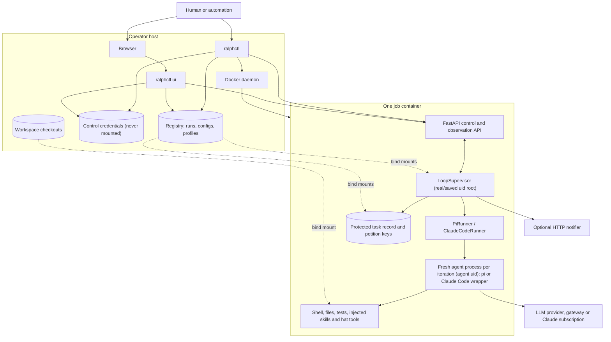
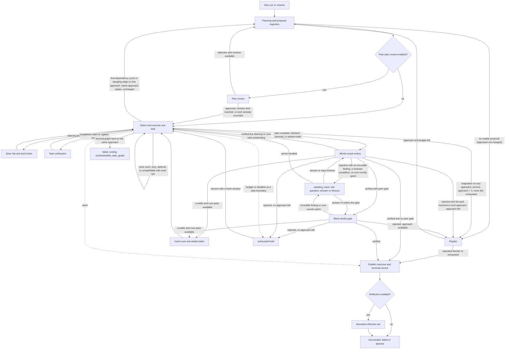
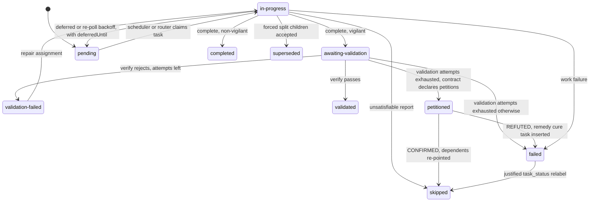
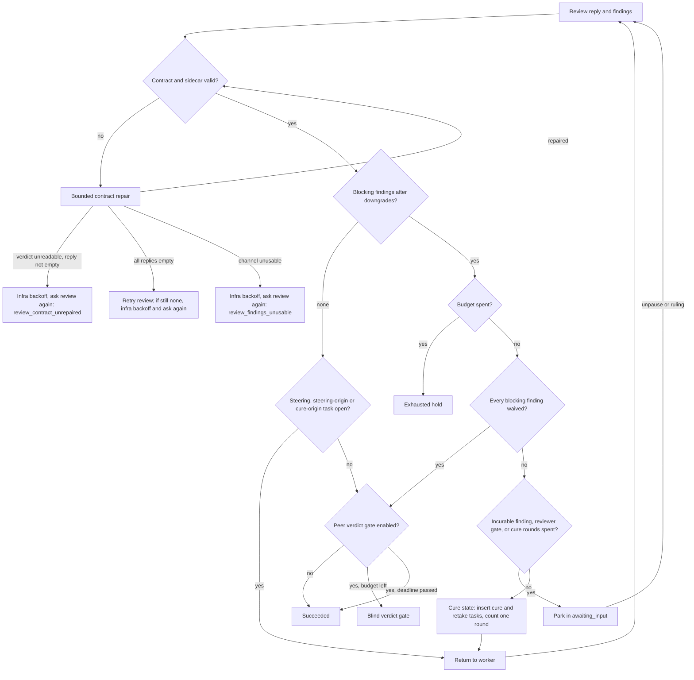
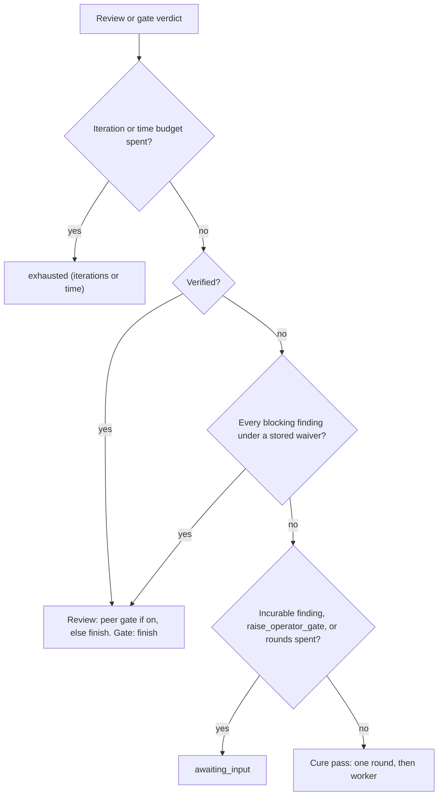
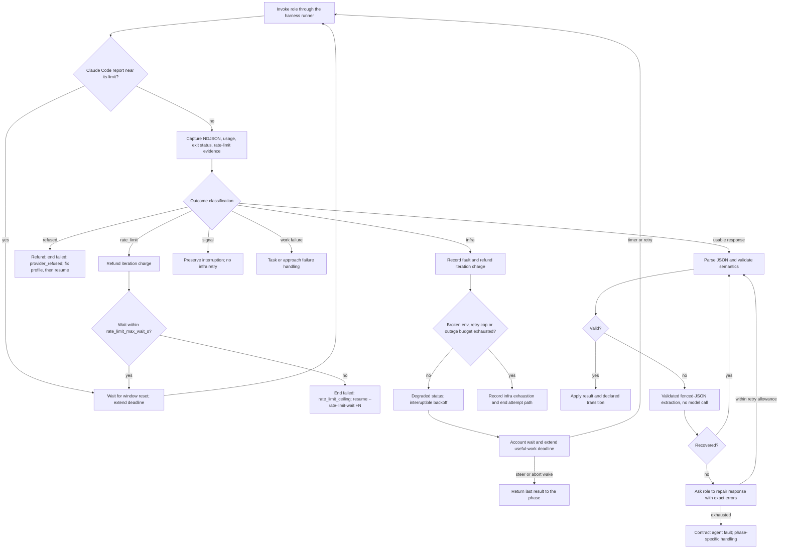
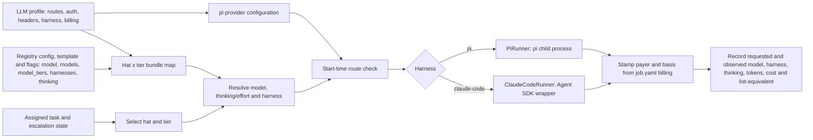
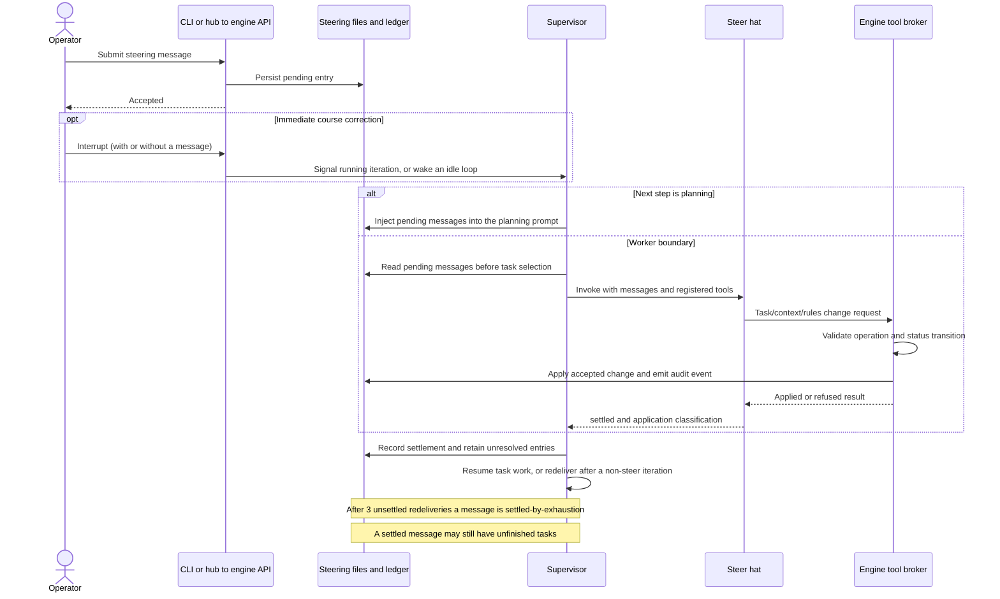
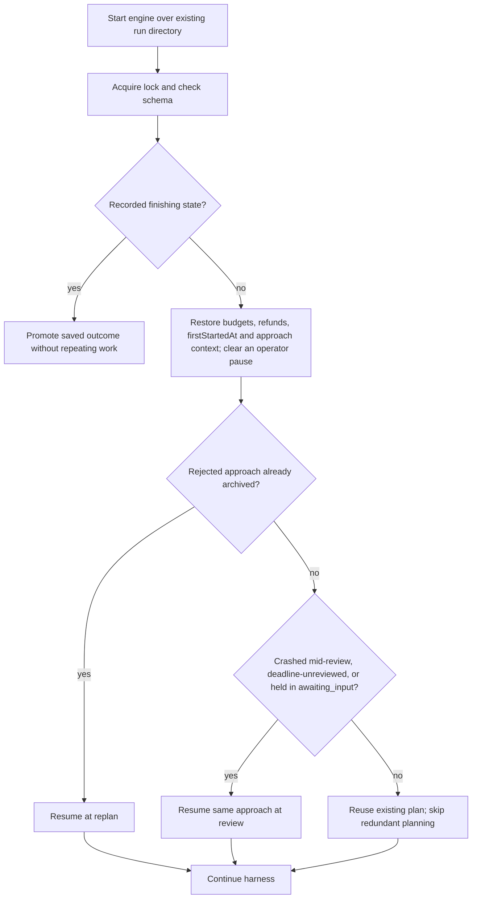

# ralphd solution technical specification

**Implementation snapshot:** `0.32.2` (working tree on top of `34312979`), inspected 6 October 2026.

This document explains how the implemented harness turns a product requirement
document (PRD) into a durable, supervised coding run. It is intended for engineers
integrating, operating, or extending ralphd. The diagrams are architectural
projections of the implementation; they omit minor guards and diagnostic paths.
The exact legal phase and task transitions live in
[`transitions.py`](../src/ralphd/engine/transitions.py).

The implementation is the authority for this snapshot. See [SPEC.md](../SPEC.md)
for the full product reference, [the API reference](api.md) for request schemas,
and [the CLI reference](cli.md) for every command and flag. Section 14 records
verified gaps between intended protection and actual enforcement.

## Contents

- [Purpose and capability envelope](#1-purpose-and-capability-envelope)
- [Deployment architecture](#2-deployment-architecture)
- [Startup and provisioning flow](#3-startup-and-provisioning-flow)
- [Three different state models](#4-three-different-state-models)
- [End-to-end harness flow](#5-end-to-end-harness-flow)
- [Planning, scheduling, and task execution](#6-planning-scheduling-and-task-execution)
- [Review, cure, peer verdict, and success](#7-review-cure-peer-verdict-and-success)
- [Response repair and failure containment](#8-response-repair-and-failure-containment)
- [Budgets and model selection](#9-budgets-and-model-selection)
- [Steering, amendments, and petitions](#10-steering-amendments-and-petitions)
- [Persistence and observability](#11-persistence-and-observability)
- [Restart and resume](#12-restart-and-resume)
- [Completion and reflection](#13-completion-and-reflection)
- [Trust boundaries and current limitations](#14-trust-boundaries-and-current-limitations)
- [Validation and extension guidance](#15-validation-and-extension-guidance)

## 1. Purpose and capability envelope

ralphd runs one coding job per Docker container. A Python supervisor repeatedly
launches a fresh agent process under a role-specific prompt, interprets its
structured response, applies task and phase transitions, and records the result.
Each role (a "hat") runs on one of three agent harnesses (`config.HARNESSES`):
`pi` (the default); `claude-code`, which drives the Claude Code CLI through the
Python Agent SDK ([`harness/claude_code.py`](../src/ralphd/harness/claude_code.py));
or `codex`, served OpenAI-family models only and dispatched to `CodexRunner`
([`runner.py`](../src/ralphd/engine/runner.py)), whose child is the codex
wrapper ([`harness/codex.py`](../src/ralphd/harness/codex.py)). Every
harness feeds the engine the same pi-shaped NDJSON event stream. The LLM performs planning,
implementation, and judgment. The harness controls scheduling, budgets, retries,
state updates, and the decision to publish an outcome.

Several job containers can run independently. Within one job, the normal work
path is sequential: one assigned task per worker iteration. When more than one
task is selectable, a constrained router call picks one (`route_task_selection`,
on by default); it never runs two tasks at once. Peer review means another role
invocation; it does not imply concurrent workers.

| Capability | Implemented behavior |
|---|---|
| Autonomous delivery | Plan, execute tasks, review the entire result, cure findings (bounded by `cure_pass_ceiling`, default 3) or start another approach. |
| Task verification | Optional vigilant mode independently verifies each completion claim. |
| Peer checks | Optional plan review before work, an optional one-off mid-plan review once a fixed fraction of the plan is done (`mid_plan_review`), and an optional blind verdict gate after the main reviewer approves. |
| Bounded recovery | Separate handling for infrastructure outages, work failures, signal interruptions, malformed responses, lack of progress, provider refusals and, on `claude-code` hats, subscription rate-limit windows. An exhausted job deadline or iteration budget holds the run in the resumable `exhausted` state instead of failing it. |
| Task deferral | A worker can defer a task to a later time (`deferredUntil`); repeated CI-wait re-polls back off in wall-clock time instead of spending iterations. The operator can release a deferred task early. |
| Operator intervention | Durable steering, rulings (`ralphctl rule`), amendments, interrupt, pause/unpause, answers to an `awaiting_input` question (`ralphctl answer`), budget changes, retry-now, undefer, and abort. |
| Provider flexibility | pi-supported providers, named LLM profiles, custom endpoints/headers, a per-hat harness (`pi`, `claude-code` or `codex`), and model/thinking selection by role and difficulty tier. |
| Cost attribution | Per-iteration usage with provider, derived (host `pricing:` map or built-in Bedrock table) or unknown cost, grouped by phase, approach, tier and, for runs started with a `billing:` block, by payer and billing basis (metered, subscription, chargeback, free). |
| Runtime provisioning | Inject and update skills, credentials, prompts, and LLM configuration; `ralphctl llm test --hats` pings every hat's route through the real runner before launch. |
| Harness-owned state | The authoritative `tasks.json`, the control credential and the petition key store live where an iteration cannot replace them; the engine keeps root as its real and saved uid so an iteration, dropped fully to the agent uid, cannot signal it; the commits each worker iteration creates are scanned for known secret values at the task boundary (`commit_secret_scan`, on by default), and when `workspace_push_remote` hands the push to the engine it pushes only a clean range. |
| Durability | Host-mounted run state, iteration transcripts, approach archives, restart reconstruction, episode history, and terminal records. |
| Observation | CLI, per-job HTTP API, SSE events, live logs, and a host web hub with disk fallback, a current-iteration panel, per-iteration harness/model/thinking, router-call and artifact browsers, and a by-payer cost view. |
| Learning artifacts | Optional post-run reflection and proposed prompt/skill changes, applied separately through `ralphctl suggestions`. |
| Notifications | Worker/steer notification tool and engine escalations through a configured HTTP notifier; an escalation is retried up to three times, an oversized one is digested, and an undelivered one is flagged on the run's listing. Notifications can carry a hub deep link (`hub_base_url`). |

Sources: [`engine/config.py`](../src/ralphd/engine/config.py) (`HARNESSES`,
`BILLING_BASES`, the `JobConfig` toggles and their defaults),
[`engine/runner.py`](../src/ralphd/engine/runner.py) (`PiRunner`,
`ClaudeCodeRunner`), [`engine/router.py`](../src/ralphd/engine/router.py),
[`engine/commit_scan.py`](../src/ralphd/engine/commit_scan.py),
[`engine/privsep.py`](../src/ralphd/engine/privsep.py).

## 2. Deployment architecture

The CLI is a host-side launcher and operator client. The engine and HTTP API share
one Python process inside the job container. A per-harness runner launches and
supervises the external agent process: `PiRunner` spawns `pi`, and
`ClaudeCodeRunner` spawns the `python -m ralphd.harness.claude_code` wrapper,
the only module that imports the Claude Agent SDK. Both share one child-process
path (own session, agent uid, prompt on stdin, startup watchdog, timeout ladder)
and one transcript format. The web hub is a separate host-side HTTP server
started by `ralphctl ui`; it reads the registry and proxies selected live requests.



| Component | Responsibility and implementation |
|---|---|
| CLI and image builder | Registry, image selection/build (the job image pins the Claude Agent SDK), mounts, process lifecycle, host configuration, LLM profile and billing resolution, `llm test` route pings. [`cli/main.py`](../src/ralphd/cli/main.py), [`cli/image.py`](../src/ralphd/cli/image.py), [`cli/llm_profiles.py`](../src/ralphd/cli/llm_profiles.py), [`engine/llm_ping.py`](../src/ralphd/engine/llm_ping.py). |
| Engine bootstrap | Control-credential provisioning, UID separation, exclusive run lock, schema compatibility, budget seeding, task-record and key-store protection, provisioning, route validation, API and job startup. [`engine/main.py`](../src/ralphd/engine/main.py), [`engine/privsep.py`](../src/ralphd/engine/privsep.py). |
| Supervisor | Phase handlers, budgets, recovery, rate-limit waits, deadline hold, review/cure policy, steering, rulings, deferral, billing stamps, completion. [`engine/loop.py`](../src/ralphd/engine/loop.py). |
| Router | Deterministic-first choice of the next edge or task; asks a model only when two or more are legal, and falls back to the table's declared choice. [`engine/router.py`](../src/ralphd/engine/router.py). |
| Transition and response contracts | Declared edges, role response schemas, structural validation and repair protocol. [`transitions.py`](../src/ralphd/engine/transitions.py), [`contracts.py`](../src/ralphd/engine/contracts.py), [`contract_enforcement.py`](../src/ralphd/engine/contract_enforcement.py). |
| Plan and task management | Proposal ingestion/lints, deterministic scheduling, status application and persistence. [`plan_ingestion.py`](../src/ralphd/engine/plan_ingestion.py), [`scheduler.py`](../src/ralphd/engine/scheduler.py), [`state.py`](../src/ralphd/engine/state.py). |
| Execution and faults | `AgentRunner` protocol, agent process groups, NDJSON capture, Claude SDK message normalisation, timeouts, usage and cost extraction, fault classification. [`runner.py`](../src/ralphd/engine/runner.py), [`harness/claude_code.py`](../src/ralphd/harness/claude_code.py), [`harness/normalise.py`](../src/ralphd/harness/normalise.py), [`faults.py`](../src/ralphd/engine/faults.py). |
| Secret hygiene | In-memory redaction of persisted and served output; task-boundary scan of the commits a worker iteration created, gating the push when the engine owns it. [`redact.py`](../src/ralphd/engine/redact.py), [`commit_scan.py`](../src/ralphd/engine/commit_scan.py). |
| Cost | Provider-quoted, host-map or built-in Bedrock pricing; per-payer stamping and views. [`pricing.py`](../src/ralphd/engine/pricing.py), [`pricing_aws.py`](../src/ralphd/engine/pricing_aws.py), [`state.py`](../src/ralphd/engine/state.py) (`stamp_billing`, `payer_view`). |
| Judgment records | Structured findings, petitions, operator rulings and terminal accounting. [`findings.py`](../src/ralphd/engine/findings.py), [`petitions.py`](../src/ralphd/engine/petitions.py), [`run_record.py`](../src/ralphd/engine/run_record.py). |
| Interfaces | Engine routes, role tool broker, web hub and static UI, shared transcript merge/render with engine-written side indexes for bounded tails. [`api.py`](../src/ralphd/engine/api.py), [`hat_tools.py`](../src/ralphd/engine/hat_tools.py), [`ui_server.py`](../src/ralphd/cli/ui_server.py), [`log_merge.py`](../src/ralphd/log_merge.py), [`cli/log_render.py`](../src/ralphd/cli/log_render.py), [`render_index.py`](../src/ralphd/render_index.py), [`collapse_index.py`](../src/ralphd/collapse_index.py). |

The hub serves its own `/api/...` routes. Reads fall back to the run directory
on disk when the container is gone; iteration detail, documents, artifacts,
faults, cost and router calls are read from disk only. Its control routes
(`steer`, `retry`, `rule`, `unpause`, `tasks/<task>/undefer`) proxy to the run's
own API, and `DELETE /api/runs/<id>` removes a terminal run through the CLI's
own removal path.

## 3. Startup and provisioning flow

`ralphctl start` resolves the launch configuration and image before starting the
engine. An explicit image is used as supplied; otherwise the CLI can build/cache
a content-hash-tagged image from packaged source inputs or derive one from a
base image/custom Dockerfile. Every recipe installs the pinned Claude Agent SDK
(`CLAUDE_AGENT_SDK_VERSION`) so any hat can run on the `claude-code` harness, and install the pinned
Codex CLI (`CODEX_VERSION`, `@openai/codex`) next to pi for the `codex` harness;
a missing or unpinned `CODEX_VERSION` in `container/Dockerfile` is refused.
The selected image and its recipe are recorded for later resume. Nothing is
pushed to an image registry, so `--image` names a locally built tag.

```mermaid
sequenceDiagram
    actor Operator
    participant CLI as ralphctl
    participant Disk as Host registry
    participant Docker
    participant Engine
    participant Agent as Agent iteration (pi or Claude Code)
    Operator->>CLI: start with PRD and workspace/config options
    CLI->>CLI: Resolve flags, template, registry, profile, harness and billing
    CLI->>Docker: Select image and build on cache miss
    CLI->>Disk: Write job config, PRD and wiring; store tokens outside every mount
    CLI->>Docker: Start container with mounts and environment
    Docker->>Engine: Run entrypoint and engine
    Engine->>Engine: Provision root-owned control credential copy
    Engine->>Engine: Establish UID separation
    Engine->>Disk: Lock run directory, check schema and seed budgets
    Engine->>Disk: Protect task record and petition key store
    Engine->>Engine: Place credentials and skills, initialize redaction
    Engine->>Engine: Check configured model routes per hat and harness
    Engine->>Engine: Start HTTP API and reconstruct execution point
    Engine->>Agent: Launch planning or resumed phase
    Agent-->>Engine: NDJSON stream and final contract response
    Engine->>Disk: Persist iteration, usage with payer, events and transitions
```

For ordinary scalar launch options, precedence is explicit flag, template,
supported registry default, then built-in default. Per-hat tables (`models:`,
`model_tiers:`, `harnesses:`) merge key by key across those levels instead of
being replaced whole; the harness table also takes an LLM profile's `harness:`
as its weakest layer (profile, registry `config.yaml`, template,
`--harness-for`). A run's `billing:` block takes each of payer and basis from
`--billing-payer`/`--billing-basis`, else the profile's `billing:` (the
registry `config.yaml`'s for `--llm host`), else the profile name and
`metered`. It is inlined into `job.yaml` so `resume` replays it, and
`--llm none` writes none. A `claude-code` hat is always stamped
`subscription`, under the registry's `subscription_payer` label when the
run's profile is not itself a `claude-code` one. LLM profiles and engine
environment overrides have their own documented merge rules. In particular, `RALPHD_NOTIFIER_URL` in the engine
process overrides `job.yaml`'s notifier URL; the URL has a flag/template
setting but no registry-wide default.

The route check is local: it reads the placed pi `models.json` and makes no
gateway call. A `claude-code` hat must name an `anthropic/` model. The engine
exits before iteration 1 on an unroutable hat. `ralphctl llm test --hats`
does the network check separately: it pings each distinct (harness, model)
pair through the real runner in a throwaway container
([`engine/llm_ping.py`](../src/ralphd/engine/llm_ping.py)).

The default registry is `~/.ralphd`, overridable with `RALPHD_REGISTRY`.

| Host location | Container location / purpose |
|---|---|
| `runs/<run-id>/` | Read/write `/run/ralphd`: durable run records and artifacts. |
| `configs/<run-id>/` | Read-only `/config`: job configuration, original PRD and injected configuration. |
| `configs/<run-id>/record/` | `/var/lib/ralphd/record`: the authoritative `tasks.json`. The engine makes it root-owned 0700 inside a root-owned parent while it runs and hands it back at shutdown. |
| `configs/<run-id>/run-secrets/` | `/var/lib/ralphd/run-secrets`: persistent petition MAC keys, protected the same way. |
| `control/<run-id>/` | Never mounted: the host copy of `.control-token` and `.api-token`, read by every later `ralphctl` command and the hub. The tokens reach the engine as environment variables; it keeps a root-owned copy at `/var/lib/ralphd/control`. |
| `llm-profiles/<name>.yaml` | Never mounted: named LLM profiles, resolved on the host at `start`. |
| `config.yaml` | Never mounted: registry-wide defaults, per-hat tables, `pricing:` and `billing:`. |
| Supplied workspace | `/workspace`, or `/workspace/<name>` for named workspaces. |
| Host Docker socket, when enabled | Optional sibling-container toolchain access; not needed for ordinary agent execution. |

Engine startup order is in [`engine/main.py`](../src/ralphd/engine/main.py):
`main()` provisions the control credential copy and drops the effective uid
(`privsep.provision_control_credentials`, `separate_engine_identity`), then
`amain()` takes the run lock, checks the schema, seeds the iteration budget,
cure-pass ceiling and rate-limit wait ceiling, migrates `tasks.json` into the
protected record directory, protects the run-secrets mount, places credentials
and skills, builds the redaction map, copies the PRD, checks hat routes, writes
the first status and starts the API and the job. A deadline hold (`exhausted`)
skips the `on_complete` command and exits instead of idling.

The normal bridge deployment publishes the job API on host loopback. Host
networking is supported; in that case the engine uses the configured host bind
address and port because Docker port publishing does not apply. A provider
reachable only through VPN split DNS may require `--network host`.

## 4. Three different state models

Keep these records distinct when integrating with the API or adding features:

| Model | Meaning | Examples |
|---|---|---|
| Run lifecycle | Whether the job is executing, stopped (one of four stop states below), finalizing, or terminal. | `starting`, `running`, `paused`, `awaiting_input`, `exhausted`, `finishing`, `succeeded`, `failed`, `aborted`. |
| Execution phase | Which harness step owns the next action. | `planning`, `worker`, `verify`, `review`, `cure`, `steer`, `replan`, `paused`, peer gates (`plan_review`, `verdict_gate`), `reflect`. |
| Task lifecycle | What has been established about one planned task. | `pending`, `in-progress`, `awaiting-validation`, `validated`, `completed`, `validation-failed`, `failed`, `skipped`, `superseded`, `petitioned`. |

The run lifecycle values are `state.NONTERMINAL_STATES` plus
`state.TERMINAL_STATES`; the step states and task statuses are
`transitions.STEP_STATES` and `transitions.TASK_STATUSES`
([`state.py`](../src/ralphd/engine/state.py),
[`transitions.py`](../src/ralphd/engine/transitions.py)). `paused` is spelled in
both namespaces: as a step state it is the transition table's parking step, and
as a lifecycle state it is the operator's own pause alone. The engine's findings
parks hold in that parking step while `status.json` shows `awaiting_input`. Some model calls are not phases of the state machine
at all: the router's constrained question (accounted as `usage.byPhase.router`),
the mid-plan review episode and the mid-run petition adjudication episode run
without a transition-table state.

`exhausted` is the one budget hold. When the iteration budget, the job deadline
or the approach budget is spent, the engine lets the current iteration finish and
freezes the run in this non-terminal, resume-eligible state with `verdict: null`
and `exhaustedBudget` set to `iterations`, `time` or `approaches`, instead of
ending it `failed`. A hold skips the `on_complete` command. `ralphctl resume`
refuses it without a top-up of the named budget and then continues the run from
its recorded position (the replan on the next approach number for `approaches`).

`health` is another dimension: a running job can be `degraded` while waiting for
an infrastructure outage to clear. A `claude-code` hat's rate-limit wait is
recorded separately in `rateLimitWait`. `verdict` is the judgment of the work,
separate from the lifecycle state: `verified`, `verified-with-residuals`,
`unverified`, `unreviewed`, or `null`. A deadline that lands during review
produces an `exhausted` hold with `verdict: null` and reason `"deadline during
review"`, not a reviewed rejection. `unreviewed` is written in three cases
(with `state: failed`), each once a judge fault outlives the infra outage
budget or no budget remains to ask again: review ran but never produced a readable verdict from a
reply that was not empty (`review_contract_unrepaired`) or a usable findings
channel (`review_findings_unusable`); review said `verified` but the peer
verdict gate produced no verdict after every `judge_retry_max` retry; or the
review hat itself had no verdict on every attempt and every retry, because it
was cut off (`stopReason: length`, no text) or its contract ladder was exhausted
on replies that were all empty. With budget left each of these is an infra
fault under the unchanged outage budget and retry schedule: the hat is asked
again after each backoff, and the run never pauses. In the gate and review
no-verdict cases the recorded review verdict stays as it is and no rejection
is recorded.

**Stop states.** A run that is not working is in exactly one of four
non-terminal states, each with one owner:

| `state` | Entered by | Left by |
|---|---|---|
| `paused` | the operator only (`ralphctl pause`, the hub, `POST /pause`); `status.json` records `pausedBy: "operator"` and the optional `pauseNote` | `ralphctl unpause` |
| `awaiting_input` | the engine, only to ask the operator about findings (`inputQuestion`) or about a secret found in a commit | an answer (`ralphctl answer`, `POST /answer`, the hub panel) or the input timeout |
| `exhausted` | the engine, when the iteration, time or approach budget is spent (`exhaustedBudget`) | `ralphctl resume` with a top-up of that budget |
| `running` with `health: degraded` | the engine, during an infrastructure outage | recovery, or `failed` once the outage budget is spent |

No other engine path parks a run, and every stop is written to `status.json`
before the engine waits on it. `awaiting_input` carries `inputQuestion`: its
`kind` (`findings` or `secret`), `trigger` (`incurable`, `reviewer_escalation`,
`cure_rounds_spent`), the blocking findings, this approach's cure rounds used and
allowed, `expiresAt` and `onTimeout`. The commit-secret park (`kind: secret`) has
one answer, `ralphctl answer <run> --secret-handled`, once the commit scan of the
offending range is clean, and never expires. A provider refusal ends the run
`failed` with `ending: provider_refused`, and a rate-limit wait that would exceed
`rate_limit_max_wait_s` ends it `failed` with `ending: rate_limit_ceiling`; both
resume through `ralphctl resume`. `ralphctl unpause` on a run that is not
`paused` is refused with the command that applies: `answer` for `awaiting_input`,
`resume --<budget>` for `exhausted`. `ralphctl resume` is for a stopped
container or an `exhausted` hold, not for a park.

Task deferral is an attribute, not a task status. A `pending` task can carry
`deferredUntil`/`deferredReason` (from a worker's `verdict: "deferred"` report or
the engine's re-poll backoff, capped at the job deadline). The scheduler skips
the task until then, and `ralphctl undefer` or the hub's **Undefer now** button
clears it early. Likewise `progressBudget` tracks the in-progress task's
corroborated-progress allowance without changing its status.

An **iteration** is a numbered agent invocation with its own transcript; its
`meta.json` records the phase, approach, assigned task, effective tier,
harness, model and thinking/effort it ran with. An **approach** groups a plan and its implementation/review cycle. An
**episode** is one execution of the engine over a run directory; resume creates
another episode without creating a different run. `startedAt` and `endedAt` are
episode-scoped, `previousEndings` keeps earlier episodes' endings, and
`firstStartedAt` keeps the run's earliest recorded start across every resume. A
**cure pass** repairs findings within the same approach; review and verdict-gate
cure passes draw on one per-approach count of cure rounds, bounded by
`cure_pass_ceiling`.

## 5. End-to-end harness flow

The supervisor dispatches phase handlers and records transitions through
`TransitionExecutor`. A move to a target state the table does not declare for
the current state raises `IllegalTransition`. Legality is checked per
(state, target) pair: the guard name labels the edge for the audit trail and for
`_step_replan`'s charge decision, but is not itself looked up in the table.
Most routing is deterministic code. The router helper
([`router.py`](../src/ralphd/engine/router.py)) is not an LLM orchestrator
consulted after every iteration. It answers two narrow questions:

- **Task selection.** It picks the next task only when the scheduler's pending
  step has two or more runnable candidates. This is on by default; turn it off
  with `route_task_selection: false` or `ralphctl start --no-route-tasks`.
- **Edge choice.** It chooses an edge only for a state with more than one legal
  edge that a step handler cannot decide from disk state.

Each call is a single JSON question bounded by `router_timeout_s`. An invalid
answer, a timeout or a non-candidate answer falls back to the deterministic
choice. A router call does not use an iteration slot, but its cost is accounted
under the `router` phase.



The table lives in [`transitions.py`](../src/ralphd/engine/transitions.py): the
base `TABLE`, plus `VIGILANT_DELTA`, `PEER_PLAN_REVIEW_DELTA` and
`PEER_VERDICT_GATE_DELTA`, composed by `table_for`. This overview omits the worker
guard's details, the self-looping `review_interrupted` retry, and how each
park chooses its resume target. Sections 7, 9, and 12 describe them.

A park happens before an approach is archived, and only for findings:

- **Rejection.** A rejection that would archive the approach parks the run in
  `awaiting_input` first (on by default; `--no-operator-input-needed-pause`
  resolves the park at once with the outcome an unanswered park takes). The
  operator answers with `ralphctl answer`. A `ralphctl rule` ruling is recorded
  but never answers a park, and a bare `ralphctl unpause` is refused.
- **Contract failures.** `review_contract_unrepaired` and
  `review_findings_unusable` (review's contract ladder exhausted on a non-empty
  reply) and a judge no-verdict (a ladder exhausted on empty replies, or a
  truncated reply), each still standing after every `judge_retry_max` retry,
  are infra faults under the outage budget: the hat is asked again after each
  backoff, and a spent budget ends the run `failed`, verdict `unreviewed`. None of them pauses.
- **Gate cure ceiling.** The peer verdict gate parks on the same ladder once the
  current approach's cure rounds are spent. Review and the gate draw on that one
  shared count (`curePasses` plus `gateCurePasses` for the approach), bounded by
  `cure_pass_ceiling` plus any `ralphctl budget --cure-passes +N` top-up granted
  to this approach. A new approach starts at zero rounds used.

Two harness episodes run in the worker step but have no state in the table:

- the mid-run petition adjudication episode, which runs before a verify pass;
- the opt-in `--mid-plan-review` episode, once per approach.

**Run endings.** Running out of iterations or reaching the job deadline at a step
boundary no longer ends the run `failed`. Instead, `_finish_exhausted` holds it in
the non-terminal `exhausted` state with a `null` verdict. Reflection is skipped,
and `ralphctl resume` continues it into `worker`. An operator abort still ends
the run `aborted`. Exhausting `max_approaches` holds the run `exhausted` (`approaches`) as
well, resumable with `--approaches +N`. The structural endings still
end the run `failed`. These endings are `repeated_blocker_signature`, a repeated
planning death and `unschedulable_task_graph`. `finishing` is persisted as a
lifecycle state when a reflection tail remains. Without reflection, the terminal
state can be written directly.

### Role contracts

Role prompts live in [`src/ralphd/prompts`](../src/ralphd/prompts). They specify a
JSON object on the final nonblank response line. The engine validates that object
against `transitions.HAT_SCHEMAS` and applies additional semantic checks. Schema
validation establishes response shape. Verification and review establish whether
the work satisfies the PRD. A hat runs on the `pi`, `claude-code` or `codex`
harness (`JobConfig.harness_for`). The contract is the same either way.

| Hat | Main output | Harness action |
|---|---|---|
| `planning` | `proposal_path`, `summary`, optional `standing_rules` | Load, repair and lint the proposal, normalize task metadata, ingest tasks as pending, and pin standing rules. |
| `worker` | `complete`, `no_verdict`, `unsatisfiable`, `plan_complete`, or `deferred`. Optional fields: `proposed_tasks`, `proposed_task_updates`, `progress`, `petition`, `task_status` with `justification`, and `debt_resolved`. | Apply the assigned task's result, any split or doomed-dependency re-point, progress evidence, petition filing, deferral, or `failed`→`skipped` relabel. |
| `verify` | Task ID and `verified`/`rejected`, `reason`, optional `notes` array | Validate the completion (a verified verdict can carry notes) or record a validation failure. Retain verification-debt notes. |
| `review` | `verified`/`rejected`, `reason`, and `findings_path`. Optional: `petition_adjudications` and `raise_operator_gate`. | Reconcile findings and route to success, cure, pause, or replan. `raise_operator_gate: true` lets the reviewer request the operator pause itself. |
| `plan_review` | `approved`/`objected`, `reason`, `notes` | Permit work, or request a bounded plan revision. An undecidable reply spends a revision directly. |
| `verdict_gate` | `verified`/`rejected`, `reason`, its own `findings_path` | Independently gate terminal success. A rejection takes a cure pass, an operator pause, a fresh approach, or ends the run, as described in section 7. |
| `steer` | `settled`, `notes`, `application` (`applied` or `partially-applied`) | Record message settlement separately from completion of the resulting tasks. |
| `reflect` | Optional `notes` only | Record post-run analysis. The engine derives "report written" and "suggestions written" from `artifacts/reflection/` on disk, not from the reply. |

The engine repairs a malformed final line before it treats the line as a missed
verdict. It first tries fenced-JSON recovery, which costs no model call. It then
asks for the corrected payload through the uncharged contract re-ask ladder,
bounded by `contract_retry_max` (default 2). A worker reply that ends in plain
prose emits `worker.verdict_absent` (section 8). The old
`<promise>COMPLETE</promise>` and `<promise>VERIFIED</promise>` strings remain
diagnostic properties in [`runner.py`](../src/ralphd/engine/runner.py). They
drive no decision.

## 6. Planning, scheduling, and task execution

### Planning and optional plan review

The planner proposes tasks in a file. It does not author authoritative task
statuses. Ingestion (`enforce_plan_ingestion`) runs in this order:

1. Validate the pointer payload.
2. Validate the proposal file's shape.
3. Repair criteria where it can. `repair_task_criteria` applies the rewrite the
   unenumerated-quantifier and clause-count lints already computed, and emits
   `task.criteria_repaired`.
4. Lint the proposal. The lint covers IDs, dependency resolution and cycles,
   duplicate IDs, boilerplate criteria, and a smuggled `status`. It also covers
   the domain-specific shapes of `successCriteria`. Examples include relational
   sha anchors, structurally unsatisfiable clauses, command-form clauses, more
   than five checkable clauses, a large `estimatedIterations` with no staged
   decomposition, and an unstaged baseline-to-target descent.
5. Normalize `tier` and `estimatedIterations`, which defaults to 1. A defaulted
   value or a degenerate distribution emits a `planning.warning` and never
   refuses the proposal.
6. Create every task record with `status: pending`.

Any failure re-prompts the planner with the specific errors, up to
`contract_retry_max`.

Tasks carry `id`, `title`, `successCriteria`, `dependsOn`, `priority`, `tier`, and
`estimatedIterations`. They can also carry `orderingOnly`, the subset of
`dependsOn` that the planner declares as pure sequencing edges. A later cure
re-open does not walk an ordering-only edge back into a validated producer. The
engine adds lifecycle, provenance, verification, failure, progress, and deferral
metadata as work proceeds.

**Planning death.** A planning attempt that produces no usable proposal does not
spend a product approach. It routes `planning → replan` on `empty_plan`, and
`_step_replan` retries planning on the same approach number. If two consecutive
planning deaths fail the same lexical lint, the run ends. The signature is kept
in `planningDeathSignature`.

**Plan review.** With `peer_plan_review` enabled, a second role can object
before implementation. Revision is bounded, with two revisions by default
(`peer_plan_review_max_revisions`, counted per approach in
`planReviewRevisions`). Reaching that bound releases the plan to the worker. This
gate is advisory and bounded, unlike the final verdict gate. An unparseable
reply, or an objection without a reason, spends a revision directly. It is not
routed. Re-ingestion is refused once the approach already records work, because
replacing the plan would reset task state. A resume over a plan that the peer
already approved or that already has work skips `plan_review` (#161).

### Scheduler policy

The scheduler (`select_next_task`) selects in this order:

1. A `validation-failed` task.
2. An `in-progress` task.
3. A `pending` task with satisfied dependencies and no `deferredUntil`.

Within each class, higher priority wins, and original list order breaks ties.
Step 3 is the only step the router can change. When `pending_candidates` holds
two or more tasks and `route_task_selection` is on (the default),
`_route_task_selection` asks the router once, with no contract retry. The router
sees each candidate's ID, title, start of description or criteria, origin,
priority, and `dependsOn`. It also sees the last worker iteration's outcome and
a fixed ordering rule. An unparseable answer, an off-list ID, or a timeout falls
back to the deterministic pick. Every call emits `router.decision`.

A dependency is satisfied by `completed`, `validated`, or `superseded`. A
`skipped` task counts toward plan completion but does **not** satisfy a
dependent task. `skipped` and `failed` can therefore make downstream work
impossible. The harness derives that "doomed" set and reports it instead of
letting it starve. The worker can repair it with `proposed_task_updates`, which
re-points the `dependsOn` of a pending task blocked by a `failed` or `skipped`
dependency. The re-point is linted and capped by
`worker_repoint_budget_per_approach` (default 3). The steer hat's `task-update`
tool can also repair it. That tool refuses a `dependsOn` write to a claimed task
(`in-progress` or `validation-failed`) and records the refusal on the steering
ledger. If the whole
actionable remainder is doomed, the run goes to review
(`doomed_plan_unverifiable`). Two other graph conditions are
dependency-graph faults: a `dependsOn` cycle among pending tasks, and an edge
naming an ID that is not in the plan. The first on an approach is an uncharged
replan of the same approach, whose planning prompt names the offending edges
(`graphFaultApproaches` records it). A second on the same approach ends the run
`failed` with `ending: unschedulable_task_graph`; `ralphctl resume` continues it
once the graph is repaired. Neither parks the run.

A remainder held on a `petitioned` ancestor goes to review after three no-task
passes (`petition_held_no_task_bound`).

Before dispatch, the harness claims the selected task as `in-progress` and
records that transition. It also fixes the task's effective tier for this claim.
Each worker invocation gets one assignment. While the agent runs, the transcript
provides liveness. The authoritative result is applied at the harness's
transition points.



This is the common task path, not the complete task transition table. The full
table is `TASK_STATUS_TABLE` plus `TASK_STATUS_VIGILANT_DELTA` in
[`transitions.py`](../src/ralphd/engine/transitions.py).

**Moves outside the table.** The table declares no edge into `pending`. The two
moves that land there are direct engine writes:

- a deferral, or a re-poll backoff;
- a cure re-open, in which `insert_cure_tasks` walks an `invalidates` finding
  back over terminal records (section 7).

A re-opened record gets fresh validation attempts
(`reset_validation_attempts_for_reopen`). The declared `pending → <prior
terminal>` un-reopen edge restores the record if the cure never touched the cited
path. Apart from those engine writes, nothing can move a task back to `pending`,
and the remedy is to supersede the task instead. `superseded` is engine-forced
only: no hat may report it and no operator may rule it.

**Validation attempts.** A task gets `VALIDATION_ATTEMPT_LIMIT` (3) validation
attempts. A task that reaches `awaiting-validation` with the budget already spent
fails as validation-exhausted without dispatching verify.

**Deferral.** Deferral uses a timestamp on a pending task, not a separate status.
The scheduler excludes a deferred task unconditionally, even after its `until`
has passed. The task runs again in two cases:

- **Nothing else is runnable.** `_sleep_until_earliest_deferred` sleeps until
  the earliest `deferredUntil`, capped at `deadlineAt`. When that time elapses,
  it clears the task's deferral. A steer, an abort or an undefer request wakes
  the sleep early and leaves the deferral in place.
- **The operator releases it.** `ralphctl undefer <run> <task>`, or
  `POST /tasks/{id}/undefer`, clears the deferral at the top of the next pass
  and emits `task.undeferred`.

`superseded` retires a parent that was replaced by child tasks. It does not count
as a completed implementation task.

### Progress, splitting, and criteria integrity

A `no_verdict` response can carry progress evidence. The supervisor checks the
claim against a before/after workspace-tree fingerprint, so a `commit` or `file`
claim is corroborated only if the tree moved. An `external` claim is honoured
once in a row. Corroborated claims spend a per-task progress allowance of
`estimatedIterations + 2`, which is three at the default estimate of 1
(`progressBudget`). Repeated unsupported claims and exhausted progress take
escalation, split, replan, or pause paths. They do not create unlimited extra
task time.

**Re-polls.** A re-poll is a `no_verdict` with no corroborated claim and no tree
delta. Its tool calls no longer reset the stagnation counter. The second and
later consecutive re-polls on one task back the task off to `pending` with
`deferredUntil`. The backoff is 600 s, then 1,200 s, then 1,800 s, capped at the
deadline, and each step emits `task.repoll_backoff` (#279). Section 9 covers the
stagnation witnesses.

**Splits.** Worker-proposed replacement tasks are linted like a planner proposal
before they are applied. There are two kinds:

- A **voluntary** split is optional. If the lint refuses it, the refusal is
  carried into the next prompt rather than re-asked.
- A **forced** split is required once the task's progress budget is spent. The
  same worker is re-asked through the contract ladder until a valid split
  arrives.

Both kinds draw on one approach-scoped budget of accepted new tasks,
`worker_split_budget_per_approach` (default 3). New worker-origin tasks never
count as progress. A superseded parent and the replacement dependency structure
preserve the unfinished obligation. If a split child of a superseded parent
exhausts its own budget, the engine archives the approach and replans (or holds
`exhausted` with no approach left) instead of splitting again.

**Criteria integrity.** Success criteria have persisted fingerprints, and the
verbatim text is kept as `criteriaOfRecord`. Any later rewrite is flagged, even
one made before the first validation failure. Where the recorded text is
intact, the rewrite is reverted and `task.criteria_edit_refused` is emitted. The
flag also produces an engine-injected blocking review finding. Ordinary worker
narration cannot waive the failed criterion. Operator amendments and
judge-authored criteria amendments follow explicit paths.

Sources: [`scheduler.py`](../src/ralphd/engine/scheduler.py),
[`router.py`](../src/ralphd/engine/router.py),
[`plan_ingestion.py`](../src/ralphd/engine/plan_ingestion.py),
[`transitions.py`](../src/ralphd/engine/transitions.py), and the supervisor's
`_step_planning`, `_step_plan_review`, `_step_worker`,
`_route_task_selection`, `_sleep_until_earliest_deferred`,
`_apply_forced_split_report`, `_verify_task`, and `_check_criteria_edits`.

## 7. Review, cure, peer verdict, and success

Review judges the entire result against the effective PRD, task evidence, operator
amendments and rulings, steering history, petitions, and prior failures. Its prompt
also carries the materiality rubric (the PRD's own inline `## Materiality rubric`,
or a product-only engine default), and, once the approach has taken a cure pass,
a confirmation-review section (below). It produces human-readable findings plus a
structured `review-findings.json` sidecar
([`findings.py`](../src/ralphd/engine/findings.py)).

Each finding has `severity` (`blocking`/`residual`), `curable`, `clause`, and
`evidence`. Curable blocking findings must supply an actionable `cured_when`,
checked semantically on the review contract ladder: it must be present and stay
within the same ~5-clause bound a planned task's `successCriteria` obeys, because
it becomes the cure task's criteria. Optional `invalidates` paths identify evidence
that must be retaken after the cure. Confirmation reviews add `reopens`,
`regression`, and `always_blocking_exception` (`exposed_secret` or
`absent_behavior`). Unknown finding keys are tolerated with a warning rather than
failing the sidecar. Severity determines acceptance; curability determines the
recovery route.

### Reading the verdict

The review reply's last line is a `review` contract payload. A reply that is
unparseable, fails the schema, contradicts a blocking finding with `verified`, sits
beside a present-but-invalid sidecar, or carries a curable finding with a missing
or overlong `cured_when` enters the bounded review contract ladder (§8). A
`fail`/`failed` verdict word is normalized to `rejected` before the ladder. Two
ladder exhaustions no longer score as a rejection. Each is an infra fault under
the outage budget with the approach unarchived: review is asked again over the
same approach after each backoff, and a spent budget ends the run `failed`,
verdict `unreviewed`:

- `review_contract_unrepaired`: the verdict claim itself is still unreadable in a
  reply that was not empty. The approach verdict is recorded as `unreviewed`. A
  ladder exhausted on replies that were all empty (no text, or only whitespace)
  is not this hold: review is re-dispatched as an uncharged fresh iteration up to
  `judge_retry_max` times, as for a reply cut off at the output-token limit, and
  when every retry also has no verdict it takes the same outage-budget route,
  or with no budget left ends `unreviewed`. No approach verdict is recorded in
  that case.
- `review_findings_unusable`: the verdict word is legible but the findings channel
  or the rest of the payload is not.

For a valid present sidecar, the engine reads the findings after three
adjustments. Blocking findings whose clause matches a CONFIRMED petition are
downgraded to residual. Engine-detected blocking findings for duplicate petitions
and criteria tampering are appended. On a confirmation review, unlinked blocking
findings are downgraded (below). One remaining blocking finding prevents
acceptance. A rejection with only residual findings is recomputed as verified and
finishes with the verdict `verified-with-residuals`. An **absent** sidecar still
keeps the response-only path, except that engine-detected criteria-tamper
findings are still written and still block. The system does not enforce sidecar
presence universally.

The review hat can also call the `record-verdict` hat tool during the iteration.
That writes an early-verdict checkpoint atomically. If review is cut off (budget,
wall clock, or the full `iteration_timeout_s`) after that checkpoint exists for
the current approach, the run concludes on it. No replacement review is dispatched,
and the outcome is marked `provisionalVerdict` (`provisional: true`, with a
`refinementScope` naming what never ran). Without a checkpoint, a review the
deadline cuts off is not scored as a rejection: the run ends with a `null` verdict
and the reason `deadline during review`, and a later resume re-enters review over
the unarchived approach.



### Success blockers

A verified verdict is deferred back to the worker, through a named guard, while
any of three blockers is outstanding: an unsettled steering message, a non-terminal
steering-origin task (`steering_pending_at_verified`), or a non-terminal
review-cure-origin task, such as a remedy inserted for a REFUTED petition
(`review_cure_pending_at_verified`). Only an empty blocker list reaches the success
edge.

### Rejection ladder

[`LoopSupervisor._run_rejection_ladder`](../src/ralphd/engine/loop.py) evaluates a
rejection, from review and from the peer verdict gate alike, in this order
(`ladder.decide` in [`ladder.py`](../src/ralphd/engine/ladder.py) names the step).
The first matching rule wins.

1. **Budget spent** (iterations or time): the run holds `exhausted`. No cure task
   is inserted and no round is counted.
2. **Every blocking finding waived**: each blocking finding's `clause` falls under
   a stored waiver (`<run_root>/waivers/`). The rejection is treated as verified
   and takes the verified edge (the peer gate for review, success for the gate).
3. **Park** in `awaiting_input` when a blocking finding is `curable: false` (a
   rejection with no structured findings counts too), the reviewer set
   `raise_operator_gate: true`, or the current approach's cure rounds are spent.
   The approach stays unarchived and a resume re-enters the judge that parked.
4. **Cure** otherwise: insert one cure task per blocking finding, count one round
   against the current approach and move to the `cure` state.

Nothing else archives an approach, and a gate rejection never ends the run
`failed` on the spot. With `operator_input_needed_pause: false` a park resolves at once with
the outcome an unanswered park takes: a reviewer escalation with rounds left cures
now, every other park records the signature, archives the approach and replans
while one remains, and holds the run `exhausted` (`approaches`) when none does.

Operators answer a parked run with `ralphctl answer <run>`, `POST /answer` or the
hub panel -- one writer, `LoopSupervisor.answer`. Each finding is waived (stored
against its PRD clause in `<run-root>/waivers/`, listed as an authoritative
"Operator waivers" section in the review, verdict-gate and planning prompts) or
accepted, and the operator chooses K cure rounds (default 1, added to the current
approach, curing now) or `--cure-rounds 0` (archive and replan the next approach
over the current tree; `--approaches +N` grants approaches when none is left).
Every blocking finding waived passes the verdict. `K >= 1` is refused for an
accepted `curable: false` finding. `ralphctl rule <run> --file <ruling.md>`
records a ruling at any time: rulings are keyed to the rejection signature, so
they survive a replan, and they reach review, verify and planning, but a ruling
never releases a park and a bare `ralphctl unpause` of an `awaiting_input` run is
refused. Every escalation pause posts a
bounded digest (at most `MAX_NOTIFY_CHARS`) to the notifier. Delivery is retried
up to three times with 60/120 s backoff and is recorded as undelivered after the
last failure. If the deadline has already passed when a pause would park, the run
enters the resumable `exhausted` hold instead of parking in-process.

### Cure passes

Cure passes keep the current approach and insert targeted tasks through
`state.insert_cure_tasks`
([`state.py`](../src/ralphd/engine/state.py)). Each blocking finding produces one
cure task, whose `successCriteria` is its `cured_when`. A cure task inherits the
dependents of any `failed` task the finding names. Each `invalidates` path either
reopens the plan's own lane-evidence record and its verification steps, or adds or
reuses a retake task that depends on the cure. Every `validated` task marked
`sweep: true` is reopened and made to depend on the cure (`cure.sweep_reopened`).
Every reopened task gets fresh `validationAttempts` (the spent count is kept as
`priorValidationAttempts`). Cure tasks are spliced ahead of the plan's freeze task
(its last code-touching task), and that freeze task depends on them. When a cure
task lands, `_reconcile_pre_cure_heads` diffs the recorded `preCureHead` against
HEAD. A reopened record that the real diff did not touch returns to its prior
status. A sweep is never restored this way.

The ceiling is `cure_pass_ceiling`, which defaults to **3**. It bounds each
approach's own count of cure rounds: review passes (`curePasses[approach]`) plus
peer-gate passes (`gateCurePasses[approach]`), one count both channels draw on. A
new approach starts at zero, whatever an earlier approach spent.
`ralphctl budget <run> --cure-passes +N` adds N rounds to the current approach's
allowance only (`cureRoundTopUps`), while the run is live. The run-wide totals of
both counters stay readable for display and gate nothing. Each granted pass is appended to
`cure-lineage.json` with its findings keyed by cure task id and its `preCureHead`.
Remedy insertions are tagged `remedy` and never count as a pass.

Any all-curable rejection is granted a pass while the approach has rounds left.
A rejection that shows no progress -- its blocking-clause set (`cureBlocking`) or,
on a confirmation review, its reopened root findings are the same as or a superset
of the previous granted pass's -- is not refused: it spends one round and cures,
and the round count alone bounds it.

**Confirmation review.** Once an approach has a granted pass, the next review gets
a `## Confirmation review` section. It lists the previous pass's findings and the
diff range `preCureHead..HEAD`, and it asks for three checks in order: each listed
finding is closed at the level of its rule, the diff breaks nothing it touches, and
the tier suite is green at HEAD. The reviewer is told not to re-audit untouched
requirements. Every blocking finding must link to that pass in one of two ways:
`reopens` naming one of the listed cure task ids, or `regression: true`. A blocking
finding that does neither is downgraded to residual (`review.finding_downgraded`)
unless it claims an `always_blocking_exception`. Progress on a confirmation review
is tracked by identity, not text: the reopened findings are traced back to their
root cure tasks. Reopening every root the previous pass targeted still spends one
round and cures while rounds remain.

Optionally, `--mid-plan-review` (off by default) runs one review per approach once
a declared fraction of the plan has reached terminal success. Its blocking findings
go through the same cure-pass admission check and the same counters.

### Peer verdict gate

With `peer_verdict_gate` enabled, a verified candidate goes to a separate
`verdict_gate` iteration before success. The prompt excludes review's reasoning,
verdict, and flagged-criteria context to reduce anchoring. It carries only
operator amendments and operator waivers. The gate writes its own
`verdict-gate-findings.json`.

Review and the gate feed one rejection ladder (`engine/ladder.py`). Every verdict
either judge renders climbs it, and the first match wins:



A review verified after the budget ran out holds `exhausted` like any other
verdict; the gate is never dispatched past the deadline. A gate rejection never
ends the run `failed`: with rounds left it cures, sharing the approach's cure-round
count and lineage with review, so the next review is a confirmation review; with
rounds spent it parks in `awaiting_input`. Independent model families
still require configuration: enabling a peer role alone does not ensure a
different model or provider.

## 8. Response repair and failure containment

There are two different recovery loops: repairing an invalid agent response, and
waiting out an execution infrastructure that is unavailable. Infrastructure now
covers a provider outage, a provider rate-limit window, and a provider refusal.
The two loops keep separate accounting and should stay separate in monitoring and
extensions.



### Contract repair

`LoopSupervisor._ask_contract_fix`
([`engine/loop.py`](../src/ralphd/engine/loop.py)) is the shared repair channel,
driven by `enforce_contract`
([`contract_enforcement.py`](../src/ralphd/engine/contract_enforcement.py)). It
first scans the hat's own final text for a fenced `json` block that validates
against the contract. If one exists, that block is used with no model call.
Otherwise the channel asks for a corrected payload, quoting the exact errors and
the hat's last reply. The request runs on the originating hat's own model and
never re-issues the task prompt. `contract_retry_max` (default 2) allows that many
re-asks after the first attempt. Repair calls do not create a numbered work
iteration; their usage is recorded under the `contract` phase. Fenced extraction
is part of this channel, not a second general response protocol.

Phase handling around the ladder differs by hat:

- **Worker verdict.** Recovery is tried in a fixed order. First the engine
  attempts fenced extraction (`contract.recovered`). If that fails and the reply is
  at least a JSON object, it goes through the worker contract ladder. Plain prose
  makes no model call and emits a single `worker.verdict_absent` event.
- **Review.** Exhaustion with an unreadable verdict claim, or with an unusable
  findings channel, pauses the run instead of scoring a rejection (§7). The
  ladder re-reads the sidecar on every attempt, so a hat that rewrites it
  recovers.
- **Verify and verdict gate.** Exhaustion still becomes a negative verdict.
- **Reflect.** The ladder is skipped entirely when the engine cut the iteration
  short (interrupt, timeout, or no traffic), so an engine kill is never charged
  as a `contract.agent_fault`.
- **Plan review.** It keeps its own bounded revision handling.

### Runners and supervision

A runner implements the `AgentRunner` protocol
([`runner.py`](../src/ralphd/engine/runner.py)), and the loop keeps one runner per
harness (`_runner_for`). Each hat's model bundle names its harness. Both
implementations share `_ChildProcessRunner`. It starts the agent as its own
process group under the agent uid, writes the prompt to stdin, captures large
NDJSON records, extracts the final response and token usage, and scrubs every
line it writes.

- `PiRunner` runs `pi`.
- `ClaudeCodeRunner` spawns `python -m ralphd.harness.claude_code`
  ([`harness/claude_code.py`](../src/ralphd/harness/claude_code.py)). That process
  runs the Claude Agent SDK in an isolated config dir and normalises SDK messages
  into pi events. It also reports structured `rate_limit`, `http_status`, and
  `error_type` evidence.
- `CodexRunner` spawns `python -m ralphd.harness.codex`
  ([`harness/codex.py`](../src/ralphd/harness/codex.py)), which runs `codex exec --json`
  and normalises its events into pi events. Its `IterationResult.harness` is
  `codex`. It first runs `<cli> --version` (`$RALPHD_CODEX_CLI_PATH`, else
  `codex` on `PATH`) and compares it to `CODEX_MIN_VERSION` with
  `ralphd.cli.versions.compare_versions`, the helper the `claude-code` gate
  also uses; a CLI below the minimum ends the
  iteration in-band as `codex_version_too_old` and a missing one as
  `codex_cli_not_found`, both classified `refused`.

On timeout or cancellation the group gets SIGINT, then SIGKILL after
`SHUTDOWN_GRACE_S` (30 s). The startup watchdog detects missing traffic, and a
CPU-progress check keeps a slow process startup from being treated as a hung
endpoint. A no-traffic verdict now escalates through the same SIGINT, grace, and
SIGKILL ladder. Iteration exceptions, including stray cancellations, are contained
at `_run_iteration_once` and recorded as a failed iteration. An unrecoverable
supervisor exception can still fail the job with an `engine error`.

### Fault classes and retries

The classifier ([`faults.py`](../src/ralphd/engine/faults.py)) returns `infra`,
`work`, `signal`, `rate_limit`, `refused`, or `output_truncated`.

- **`rate_limit`.** It comes from structured Claude Code evidence only. A pi text
  `429` stays `infra`.
- **`refused`.** A non-transient HTTP 400/401/403/404 or harness refusal, matched
  against `REFUSED_SIGNATURES`. Examples include a bad credential, a missing model,
  the subscription's extra-usage refusal, and a Claude Code CLI that is too old.
- **`output_truncated`.** The final assistant message ended `stopReason: length`
  with no text, so the provider cut the reply off. It is recorded on the
  iteration but adds no retry or refund.
- **`infra`.** Provider and network failures, service errors, pi back-pressure
  text, and the relevant stream-abort shapes.

`_run_iteration_with_infra_retry` wraps the phases in `INFRA_RETRY_PHASES`:
planning, worker, review, verify, reflect, plan_review, and verdict_gate.

- **Rate-limit wait.** A `rate_limit` attempt is refunded. The wrapper waits until
  the window's `resetsAt` plus jitter, or 15 minutes when no reset is known, then
  re-runs the same work. The wait extends the deadline (`rateLimitWaitTotalS`).
  Cumulative waiting above `rate_limit_max_wait_s` (default 24 h) ends the run
  `failed` with `ending: rate_limit_ceiling` instead; `ralphctl resume <run>
  --rate-limit-wait +N` raises the ceiling and continues. A Claude Code hat whose last report is at or above
  `rate_limit_preempt_utilization` (0.95) waits *before* starting.
- **Refusal.** A `refused` attempt is refunded and never retried. The run ends
  `failed` with `ending: provider_refused`, its reason naming `PUT /config/llm`.
  After the operator fixes the profile or credentials, `ralphctl resume`
  re-runs the same work.
- **Outage backoff.** The default retry waits are 2, 5, 15, 30, 60, 120, then 300
  seconds, capped at 300 seconds thereafter. The default outage allowance is four
  hours of **backoff wait**, not a hard cap on all elapsed time including failed
  calls. `reflect` gets a shorter allowance. A non-infra result resets the
  episode. A broken-environment instant-failure streak or an explicit
  `infra_retry_max` ends the episode early.
- **Waking the backoff.** `retry` interrupts the wait and resets its allowance
  while keeping the attempt count. A steer or an abort also wakes it, through the
  control-plane doorbell. That wake does not reset the episode clock and does not
  dispatch a second attempt. The last result returns to the phase, so the next
  dispatch pass sees the steer, or the abort winds the run down.

Signal interruptions are classified separately: they do not enter the infra
retry loop or automatically constitute an agent's work failure. Operator abort
is distinguished from unclaimed engine termination so host auto-resume does not
undo an intentional stop.

## 9. Budgets and model selection

### Independent limits

These are built-in defaults before templates, registry settings, profile values,
job configuration, or supported runtime overrides. Source:
[`config.py`](../src/ralphd/engine/config.py),
[`loop.py`](../src/ralphd/engine/loop.py), and
[`CLI launch defaults`](../src/ralphd/cli/main.py).

| Limit or feature | Default | Semantics |
|---|---|---|
| Iteration budget | 25 | Charged work allowance; raw iteration numbering is retained for history. Exhaustion holds the run in the resumable `exhausted` state rather than ending it. |
| Approaches | 3 | Maximum plan/review approaches. A planning attempt that yields no usable plan retries on the same approach number; two consecutive attempts failing the same ingestion lint end the run. |
| Job timeout | 8 hours | Useful-work deadline; accounted infra, rate-limit and pause waits extend it. Reaching it holds the run in `exhausted`. |
| Iteration timeout | 45 minutes | Individual invocation cap, read once per dispatch. The deadline is a boundary checked before dispatch, not a clamp on a started iteration. Reflection runs under `min(iteration timeout, 600 s)`. |
| Startup traffic window | 150 seconds | Watchdog input, with CPU-progress discrimination. |
| Infra outage wait | 4 hours | Separate allowance per outage episode; reflection has a 300-second cap. |
| Infra attempt cap | Unset | Wait allowance governs unless a cap is explicitly configured. |
| Rate-limit wait ceiling | 1 day | Total rate-limit waiting per run (`claude-code` hats only). A wait that would pass it ends the run `failed` with `ending: rate_limit_ceiling`. |
| Rate-limit preemption | 0.95 utilization | A `claude-code` iteration is not started while the last `allowed_warning` report is at or above this; the loop waits for the window's reset. |
| Contract retries | 2 | Initial response plus up to two repair attempts for the shared ladder. |
| Task progress allowance | Estimate + 2 | Bounds continuation supported by progress claims. |
| Worker split budget | 3 per approach | New tasks a worker's `proposed_tasks` may insert, shared by voluntary splits and the mandatory forced split; an over-budget batch is refused whole. |
| Worker re-point budget | 3 per approach | Existing tasks a worker's `proposed_task_updates` may move; a separate counter because a re-point inserts nothing. |
| Cure passes | 3 per approach | `cure_pass_ceiling`: rounds per approach, one count shared by the review (`curePasses`) and verdict-gate (`gateCurePasses`) channels; a new approach starts at zero. `--cure-passes +N` tops up the current approach only (`cureRoundTopUps`). A no-progress rejection (same or superset blocking set, or the same reopened roots) spends a round and cures while rounds remain. |
| Peer plan revisions | 2 | Releases work when the bounded advisory loop ends. |
| Steer redelivery bound | 3 | Redeliveries of a message the steer hat never settled before it is marked settled-by-exhaustion with a warning. |
| Router timeout | 60 seconds | Per router request. |
| Task-selection routing | On | The router is asked when two or more tasks are runnable; `--no-route-tasks` or `route_task_selection: false` restores the deterministic pick. |
| Reflection | Off | When enabled, nominal 600-second tail window and at most 300 seconds of infra backoff allowance. |
| Vigilant / peer plan / peer verdict / mid-plan review | Off | Enable explicitly in job configuration (the two peer gates are also `start` flags). |
| Pause before archive | On | `operator_input_needed_pause`: a rejection that would archive the approach pauses for an operator answer first; `--no-operator-input-needed-pause` disables it. |
| Auto-resume eligibility | On | Requires a host invocation of the sweep; this is not a background service. |
| Completion behavior | Exit | `idle` retains the API until shutdown. |
| Price strategy | `none` | Missing price remains unknown unless an operator `pricing:` map or a supported derivation strategy covers it. |
| Billing | Unset | Stamped only when `ralphctl start` inlines a `billing:` block (every profile run since 0.32.1); `--llm none` and older runs stay unstamped. |

`budget_left()` charges `iterations_used` minus three persisted refunds: infra
retries, steer-hat iterations, and the off-budget mid-run adjudication episode
(§10). A restart must not recharge them. A rate-limited or `refused` attempt is
refunded through the infra bucket; a rate-limit wait is credited back to the
deadline and recorded as `rateLimitWaitTotalS`, separately from
`infraWaitTotalS`. Raw iterations, charged iterations, and auxiliary model
calls (router and contract repair, which take no iteration slot) are therefore
different quantities. A dollar cost report is observational; there is no general
USD-spend termination cap in this configuration model.

A worker that only re-polls a long-running wait (an uncorroborated
`no_verdict` progress claim with no tree delta) is backed off from the second
consecutive re-poll on the same task: the task is deferred 600, 1200, then 1800
seconds, so the wait costs wall clock instead of back-to-back iterations. An
operator can release a deferral early with `ralphctl undefer` or the hub button.

`PATCH /config/budget` ([`api.py`](../src/ralphd/engine/api.py)) changes six
knobs in flight with the same `+N`/`N` grammar: `iterations`, `maxApproaches`,
`iterationTimeoutS`, `jobDeadlineEpochS`, `curePassCeiling` and
`rateLimitMaxWaitS` (`ralphctl budget <run> <+N|N>` with `--approaches`,
`--timeout`, `--iteration-timeout`, `--cure-passes`, `--rate-limit-wait`).
Startup seeds the iteration budget and the rate-limit ceiling from the greater
of the configured and persisted values, so an operator top-up survives a
container restart. A `curePassCeiling` change is a top-up for the current
approach only, persisted in `status.json` as `cureRoundTopUps`, so it survives a
restart too; the other three are process-only. The
off-budget grace review is retired. An exhausted deadline or iteration budget
now holds the run in `exhausted` with no verdict, and `ralphctl resume` continues
the ordinary loop; it is not an unlimited permission to keep dispatching.

### Role and tier dispatch

Difficulty tiers are `trivial`, `normal`, and `hard`
([`tiers.py`](../src/ralphd/engine/tiers.py)). `default_host_map` widens each
hat's plain bundle (`JobConfig.bundle_for`) into a hat x tier map and layers the
`model_tiers` table on top; `resolve_bundle` is the one pure resolver, called
from the single dispatch site in `_run_iteration_once`. A missing rung borrows
the planning hat's ladder at the same tier, and a misspelled tier key folds onto
`hard`, so a typo never downgrades a model. Escalation after a validation
failure moves the task's effective tier up one rung, capped at `hard`.

| Dispatch | Tier policy |
|---|---|
| Worker | Assigned task's effective tier, including escalation. |
| Per-task verification | One step below the task's effective tier, floored at `trivial`. |
| Run-level review, verdict gate, mid-plan review, mid-run adjudication | `hard`. |
| Planning, reflect, steer, plan review and other untiered hats | `normal` (`DEFAULT_TIER`). |
| Router and contract repair | Untiered: the router uses `router_model`, then `models.router`, then the worker's `trivial` rung, then `model`; a contract re-ask uses the failing hat's own model. |

A bundle carries a model, a thinking level or an OpenAI-style effort (never
both), and a harness. The harness (`pi`, `claude-code` or `codex`) is chosen per hat, is
shared by all of that hat's tiers, and selects one runner per harness
(`PiRunner`, `ClaudeCodeRunner` or `CodexRunner` in
[`runner.py`](../src/ralphd/engine/runner.py)). A `codex` hat is served
OpenAI-family models only; the start-time route check refuses any other.



The hat lineup is assembled by `ralphctl start` and frozen into `job.yaml`. The
per-hat `models:` table and `model_tiers:` merge key by key, weakest to
strongest: registry `config.yaml`, then the `--template`'s `job.yaml`, then
`--model-for HAT=REF` / `--model-for-tier HAT:TIER=REF`. `harnesses:` starts from
the profile's `harness:` for every hat, then the registry, the template and
`--harness-for HAT=NAME`; an unknown hat or harness name is a usage error. The
scalar `model` comes from the profile unless the registry, template or `--model`
sets it. The retired `model_strategy`/`fast_model` keys are translated once at
load. When no model is configured, the harness's own default applies. The
effective map is published by `JobConfig.provisioning_table` to `ralphctl
status` and to the hub header, which renders it as a table with one column per
tier, and every iteration's `meta.json` records its
harness, effective tier and, when set, thinking or effort.

Route validation before iteration 1 (`check_hat_routes` in
[`llm.py`](../src/ralphd/engine/llm.py)) checks every hat's plain ref and every
configured tier rung against the profile's local `models.json` providers plus its
`builtin_providers`, not a paid request. A `claude-code` hat must name an
`anthropic/` model. `ralphctl llm test <profile> [--hats]` is the explicit,
paid check: it pings every distinct (harness, model) pair through the real runner
in a throwaway container and classifies the result as `ok`, `infra` or `refused`.

Named profiles ([`llm_profiles.py`](../src/ralphd/cli/llm_profiles.py)) support
provider credentials, custom base URLs, a top-level `headers:` shorthand applied to
every provider, `--llm-header` overrides, a `harness:`, `builtin_providers:`,
`price_strategy:` and `billing:`. References can take values from the
environment, files, or host commands, resolved on the host. Resolved wiring
(including headers and builtin providers) is recorded for resume, and header
values that came from a reference are masked on every surface.

The `claude-code` harness ([`harness/claude_code.py`](../src/ralphd/harness/claude_code.py))
runs the iteration through the Python Agent SDK as a child of the same spawn path
as pi, with the agent uid and the agent's real `HOME`. It scrubs gateway and
cloud routing variables so the CLI always uses `CLAUDE_CODE_OAUTH_TOKEN`, isolates
`CLAUDE_CONFIG_DIR`, disables the CLI's bundled skills, refuses a CLI below
`CLAUDE_CODE_MIN_VERSION` (compared with `ralphd.cli.versions.compare_versions`), and maps the hat's thinking level through
`EFFORT_TABLE`. Its output is normalised into pi events, so the transcript,
watchdog and contract machinery are shared. Hat tools reach it as in-process MCP
tools (`mcp__ralphd__<name>`) over the same engine spool as pi's extension. A
non-transient provider refusal (HTTP 400/401/403/404, or a too-old CLI) is
classified `refused`, spends nothing from the outage budget and ends the run
`failed` with `ending: provider_refused`.

The router helper ([`router.py`](../src/ralphd/engine/router.py)) accepts only
declared successor states and has bounded retries plus an explicit deterministic
fallback. Its main live use is next-task selection: when
`scheduler.pending_candidates` finds two or more runnable tasks,
`decide_task_selection` asks once with every candidate's id, title, description
start, origin, priority and dependencies, and falls back to the deterministic
pick (priority, then plan order) on a timeout, an unparseable answer or a
non-candidate id. Each completed decision emits `router.decision`, writes a
transcript under `artifacts/router/`, and is linked from the worker iteration it
selected for. Router and contract-repair usage is accounted under its own phase
(`router`, `contract`) and never takes an iteration slot.

### Cost accounting

Cost accounting ([`runner.py`](../src/ralphd/engine/runner.py),
[`pricing.py`](../src/ralphd/engine/pricing.py),
[`state.py`](../src/ralphd/engine/state.py)) keeps several figures apart and
never sums them silently:

| Figure | Source | Rendering |
|---|---|---|
| Quoted | Provider-reported `costUSD` (a float). | Bare amount, e.g. `$0.56`. |
| Derived | `costDerivedUSD` from the operator `pricing:` map, then the built-in Bedrock table when `price_strategy: aws`. | `~$0.45 derived`, shown beside, never added to, a quote. |
| Unavailable | Billable tokens with no quote and no rate; an implausible zero quote counts here. | `unavailable`, or `+ (partial, rest unavailable)` on a partly priced total. |
| Declared free | A `pricing.free` pattern or a `free` billing basis. | `$0.00` that is believed. |
| List-equivalent | The SDK's `total_cost_usd` for `claude-code`, and the relocated quoted/derived money of a pi route billed `subscription`/`free`. | A separate `list-equiv` figure; never part of the cost. |

The operator map always wins over the built-in table, which carries an `AS_OF`
date and a staleness verdict (the table includes Opus 5.5 and the gpt-6 family).
A `claude-code` iteration is always `$0` with `costBasis: subscription`.
Requested and observed model identities (`model`, `modelRaw`) are retained so a
gateway's actual routing can be examined. Surfaces consume the server-rendered
`costDisplay` instead of re-deriving it; the runs list also sorts on a numeric
`costUSD`, with unknown costs last.

**Payer and basis (#298, 0.32.1).** A profile's `billing:` block names who pays
(`payer`, a free-text label) and how (`basis`: `metered`, `subscription`,
`chargeback` or `free`). Without the block the payer is the profile name and the
basis `metered`; a `harness: claude-code` profile is always `subscription`;
`--llm host` takes the registry `billing:` (default payer `host models.json`);
`--billing-payer`/`--billing-basis` override per run. `start` inlines the result
into `job.yaml`, so a later profile edit never rewrites history.
`JobConfig.billing_for(harness)` decides each hat's stamp: a `claude-code` hat
under a non-`claude-code` profile is stamped with `subscription_payer` (default
`claude-code subscription`), and a pi hat under a `claude-code` profile with the
profile name and `metered`. `stamp_billing` labels metered and chargeback usage
only. For `subscription`/`free` it sets the cost to `0.0` and moves the quoted
and derived money under `listEquivalent*` keys, recording unpriceable tokens as
`listEquivalentUnpricedTokens`. Usage then folds into `usage.byPayer` with
per-model rows, alongside `byPhase`, `byApproach` and `byTier`. `ralphctl cost`,
`ralphctl status`, the hub and the run record show a `spend:` headline and a
by-payer table. The headline is withheld when `byPayer` covers fewer tokens than
the total, and an unstamped run renders in its old layout.

## 10. Steering, amendments, and petitions

### Durable steering

Steering is an operator message queue with a durable application ledger
(`steering/NNN-<name>.md`, `.consumed.json`, `.ledger.json`). Pending messages
have priority at worker boundaries: `_step_worker` checks them before any task
is selected and routes to the steer hat through the `steering_pending` edge. A
planning iteration receives pending messages directly in its prompt under
`## Operator steering (MUST take priority)`, so a message pending at a replan
boundary becomes planning input rather than a steer-hat call. Steering is also
checked before terminal success. `POST /interrupt` (`ralphctl steer --now`, the
hub's apply-now checkbox) enqueues the message first and then either signals the
running iteration or, when the loop is idle between iterations or in a deferred
or backoff wait, wakes it. Message delivery, settlement, and completion of
created tasks are separate facts.



The broker ([`hat_tools.py`](../src/ralphd/engine/hat_tools.py)) serves
filesystem-spooled tool requests inside the engine process. A pi hat reaches the
broker through a generated pi extension. A `claude-code` hat reaches the same
spool through in-process MCP tools named `mcp__ralphd__<name>`. Steer tools
include task insert/update/delete, standing-rule changes, context reads/writes,
and notification. They use the engine's state appliers, so a requested illegal
transition is refused. The worker gets only the notification tool, and review
gets only `record-verdict`, which checkpoints an early verdict. No other hat
receives the steer mutation tools.

Steering iterations are refunded from the work allowance, but still have
transcripts and usage. A `settled: false` response keeps the message pending
for bounded redelivery (`steer_redelivery_max`, 3). Redelivery is withheld for at
least one non-steer iteration, and an exhausted message is marked
settled-by-exhaustion with a warning. Every hat's prompt carries a read-only echo
of recent operator messages and the steering ledger, which states that a steer
is not a waiver. Review success is held back while steering is unsettled, while a
steering-origin task is unfinished, or while an engine-inserted `review-cure`
task is unfinished (`_terminal_success_blockers`). The run then defers once to
`worker` through `steering_pending_at_verified` or
`review_cure_pending_at_verified`.

### Explicit changes to obligations

| Mechanism | Authority and behavior |
|---|---|
| Steering | Requests work or plan/context changes. Applied steering informs review, but does not itself waive an obligation. |
| Operator ruling | `ralphctl rule <run> --file <f>`, `POST /rule` or the hub's parked-question textarea writes `rulings/NNN-<name>.md` under the run root. A ruling is keyed to the current rejection signature, not to a task id, so it survives a replan. It reaches both review and per-task verify. It never releases an `awaiting_input` park (only an answer does); it buys no re-park and bounds nothing on the rejection ladder. |
| Operator amendment | A host-side `ralphctl amend` record under read-only `/config/amendments`. Three kinds: `replace` and `waive` change the effective criterion presented to review and the peer verdict gate, but not to per-task verify; `--status` is applied by the engine to `tasks.json` at load and at every worker and review step boundary. Rulings are task-scoped (stamped with an approach) or wave-scoped (`--wave`). A task-scoped ruling whose target a replan removed is reported `ORPHANED`, emits `amendment_target_not_in_plan`, and can be moved with `--repoint`. |
| Impossibility petition | Worker declares an obligation impossible with a type and evidence. The engine files it in the run-scope `petitions.md`, never in the workspace (pre-committed workspace `artifacts/reports/*-petitions.md` files are still read), and refuses a duplicate or an out-of-vocabulary type. Independent adjudication must decide it. The types are `environmental`, `temporal`, `contradictory-clauses`, `external`, and `self-referential`. When the PRD declares a petition protocol, validation exhaustion files one too and moves the task to `petitioned` instead of `failed`. |
| Confirmed petition | Removes the adjudicated obligation from the blocking set and accepts the matching `petitioned` task. It is persisted across approaches and episodes with MAC-backed integrity records. |
| Refuted petition | A `substance` remedy moves the `petitioned` task to `failed` and inserts one `review-cure` task. That task's criteria come from the remedy's `Done when:`/`Cured when:` marker, and a remedy without one is refused on the review contract ladder. A `form` remedy moves the task to `validated` and records the remedy as debt instead of retrying the implementation. |
| Verification debt | Durable notes carried forward from verification/adjudication; explicit resolution records preserve what was addressed. |

When a rejection would archive the approach, an `awaiting_input` park stops it
first, for review and for the peer verdict gate alike. Either park is answered
with `ralphctl answer`; a ruling is recorded but does not release it.

Bounded mid-run adjudication
(`_maybe_run_midrun_adjudication_episode`) is one off-budget iteration on the
review hat's model at the `hard` tier. It settles open petitions before the next
verification without waiting for the final whole-result review. An obligation
already adjudicated either way is a settled obligation and is not presented
again, but only a CONFIRMED adjudication exempts anything. Duplicate filings and
criteria tampering have engine-detected finding paths.

The confirmed record (`petition-adjudications.json`, a root-owned write) is
authenticated by an HMAC whose per-run key never lives in the agent-owned run
dir. The key is kept in engine memory and, where the uid boundary exists, in a
root-owned `0700` store (`/var/lib/ralphd/run-secrets`, or
`$RALPHD_RUN_SECRETS_DIR`), so accepted adjudications survive a new container
episode. Each write is also witnessed in `events.jsonl`. A mismatch fails closed
to an empty record and tells review to raise a blocking finding. These records do
not replace independent evidence that an implementation meets an unwaived
requirement.

## 11. Persistence and observability

Fresh agent processes recover context through files and rebuilt prompts, not a
single ever-growing chat session. Prompts combine the role text, PRD, task/approach
context, standing rules, relevant steering, operator rulings and amendments, and
adjudication/evidence records. File names below are the constants in
[`state.py`](../src/ralphd/engine/state.py) unless another module is named.

| Record | Consumer and purpose |
|---|---|
| `status.json` | Run state/phase, approach, budgets, health, usage (including the per-payer `byPayer` split, #298), pause reason/detail, cure-pass counters, rejection signatures, `firstStartedAt` plus each episode's `startedAt`, and prior endings (`previous-endings/`). |
| Authoritative `tasks.json` | Current plan and harness-applied task lifecycle. Since v0.22 it lives in the root-owned, bind-mounted `/var/lib/ralphd/record/` (host `<registry>/configs/<run-id>/record/`); the run-dir `tasks.json` is a root-owned `0644` view refreshed by the same writer ([`privsep.py`](../src/ralphd/engine/privsep.py)). |
| PRD, notes and standing-rule files | Durable instructions and context for fresh invocations (`prd.md`, `composite-prd.md`, `notes.md`, `standing-rules.md`). |
| `iterations/<number>/` | Invocation metadata (model, harness, tier, thinking/effort, task, attempt, router link), captured `output.jsonl`/`prompt.md` (plus `output.claude.jsonl` or `output.codex.jsonl`, the raw scrubbed stream of a `claude-code` or `codex` iteration, which no reader consumes), retry `attempts/`, and the incrementally maintained `render_index.json` used for bounded log tails ([`render_index.py`](../src/ralphd/render_index.py)). Interrupted attempts remain inspectable. |
| `events.jsonl` | Ordered events for phases, task changes, contracts, retries, steering, pauses/unpauses, escalations, notifications and terminal transitions. |
| `approaches/` | Archived plans, findings and approach metadata used by replan and history views. |
| `steering/`, `rulings/` and their ledgers | Operator steering messages with delivery/consumption and settlement evidence, and run-scoped operator answer-channel rulings (`rulings/NNN-<name>.md`). |
| Host `configs/<run-id>/amendments/` | `ralphctl amend` rulings, written host-side into the directory mounted read-only at `/config`. |
| Findings, petition adjudications, cure lineage and debt | `review-findings.*`, `verdict-gate-findings.*`, `review-verdict-early.json`, `petition-adjudications.json` (root-owned and MAC-keyed, [`petitions.py`](../src/ralphd/engine/petitions.py)), `cure-lineage.json`, `debt.*`. |
| `run-record.json`, `run-record.md` | Engine-generated accounting written on every terminal or hold write: header, usage (with the payer table when stamped), approach history, petitions, consumed steers, operator amendments (the record's `operatorRulings` section), notifications sent and debt ([`run_record.py`](../src/ralphd/engine/run_record.py)). |
| `artifacts/`, reflection output and suggestions | Deliverables, `artifacts/router/decisions.jsonl` and optional post-run analysis. |
| Host `host.json`, config wiring and `control/<run-id>/` | Container/API location, selected image/network/recipe and launch inputs replayed by `resume`; `.api-token`/`.control-token` live in the host-only `control/<run-id>/` directory, which is never mounted into a container ([`cmd_start`](../src/ralphd/cli/main.py)). |

Task reads distinguish fresh, stale fallback, and unreadable state. A parse failure
must not silently become an empty plan or a claim that zero tasks remain. Atomic
writes, schema checks, and the run lock reduce crash inconsistency; they do not
make all workspace and event updates one transaction.

| Surface | Main capabilities |
|---|---|
| Engine read API | Health/version, status, tasks, PRD/notes, iterations/output, logs, events, artifacts (paged listing and capped text view) and effective configuration ([`api.py`](../src/ralphd/engine/api.py)). |
| Engine control API | Steering, rulings (`POST /rule`), interrupt, task undefer, pause/resume, retry, abort, shutdown and budget patching. |
| Runtime config API | Prompt overrides, skill/credential CRUD, and LLM configuration updates. |
| CLI | Launch/resume/stop/remove/repair; runs list, status, watch, logs, iteration, fault, cost, tasks, docs, artifacts and router views; steer, rule, amend, interrupt, pause/unpause, retry, undefer, budget and abort; configuration, LLM profiles and `llm test`, skills/creds/prompts, suggestions and doctor checks. |
| Web hub | Sortable runs list (including cost), run detail with started/resumed/wall/active durations, provisioning table of hat models and tiers, payer and cost tables, tasks, iteration timeline with harness/thinking/router links, a Current iteration panel beside the live log, documents, a paged artifacts browser, steering (with apply-now through `POST /interrupt`), a parked-question panel that files a ruling or unpauses, retry, undefer and eligible run deletion. It is not a full CLI replacement: abort, pause, budget, amend and resume remain CLI-only ([`ui_server.py`](../src/ralphd/cli/ui_server.py), [`app.js`](../src/ralphd/cli/web/app.js)). |

`GET /events` supports SSE and replay from an event position (`since`). Log
endpoints can tail/follow; the hub serves a bounded, exact tail from each
iteration's render index rather than fetching a whole backlog. CLI and hub also
read durable data when an engine API is unavailable. The hub uses cached disk
views and ETags for run detail and log tails, and its browser client widens the
poll interval when a run is not running or nothing has changed. Every hub
response carries a strict `Content-Security-Policy`.

Credentials are provisioned for agent use, while the redaction layer
([`redact.py`](../src/ralphd/engine/redact.py)) scrubs known secret values from
captured output, events and served logs. Commits are a separate sink: a value
scan at the task boundary and engine-installed `pre-push`/`commit-msg`/`pre-commit`
hooks refuse a commit or push carrying a known secret value, and a hit faults the
task and pauses the run ([`commit_scan.py`](../src/ralphd/engine/commit_scan.py)).

Notifications POST a JSON text payload to the configured endpoint, capped at
`MAX_NOTIFY_CHARS` (3,500) with oversized operator escalations digested
([`config.py`](../src/ralphd/engine/config.py)). `notification.sent` denotes a
successful HTTP status; missing configuration, connection failures, and non-2xx
statuses produce `notification.failed`. An operator escalation is attempted up to
three times, and one that never succeeds emits
`notification.escalation_undelivered`, which status, the runs list and the run
page surface as an undelivered-escalation marker. Startup emits
`notifier.unconfigured` when no URL is set, and `doctor` reports unconfigured
nonterminal runs from their persisted wiring. An HTTP success is a transport
acknowledgment, not proof that the operator read the notification.

## 12. Restart and resume

`ralphctl resume` starts a new container over existing state and replays the
recorded image, network, workspace mounts, LLM wiring and extra environment. It
re-binds the protected task-record and run-secrets mounts, moves any legacy
in-run-dir `.api-token`/`.control-token` into the host-only control directory,
and accepts `+N|N` top-ups for iterations, approaches, job timeout and iteration
timeout ([`cmd_resume`](../src/ralphd/cli/main.py)). Docker access is replayed
too (#297, 0.32.2): `start` records it on or off in the config dir's
`docker-access.json` (not the agent-writable run dir), and a bare resume or a
`doctor --fix` auto-resume re-applies it, re-validating the socket and refusing
with exit 2 if a recorded grant's socket is gone or the record exists but
cannot be read; `--no-allow-docker` drops it
and `--allow-docker` grants it, each re-recorded. This differs from `unpause`, which calls
`POST /resume` on an already-running engine to release an operator pause; an
`awaiting_input` run is answered, not unpaused, and an `exhausted` run is
resumed with a top-up. The run lock prevents
two engines from legitimately executing the same run directory at once.



Recovery reconstructs an appropriate entry point from durable evidence
([`_resume_point`](../src/ralphd/engine/loop.py)); it does not restore a suspended
Python stack or an agent's in-memory session. Each episode's opening write sets
`state: running`, except that it keeps `finishing`, `awaiting_input` and
`exhausted`, so a stop recorded by a dead process is still shown and is re-derived
from `status.json` and `events.jsonl` rather than restored from memory. Only the
cases in the diagram have a dedicated entry; everything else takes the default
existing-plan entry. A 0.35 run directory is migrated once at load: its deadline hold becomes `exhausted` and an engine pause becomes `awaiting_input`
(SPEC.md section 5.2). An interrupted review is retried as
review rather than interpreted as a rejection. An approach already archived as
rejected proceeds to replan. A recorded finalization outcome can be promoted
without rerunning implementation or duplicating reflection work. `firstStartedAt`
keeps the run's earliest recorded start across episodes, while `startedAt` and
`previousEndings` describe each episode.

Since v0.24 (named `exhausted` since v0.36), a spent job deadline, iteration budget or approach budget does not end the run.
It enters the nonterminal `exhausted` hold: no verdict, no `endedAt`, no
reflection and no `on_complete_cmd` ([`_finish_exhausted`](../src/ralphd/engine/loop.py),
[`engine/main.py`](../src/ralphd/engine/main.py)). A held run continues through
`resume` with a top-up of the budget it names (`--iterations`, `--timeout` or
`--approaches`); a resume without it is refused.

The host self-recovery sweep is `ralphctl doctor --fix`. It resumes a run recorded
nonterminal whose container has vanished, if that run's `auto_resume` setting is
on (the default). It applies a progress-keyed crash-loop guard: five attempts with
30 s to 1 h backoff, then a recorded give-up. Operator-initiated termination
(`abort`/`stop`) is excluded, and so is a run held in `exhausted`, so an unattended
sweep never grants a new budget window. Automatic recovery requires someone to
invoke or schedule that sweep; enabling a run's eligibility does not install a
daemon.

## 13. Completion and reflection

A worker completion claim does not directly succeed the job. Whole-result review,
the optional peer verdict gate, and the terminal-success blockers must clear
first ([`_terminal_success_blockers`](../src/ralphd/engine/loop.py)). A steering
file not yet processed, a steering-origin task not yet terminal, or a
`review-cure`-origin task not yet terminal discards a `verified` verdict and
routes the run back to `worker` (`steering_pending_at_verified` and its sibling
guard in [`transitions.py`](../src/ralphd/engine/transitions.py)).
A curable rejection can take a bounded cure pass over the same approach. Review and
the verdict gate draw on one per-approach count of cure rounds, bounded by
`cure_pass_ceiling` (default 3); a new approach starts at zero.
An ordinary rejection that would archive the approach can hold in an
operator-answerable pause instead. When a result is decided, the engine writes the
terminal accounting itself rather than relying on the LLM's closing prose to
reconstruct budgets, petitions, operator amendments, consumed steers, notifications, payer usage or approach
history ([`run_record.py`](../src/ralphd/engine/run_record.py)).

A successful verdict is `verified`, or `verified-with-residuals` when the findings
channel carries residual findings. Other recorded endings are `rejected`,
`unverified`, `unreviewed` (review never produced a usable contract payload, or
no verdict at all after every retry, or the peer verdict gate produced no verdict after every retry), or
`null` (a deadline took review before it spoke). Running out of deadline or
iteration budget is not a completion. It enters the `exhausted` hold described in
section 12, which skips reflection and the completion hook.

With reflection enabled, the outcome is settled while status reads the
nonterminal `finishing` state with `pendingTerminalState`. The reflection hat runs
exactly once, outside the iteration budget, through the infrastructure-retry
wrapper with a bounded tail, and writes a report plus optional proposed
prompt/skill changes under `artifacts/reflection/`. Its outcome is recorded
separately (status `reflect`, and `FAILED.md` on failure); it does not erase the
already-decided work verdict. Signal teardown marks reflection not attempted rather
than starting more model calls while the container is stopping.

After the tail, the engine emits the terminal `state` event and then publishes the
final lifecycle state. An optional `on_complete_cmd` hook runs at the agent UID
with `RALPHD_RUN_ID`, `RALPHD_STATE` and `RALPHD_VERDICT` in its environment; hook
failure is recorded without replacing the job outcome
([`engine/main.py`](../src/ralphd/engine/main.py)). `on_complete: exit` (the
default) stops the container normally, while `idle` retains the API for inspection
until shutdown. Shutdown then releases the protected task-record and run-secrets
directories back to the agent UID so host-side removal still works. Proposed
harness changes remain subject to the separate suggestions application flow.

## 14. Trust boundaries and current limitations

The shipped container starts the engine as root and then keeps real/saved UID 0
while using the agent's effective UID for ordinary files. Agent children drop
fully to the agent identity. This applies to both the pi and Claude Code harnesses
and to `on_complete_cmd`, all spawned through
[`agent_child_kwargs`](../src/ralphd/engine/privsep.py). Ordinary agent-UID signals
therefore cannot kill the supervisor. The engine raises its effective UID back to
0 only inside `root_for_write()` for specific writes and reads. If started without
root privileges, this protection degrades with a warning. Docker socket access is
a separate explicit grant with much broader power; this arrangement is not a
hostile-code sandbox.

Network API authentication and operator-control authentication are independent.
Optional `Authorization: Bearer` protects the API except `/healthz`.
`X-Ralphd-Control-Token` protects every mutating route on CLI-launched jobs
([`api.py`](../src/ralphd/engine/api.py)). Both values are delivered to the engine
as environment variables, stripped from every iteration's environment
(`CONTROL_PLANE_ENV_VARS`), and stored on the host only in
`<registry>/control/<run-id>/`, which is never mounted into a container. The hub
has no authentication of its own, attaches the host-side tokens when proxying, and
refuses a non-loopback `--bind` unless `--allow-non-loopback-bind` is passed.

The two gaps this section recorded at `0.20.2` are closed in the current source:

| Gap at 0.20.2 | Current enforcement | Evidence |
|---|---|---|
| Agent-readable control credential (`.control-token` in the agent-mounted run directory) | `ralphctl start` writes both tokens to the host-only control directory; `resume` migrates and deletes any legacy copy in the run dir. A container-internal copy lives in root-owned `0700` `/var/lib/ralphd/control`. A run directory that predates control-token provisioning has none and resumes with the mutating gate open. | [`control_creds_dir`, `_migrate_legacy_control_creds`](../src/ralphd/cli/main.py); [`provision_control_credentials`](../src/ralphd/engine/privsep.py); `tests/test_control_plane_auth_docker.py` |
| Replaceable authoritative `tasks.json` | The authoritative copy lives in `/var/lib/ralphd/record/`, a host bind mount the engine chowns root `0700` under root-owned ancestors. The run-dir copy is a view only. With no mount (an older `ralphctl`, or an unprivileged engine), the record falls back to the run dir. | [`task_record_dir`, `protected_tasks_dir`](../src/ralphd/engine/privsep.py); `tests/test_engine_uid_docker.py` (replacing the protected copy is refused, while replacing the view still succeeds) |

The petition MAC key store (`/var/lib/ralphd/run-secrets`) and the git-sink hook
directory (`/var/lib/ralphd/commit-scan-hooks`) received the same
root-owned-mount-point treatment.

The run directory itself remains agent-owned by construction: the agent writes
notes, artifacts and iteration records there. These gaps were verified against the
current source. They have not been reproduced end to end in a container:

| Gap | Observed behavior | Required design correction, not implemented here |
|---|---|---|
| Forgeable answer-channel rulings | Rulings are files at `<run dir>/rulings/NNN-*.md`. [`ruling_entries`](../src/ralphd/engine/state.py) reads every file that matches the glob without authenticating it, and `_operator_ruling_review_context` gives each one to review and verify as "operator-authored and binding". A hand-planted file in ruling format reads back as an ordinary entry. The source says this channel's trust rests on its single writer path, not on the file being unwritable. Steering files in `steering/` are read the same way. | Store rulings where the agent cannot write, such as the read-only `/config` used for amendments or the protected record mount, or authenticate them the way petition adjudications are authenticated. |
| Agent-replaceable engine state in `status.json` | `RunDir.update_status` writes with `atomic_write_json` at the engine's effective (agent) UID into the agent-owned run dir. The engine later reads decision inputs back from that file, including cure-pass counters, rejection signatures, `inputAnswer` and approach. | Move the decision-bearing fields to the protected record directory, or authenticate them. |

Other scope limits:

- Execution within a job is sequential; there is no distributed worker scheduler.
  Since v0.28, choosing between two or more candidate tasks can be routed to a
  model, but one task runs at a time.
- Review independence is a prompt and routing property, not a proof of correctness
  or isolation from all workspace evidence.
- When no review findings sidecar exists at all, the verdict claim is still
  trusted (`_review_findings_channel`). The exception is engine-detected
  criteria-tamper findings, which are reported even then. A sidecar that exists
  but is invalid is a contract error, not a fallback.
- The commit secret scan matches configured values only and fails open on a git
  read it cannot complete. `--no-verify` bypasses the git hooks. The task-boundary
  scan still records the hit and pauses the run, but it cannot recall a push the
  worker already made ([`commit_scan.py`](../src/ralphd/engine/commit_scan.py)).
- With `--network host`, the job shares the host's loopback. The hub's
  unauthenticated, token-attaching proxy on `127.0.0.1` is therefore not separated
  from the job by the network. This follows from the hub design and Docker host
  networking, and it has not been reproduced.
- Infrastructure budgets bound classified retry behavior; an unrecognized provider
  failure can take a different path until its signature is supported.
- Durable state and transcripts survive container replacement; arbitrary external
  side effects and uncommitted agent reasoning are not transactional checkpoints.
- Image/package publication and stronger per-iteration process isolation remain
  outside the implemented delivery described here.

## 15. Validation and extension guidance

The repository tests are tiered by pytest marker. Membership is derived in
`tests/conftest.py`, not enumerated:

| Tier | Selection | Who runs it |
|---|---|---|
| `smoke` | `fast` items whose module spawns no real engine or `ralphctl` process: in-process engine, CLI, hub and docs/SPEC checks | The per-task verify pass of a run on this repository, and `scripts/final_sha_guards.sh` |
| `fast` | Everything outside the nightly lanes, including the stub-pi flow modules in `tests/flows/`, the stub Claude Code CLI (`tests/stub-claude/claude`, v0.30) and process-boundary CLI tests | `gate.yml` on every pull request and push to `main` (`-m fast -n 2`, self-hosted `fast-lane` slots) |
| `docker`, `browser` | Real sibling-container tests (including the agent-UID boundary probes) and Chromium-driven hub tests | `heavy.yml` on every pull request and push to `main`, self-hosted `ralphd-vps`/`docker-host` (the browser job also `browser-runner`) |
| dev-layout and `nightly` nodes | A six-cell container matrix (`ubuntu:24.04`, `python:3.11-slim`, `python:3.14-slim` × `PYTHONUSERBASE` exported/unset) running `fast` plus every node the other lanes leave out | `nightly.yml`, 02:00 UTC and manual dispatch |

`tests/test_tier_budgets.py` checks the recorded wall-clock budgets in
[testing.md](testing.md). It also checks collected counts against ratcheting
`TIER_CEILINGS`, which in the current tree are 7,468 tests in 499 modules for
`fast` and 5,743 tests in 375 modules for `smoke`. Loop-driving tests must be
bounded. The records-lint lane and the sweep-sha practice are retired. See
[testing.md](testing.md) and [ci.md](ci.md) for current commands, runner placement
and CI policy.

The `0.20.2` edition of this section cited a focused 279-test run and two container
reproductions. Both boundaries now have agent-identity tests:
`tests/test_control_plane_auth_docker.py` covers credential reads before and after
`resume`, and `tests/test_engine_uid_docker.py` covers replacement of the protected
task record. Commit-scan hook placement has `tests/test_commit_scan_engine_boundary.py`
and `tests/test_commit_scan_hooks_docker.py`. For this revision, a focused
non-docker run passed 260 tests with 5 skipped. It covered the UID-boundary,
control-plane auth, commit-scan boundary, run-secrets, task-record-dir, payer
billing and tier-budget modules plus `tests/flows/`. Every skip needed an `agent`
account, a root-owned `/var/lib/ralphd`, or the host docker socket. This is focused
evidence, not a full-suite or deployment certification, and the docker and browser
tiers were not run for this revision. The open gaps in section 14 have no test,
because no current check writes a ruling or `status.json` from the agent identity.

For changes to the harness:

- Extend role schemas, declared transitions, and the consuming handler together;
  update generated transition documentation when the table changes.
- Apply task changes through the shared status applier and the single
  `RunDir.write_tasks` writer (AST-audited by `tests/test_task_state_writer.py`),
  and preserve provenance, criteria fingerprints and dependency semantics.
- Keep infrastructure faults, work failures, interruptions, holds (`exhausted`,
  recorded pauses) and contract failures distinct in both accounting and recovery.
- Test restart behavior through the actual bootstrap path as well as directly
  constructed supervisors.
- Test protection from the agent identity, including filesystem replacement of
  the entry and every ancestor, and credential discovery, rather than only
  invoking a helper as the engine. Any new record the engine trusts needs the same
  treatment as the task record, or authentication.
- Add a test and ratchet `TIER_CEILINGS` to the measured count in the same change;
  state the count in the commit message.

Mermaid source is embedded in this document so GitHub and Mermaid-capable Markdown
viewers can render it directly. The diagrams are intentionally readable summaries;
use the linked code and full [architecture reference](architecture.md) when an
individual guard or payload field determines behavior.
